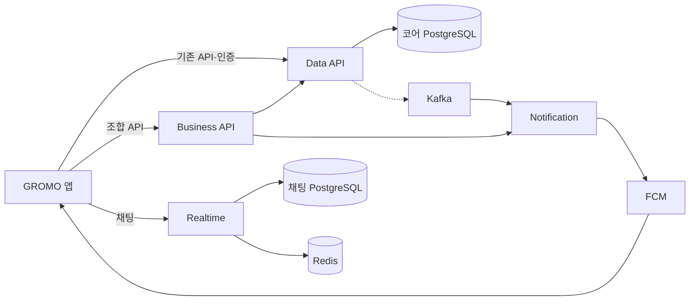

# GROMO

[](https://github.com/OneOrThree/phone/actions/workflows/ops-smoke.dev-v2.yml)
[](https://github.com/OneOrThree/phone/tree/deployment-status)
[](https://github.com/OneOrThree/phone/actions/workflows/prod-cd-V2.yml)


스모크 배지는 dev V2 배포 뒤 실행한 서버 스모크 결과, dev 배지는 dev V2 네 서비스의 최근 배포 결과 합산, prod 배지는 마지막으로 배포에 성공한 Catus V2 앱 버전을 표시합니다. 최초 게시 전에는 배지가 표시되지 않을 수 있습니다. 발행·수동 배포·롤백과 운영 선행 조건은 [Catus 운영 절차](docs/prd/fishcat/server-separation/deployment.md#catus-20-운영-발행배포)를 따릅니다.

집중한 시간을 캐릭터의 성장과 섬 활동으로 이어 주는 시간 관리 앱입니다.
React Native(Expo) 앱과 네 개의 Spring Boot 서버를 한 저장소에서 관리합니다.

| 바로 시작하기 | 문서 |
| --- | --- |
| 앱을 실행하고 싶어요 | [2.0 앱 시작하기](app/app-dev/README.md#로컬-실행) |
| 서버 스모크 결과·실행 방법을 알고 싶어요 | [전체 실행 흐름](smoke/README.md#전체-실행-흐름) · [로그인 재시도 차트](smoke/server/login-retry.md) |
| 서버 구성을 알고 싶어요 | [서버 전체 문서](server/README.md) |
| 기능 정책·설계를 찾고 싶어요 | [문서 인덱스](docs/README.md) |
| 시스템의 목표 구조를 보고 싶어요 | [서비스 아키텍처](docs/architecture/service-architecture.md) |
| 개발 규칙을 확인하고 싶어요 | [개발 가이드](CLAUDE.md) · [리뷰 규칙](AGENTS.md) |

## 제품과 시스템

GROMO는 집중 세션과 스크린타임을 기록하고 캐릭터·아이템·재화·친구·그룹 활동을 연결합니다. 기존 앱 API와 인증은 Data API가 담당하며, 서비스 분리에 따라 Business API, Notification, Realtime이 각자의 역할을 나눠 맡습니다.



현재 구현과 Target-1 목표 구조의 차이, 데이터 소유권, 서비스별 실행 방법은 [서버 전체 문서](server/README.md)에서 확인합니다.

## 저장소 지도

| 경로 | 역할 | 상세 문서 |
| --- | --- | --- |
| `app/app-dev/` | **활성 2.0 앱** — React Native·Expo 앱과 iOS·Android 네이티브 프로젝트. 현재 제품 흐름은 로컬 목업 데이터로 동작합니다 | [2.0 앱 README](app/app-dev/README.md) |
| `app/legacy/app-dev/` | **동결된 1.x 앱**(스토어 1.1.0까지) — 기존 iOS 확장과 Android 네이티브 프로젝트를 보관합니다 | [1.x 앱 README](app/legacy/app-dev/README.md) |
| `server/` | Business·Data·Notification·Realtime와 실행·관측 도구 | [서버 README](server/README.md) |
| `docs/` | 기능 정책·설계, 아키텍처, 팀 규약 | [문서 인덱스](docs/README.md) |
| `loadtest/` | k6 부하 테스트 하네스와 결과 해석 | [부하 테스트 README](loadtest/README.md) |
| `.github/workflows/` | 앱·서버 CI/CD와 문서 생성 | [워크플로 목록](.github/workflows/) |

## 로컬에서 시작하기

자주 쓰는 첫 실행 명령만 접어 두었습니다. 환경별 설정과 문제 해결은 각 상세 문서를 따릅니다.

<details>
<summary><strong>앱 실행 명령 보기</strong></summary>

```bash
cd app/app-dev
npm ci
npm start
```

플랫폼 실행과 검증 범위는 [2.0 앱 README](app/app-dev/README.md)를 참고합니다. 1.x 핫픽스나 기존 배포 절차는 [동결 앱 README](app/legacy/app-dev/README.md)에 남아 있습니다.

</details>

<details>
<summary><strong>Data API 실행 명령 보기</strong></summary>

```bash
docker compose -f server/scripts/docker-compose.local.yml up -d db redis
cd server/data-api
test -f src/main/resources/application-local.yml || cp src/main/resources/application-local.yml.example src/main/resources/application-local.yml
./gradlew bootRun --args='--spring.profiles.active=local'
```

API는 `http://localhost:8080`, Swagger UI는 `http://localhost:8080/swagger-ui/index.html`에서 확인합니다. 다른 서버의 실행 조건은 [서버 README](server/README.md)에 연결되어 있습니다.

</details>

## 문서 찾아가기

| 알고 싶은 것 | 문서 |
| --- | --- |
| 서버 전체 연결·현재 상태 | [server/README.md](server/README.md) |
| Business API | [server/business-api/README.md](server/business-api/README.md) |
| Data API | [server/data-api/README.md](server/data-api/README.md) |
| Notification | [server/notification/README.md](server/notification/README.md) |
| Realtime | [server/realtime/README.md](server/realtime/README.md) |
| 관측·배포 | [Observability](server/observability/README.md) · [Scripts](server/scripts/README.md) |
| 2.0 앱 구조·실행·검증 | [app/app-dev/README.md](app/app-dev/README.md) |
| 동결된 1.x 앱·기존 배포 | [app/legacy/app-dev/README.md](app/legacy/app-dev/README.md) |
| 목표 아키텍처·결정 장부 | [docs/architecture/README.md](docs/architecture/README.md) |
| 기능별 PRD·정책·설계 | [docs/README.md](docs/README.md) |
| 팀 규약 — Git·PR · 지라 티켓 · 백엔드 계층·오류·날짜 | [docs/conventions/](docs/conventions/) |

## 변경에 참여하기

브랜치 이름과 커밋·PR 형식(담당자·라벨·머지 조건 포함)은 [docs/conventions/git-pr-conventions.md](docs/conventions/git-pr-conventions.md), 지라 티켓 양식은 [docs/conventions/jira-ticket-template.md](docs/conventions/jira-ticket-template.md), 리뷰 언어와 심각도 표기는 [AGENTS.md](AGENTS.md)를 따릅니다. 앱과 서버는 툴링을 공유하지 않으므로 변경한 서비스 디렉터리에서 해당 검증 명령을 실행합니다.

## Catus V2 운영 배포

기존 Catus VPC에 앱·Kafka·Redis·백오피스 호스트를 분리한다. DB는 아직 기존 Catus 서버와 같은 `catus-prod-db`를 쓰며, 전용 `catus-prod-db-v2`는 만들어 두기만 했다. V2용 파일·태그·IAM·SSM·배포 상태는 기존 배포와 구분한다. 기존 env 자격은 재사용하고 Kafka·Redis 주소는 V2 자원으로 생성한다.

main 대상 PR 검사 → main에서 release로 merge commit 승격 → release에서 단위별 V2 태그·산출물 발행 → release 전용 CD 순서다. 앱은 변경 서비스만 빌드·배포하며 현재 Data·Realtime 계약 쌍은 유지한다. Kafka·Redis 설정은 `server/scripts/v2/prod/`가 소유한다. 운영 비밀은 Git에 보관하지 않는다. 절차와 복구는 [prod V2 파이프라인](docs/engineering/prod-v2-pipeline.md), dev는 [dev V2 파이프라인](docs/engineering/dev-v2-pipeline.md)을 따른다.

| 단위 | CI | CD | 마지막 운영 성공 버전 |
| --- | --- | --- | --- |
| 앱 조합 | prod-ci-V2.yml | prod-cd-V2.yml |  |
| Data | 서비스별 선택 빌드 | 앱 CD에서 대상 선택 |  |
| Business | 서비스별 선택 빌드 | 앱 CD에서 대상 선택 |  |
| Realtime | 서비스별 선택 빌드 | 앱 CD에서 대상 선택 |  |
| Notification | 서비스별 선택 빌드 | 앱 CD에서 대상 선택 |  |
| Kafka | kafka-ci.prod-V2.yml | kafka-cd.prod-V2.yml |  |
| 백오피스 | backoffice-ci.yml(PR) | backoffice-cd.prod-V2.yml |  |
| Redis | redis-ci.prod-V2.yml | redis-cd.prod-V2.yml |  |

버전 태그는 `catus-vX.Y.Z-V2`, `kafka-vX.Y.Z-V2`, `redis-vX.Y.Z-V2`, `backoffice-vX.Y.Z-V2`다. 배지는 마지막 검증 성공 버전이며 실시간 가용성 감시는 아니다. 최초 성공 기록 전에는 운영 미확인 상태다. 실패·부분 적용·롤백 결과와 실행 링크는 별도 배포 결과 및 관련 PR 댓글에 남긴다. 표시 재시도는 호스트를 다시 배포하지 않는다.
