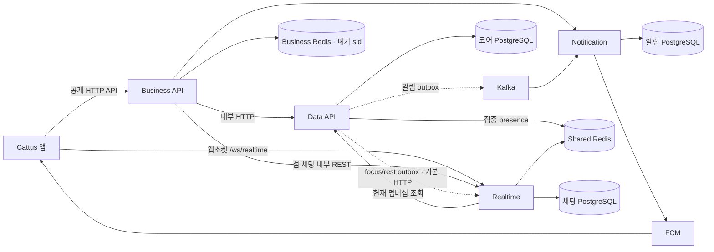

# Cattus

[](https://github.com/OneOrThree/phone/actions/workflows/ops-smoke.dev-v2.yml)
[](https://github.com/OneOrThree/phone/tree/deployment-status)
[](https://github.com/OneOrThree/phone/actions/workflows/prod-cd-V2.yml)


스모크 배지는 dev V2 배포 뒤 실행한 서버 스모크 결과, dev 배지는 dev V2 네 서비스의 최근 배포 결과 합산, 운영 배지는 운영 V2에 마지막으로 배포에 성공한 서버 태그(`catus-vX.Y.Z-V2`)를 표시합니다. 최초 게시 전에는 배지가 표시되지 않을 수 있습니다. 발행·배포·롤백 절차는 [prod V2 파이프라인](docs/engineering/prod-v2-pipeline.md)을 따릅니다.

고양이가 된 사용자들이 섬에서 함께 집중하고, 낚은 물고기로 섬을 키우는 앱입니다.
React Native(Expo) 앱, Spring Boot 서버 4종, 백오피스를 한 저장소에서 관리합니다.

| 바로 시작하기 | 문서 |
| --- | --- |
| 앱을 실행하고 싶어요 | [2.0 앱 시작하기](app/app-dev/README.md#로컬-실행) |
| 서버 스모크 결과·실행 방법을 알고 싶어요 | [전체 실행 흐름](smoke/README.md#전체-실행-흐름) · [로그인 재시도 차트](smoke/server/login-retry.md) |
| 서버 구성을 알고 싶어요 | [서버 전체 문서](server/README.md) · [백엔드 흐름 실험실](backeend-lab.html#mailbox) |
| 기능 정책·설계를 찾고 싶어요 | [문서 인덱스](docs/README.md) |
| 제품 용어를 확인하고 싶어요 | [용어집](CONTEXT.md) |
| 시스템의 목표 구조를 보고 싶어요 | [서비스 아키텍처](docs/architecture/service-architecture.md) |
| 바꾼 경로가 어디까지 배포되는지 알고 싶어요 | [파이프라인 지도](docs/engineering/pipeline-map.md) |
| 개발 규칙을 확인하고 싶어요 | [Claude Code 규칙](CLAUDE.md) · [Codex·리뷰 규칙](AGENTS.md) |

## 제품과 시스템

앱의 HTTP 요청은 Business API가 받습니다. 섬·집중·물고기 같은 제품 데이터와 규칙은 Data API가 가지고, Business API가 내부 API로 부릅니다. Realtime은 채팅 저장과 웹소켓 기반 섬 이동·집중 관전·바다 방을 맡고, Notification은 알림 사건을 받아 발송 조건을 확인한 뒤 FCM 푸시를 요청합니다. 우체통의 친구 편지는 Data에, 섬 단체 채팅은 Realtime에 저장됩니다. 용어는 [용어집](CONTEXT.md)을 따릅니다.



데이터 소유권과 서비스별 실행 방법은 [서버 전체 문서](server/README.md)에서 확인합니다. [백엔드 흐름 실험실](backeend-lab.html#mailbox)은 친구 편지·섬 채팅·집중·이동·알림·배포 경로를 단계별로 보여 줍니다. 저장소를 받은 뒤 `backeend-lab.html`을 브라우저로 열면 됩니다. GitHub에서는 HTML이 실행되지 않습니다. 근거는 페이지에 표시한 main 커밋이며 실제 운영 상태 조회 결과는 아닙니다.

## 저장소 지도

| 경로 | 역할 | 상세 문서 |
| --- | --- | --- |
| `app/app-dev/` | **활성 2.0 앱** — React Native·Expo 앱과 iOS·Android 네이티브 프로젝트. 서버 API와 기기 로컬 저장을 함께 쓰고, 목업 데이터는 데모·검토 모드에서만 씁니다 | [2.0 앱 README](app/app-dev/README.md) |
| `app/legacy/app-dev/` | **동결된 Gromo 1.x 앱**(스토어 1.1.0까지) — 기존 iOS 확장과 Android 네이티브 프로젝트를 보관합니다 | [1.x 앱 README](app/legacy/app-dev/README.md) |
| `server/` | Business·Data·Notification·Realtime와 실행·관측 도구 | [서버 README](server/README.md) |
| `backoffice/` | 운영진용 관리 웹 — 공지·운영진의 편지·고양이 잡지·정책·출시 현황 | [백오피스 README](backoffice/README.md) |
| `docs/` | 기능 정책·설계, 아키텍처, 팀 규약 | [문서 인덱스](docs/README.md) |
| `loadtest/` | k6 부하 테스트 하네스와 결과 해석 | [부하 테스트 README](loadtest/README.md) |
| `.github/workflows/` | 앱·서버·백오피스 CI/CD와 문서 생성 | [파이프라인 지도](docs/engineering/pipeline-map.md) |

## 로컬에서 시작하기

자주 쓰는 첫 실행 명령만 접어 두었습니다. 환경별 설정과 문제 해결은 각 상세 문서를 따릅니다.

<details>
<summary><strong>앱 실행 명령 보기</strong></summary>

```bash
cd app/app-dev
npm ci
npm start
```

플랫폼 실행과 검증 범위는 [2.0 앱 README](app/app-dev/README.md)를 참고합니다. 1.x 핫픽스나 기존 배포 절차는 [동결 앱 README](app/legacy/app-dev/README.md)에 남아 있습니다.

</details>

<details>
<summary><strong>Data API 실행 명령 보기</strong></summary>

```bash
docker compose -f server/scripts/docker-compose.local.yml up -d db redis
cd server/data-api
test -f src/main/resources/application-local.yml || cp src/main/resources/application-local.yml.example src/main/resources/application-local.yml
./gradlew bootRun --args='--spring.profiles.active=local'
```

이 명령은 내부 Data API만 실행합니다. 주소는 `http://localhost:8080`, Swagger UI는 `http://localhost:8080/swagger-ui/index.html`입니다. 앱의 공개 API는 Business가 받으므로 앱 연동에는 [Business API 실행 설정](server/business-api/README.md#빠른-검증)과 서비스 간 토큰이 추가로 필요합니다. 호스트에서 두 서비스를 함께 실행할 때는 포트를 구분합니다.

</details>

## 문서 찾아가기

| 알고 싶은 것 | 문서 |
| --- | --- |
| 서버 전체 연결·현재 상태 | [server/README.md](server/README.md) |
| Business API | [server/business-api/README.md](server/business-api/README.md) |
| Data API | [server/data-api/README.md](server/data-api/README.md) |
| Notification | [server/notification/README.md](server/notification/README.md) |
| Realtime | [server/realtime/README.md](server/realtime/README.md) |
| 백오피스 | [backoffice/README.md](backoffice/README.md) |
| 관측·배포 | [Observability](server/observability/README.md) · [Scripts](server/scripts/README.md) · [파이프라인 지도](docs/engineering/pipeline-map.md) |
| 2.0 앱 구조·실행·검증 | [app/app-dev/README.md](app/app-dev/README.md) |
| 동결된 1.x 앱·기존 배포 | [app/legacy/app-dev/README.md](app/legacy/app-dev/README.md) |
| 목표 아키텍처·결정 장부 | [docs/architecture/README.md](docs/architecture/README.md) |
| 기능별 PRD·정책·설계 | [docs/README.md](docs/README.md) |
| 팀 규약 — Git·PR · 지라 티켓 · 백엔드 계층·오류·날짜 · CI | [docs/conventions/](docs/conventions/) |

## 변경에 참여하기

브랜치 이름과 커밋·PR 형식(담당자·라벨·머지 조건 포함)은 [docs/conventions/git-pr-conventions.md](docs/conventions/git-pr-conventions.md), 지라 티켓 양식은 [docs/conventions/jira-ticket-template.md](docs/conventions/jira-ticket-template.md), 리뷰 언어와 심각도 표기는 [AGENTS.md](AGENTS.md)를 따릅니다. 앱과 서버는 툴링을 공유하지 않으므로 변경한 서비스 디렉터리에서 해당 검증 명령을 실행합니다.

## 운영 V2 배포

2026-11-02 구 dev·운영 서버를 종료했습니다. 구 워크플로우 14개 제거와 DNS·S3·Datadog 상태는 [구 서버 정리](docs/engineering/prod-v2-pipeline.md#구-서버-정리-2026-11-02)에 기록합니다. 기존 백오피스 주소는 운영 V2 주소로 이동합니다.


운영 V2는 AWS EC2 4대(서버 4종·Kafka·Redis·백오피스)에서 돕니다. 서버 4종·Kafka·Redis는 main → release 승격 PR(merge commit) 뒤 release push에서 태그와 산출물이 발행되고, 사람이 release에서 CD를 실행하고 환경 `catus-production-V2`의 승인 1회를 거쳐야 운영에 반영됩니다. 백오피스는 release를 거치지 않고, main 머지에서 승인 1회 뒤 바로 배포됩니다. 경로별 흐름은 [파이프라인 지도](docs/engineering/pipeline-map.md), 절차와 복구는 [prod V2 파이프라인](docs/engineering/prod-v2-pipeline.md)을 따릅니다.

| 단위 | CI | CD | 마지막 운영 성공 태그 |
| --- | --- | --- | --- |
| 서버 4종 묶음 | prod-ci-V2.yml | prod-cd-V2.yml |  |
| Data | prod-ci-V2.yml(바뀐 서비스만 빌드) | prod-cd-V2.yml(서버 4종을 함께 넘기고 바뀐 것만 재생성) |  |
| Business | 〃 | 〃 |  |
| Realtime | 〃 | 〃 |  |
| Notification | 〃 | 〃 |  |
| Kafka | kafka-ci.prod-V2.yml | kafka-cd.prod-V2.yml |  |
| Redis | redis-ci.prod-V2.yml | redis-cd.prod-V2.yml |  |
| 백오피스 | backoffice-ci.yml(PR) | backoffice-cd.prod-V2.yml(main 머지) |  |

태그는 `catus-vX.Y.Z-V2`, `kafka-vX.Y.Z-V2`, `redis-vX.Y.Z-V2`, `backoffice-vX.Y.Z-V2`입니다. 배지는 마지막으로 배포에 성공한 태그이며 실시간 가용성 감시는 아닙니다.
