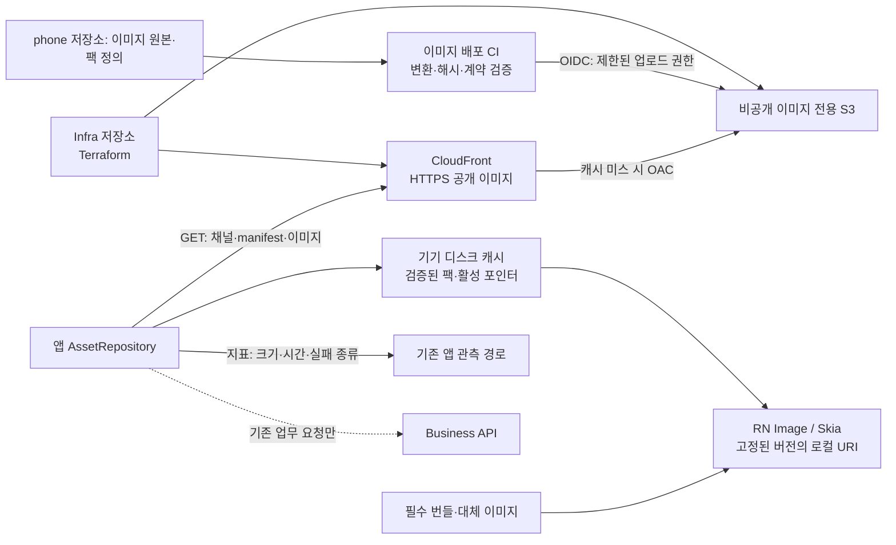
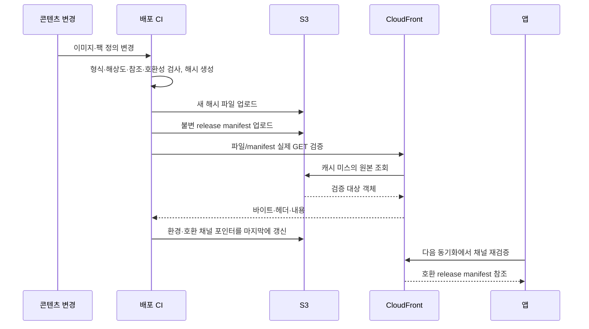
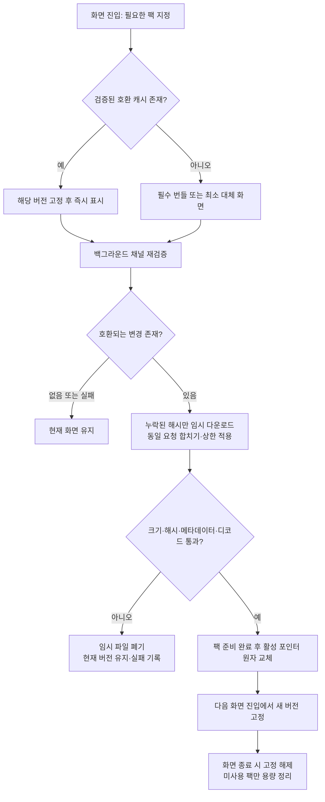

# 이미지 CDN 사전 조사 · 아키텍처 제안 이력

> **구현 정본은 [PRD·정책·HLD·LLD](../../prd/fishcat/image-cdn/README.md)로 승격했다.** 아래 초기 구조/원자 교체/캐시 제안은 조사 당시 이력이며, 후속 native 제한 수신·불변 snapshot 설계가 우선한다.

- 작성일: 2026-10-29
- 상태: **검토된 제안. 인프라 생성·이미지 업로드·앱 적용 전.**
- 코드 기준: `OneOrThree/phone` main `4f3a3d96c` (전체 SHA는 `evidence.json`).
- 범위: Catus 2.0 Android/iOS의 공개 정적 게임 이미지. 사용자 업로드·비공개 사진·원격 실행 코드는 제외.
- 목표: 앱 초기 배포 용량을 줄이고, 필요한 이미지를 CDN에서 한 번 받은 뒤 기기 캐시로 재사용한다. API·Redis에 이미지 트래픽을 추가하지 않는다.

## 1. 검증 결과와 기존 계획의 수정

| 확인 항목 | 확인 결과 | 설계 반영 |
| --- | --- | --- |
| 이미지 규모 | 깨끗한 main의 `src/assets` 이미지 690개, 215,084,572 bytes (205.12MiB). 원본 파일 합계이며 앱 압축 크기·실제 포함 크기가 아님 | Metro 의존성 및 Android/iOS 산출물 기준 용량을 별도 측정 |
| 이전 595개·약 235MiB 수치 | 미커밋 변경이 있는 기존 작업 공간 기준 | 배포 기준 자료로 사용하지 않음 |
| 기존 캐시 | `mapAssets.ts`: 맵 6파일 고정, ETag, 파일 크기/SHA-256 검증, 임시 디렉터리, 버전 교체, 이전 캐시·번들 복귀, 맵별 요청 합치기 | 동작 계약을 재사용하되 일반 이미지 로더로 그대로 확대하지 않음 |
| 대용량 다운로드 | `fetch().arrayBuffer()`로 파일 전체를 JS 메모리에 올리고 동기 파일 작업을 수행 | 디스크 다운로드와 비동기 검증 경로를 먼저 시제품으로 측정 |
| 다운로드 제한 | 해당 모듈에 명시적 요청 타임아웃·전체 용량 예산이 없음 | 취소/타임아웃, 다운로드 상한, 캐시 예산 도입 |
| 버전 정리 | 직전·현재 두 버전 보존. 열린 화면의 모든 버전을 고정하는 전역 참조 관리는 없음 | 사용 중인 묶음은 삭제 금지. 렌더러가 버전 고정/해제 |
| 서버 제공 근거 | 로컬 `serve-map-assets.cjs`와 문서 계약은 존재 | 운영 CDN이 실제 가동 중이라는 근거는 아님. AWS 실환경은 아직 조회하지 않음 |
| 일반 이미지와 Skia | 정적 `require()`와 Skia `useImage`가 함께 존재 | 공통 로더가 로컬 URI와 메타데이터를 제공. 각 렌더러에서 검증 |
| 서비스 경계 | 아키텍처 정본은 앱→Business API 원칙 | 공개 정적 자산의 앱→CDN 경로를 명시적 예외로 추가해야 함 |

재현 가능한 파일 목록·카테고리별 집계는 [evidence.json](evidence.json)에 저장한다. 별도 Infra 체크아웃에서 S3 배포/로그 버킷 구성을 확인했으나, 이 계획은 새 이미지 전용 버킷을 제안한다. 로컬 검색만으로 기존 AWS 리소스 부재를 단정하지 않는다.

## 2. 목표 아키텍처

이미지 원본 소유자는 콘텐츠 배포 파이프라인, 원본 저장소는 S3, 배포 캐시는 CloudFront, 사용자 기기 캐시는 앱이다. 이미지 바이트·manifest 조회는 Business API/Data API/Redis를 거치지 않는다. 업무 데이터·사용자 권한은 기존 API가 계속 소유한다.

인프라 구성:

- 환경별 버킷·배포 권한 분리. CDN 도메인은 소유권·DNS 확인 후 확정한다.
- S3 Block Public Access, HTTPS, OAC를 사용한다. **S3 비공개와 CDN 사용자 인증은 별개**이며 이번 공개 이미지에는 로그인 토큰을 보내지 않는다.
- CI는 GitHub OIDC로 정해진 prefix에만 업로드. 배포 역할에 일상적인 과거 파일 삭제 권한을 주지 않는다.
- CDN 캐시 키에 사용자 토큰·불필요한 쿠키·임의 query를 포함하지 않는다. 웹 미리보기가 필요하면 허용 Origin과 CORS 헤더를 따로 검증한다.
- 커스텀 CloudFront 도메인의 ACM 인증서는 `us-east-1`에 마련한다. 구체 정책은 [공식 근거](sources.md) 참조.

## 3. 파일·manifest 계약

| 객체 | 예시 경로 | 변경/캐시 정책 |
| --- | --- | --- |
| 콘텐츠 파일 | `/assets/<sha256>.png` | 같은 URL 내용 변경 금지. `public,max-age=31536000,immutable` |
| 릴리스 manifest | `/releases/<releaseId>/manifest.json` | 불변. 앱 호환 세대·팩 목록·파일 메타데이터 포함 |
| 채널 포인터 | `/channels/prod/<assetApiVersion>.json` | 짧은 TTL(초기 제안 60초), ETag, CDN minimum TTL=0. 현재 manifest 경로와 digest만 지정 |

파일 메타데이터: `assetId`, `sha256`, `bytes`, `width`, `height`, `format`. 팩 메타데이터: `packId`, `packVersion`, `files`, 아틀라스와 그 좌표 메타데이터. 앱 호환 계약: `schemaVersion`, `assetApiVersion`. 구 앱과 호환되지 않는 그림 크기·좌표 계약은 다른 호환 채널로 배포한다. 알 수 없는 필수 스키마는 거부하고 기존 버전을 유지한다.

기존 `mapAssets.ts`의 요청 `Cache-Control: no-cache` 주석만으로 CDN 최신 응답을 보장할 수 없다. CloudFront는 요청 측 해당 헤더로 재검증을 강제하지 않으므로, 채널 응답 헤더와 전용 cache behavior의 TTL을 함께 설정한다. 60초는 제안 상한이며 실제 전파/롤백 시간을 검증한다.

채널 포인터의 배포 순서는 증가하는 `generation`으로 구분하되 `releaseId`는 이전 릴리스를 가리킬 수 있게 한다. 롤백도 더 큰 generation의 포인터로 수행한다. `packVersion`/동일 해시 파일을 덮어쓰지 않는다.

manifest에서 임의 외부 URL을 받지 않는다. 허용된 상대 경로·파일 확장자·크기·픽셀 수·팩 총량을 검증한다. 파일 SHA-256은 무결성 검사이며 서명 인증을 대신하지 않는다. manifest 신뢰 경계는 HTTPS·S3 쓰기 권한·CI 배포 권한이다.

## 4. 배포 데이터 흐름

채널별 배포는 직렬화하고, 늦게 끝난 이전 CI가 최신 포인터를 되돌리지 못하도록 expected generation을 대조한다. 업로드 중 일부 실패하면 포인터를 갱신하지 않는다. CDN smoke는 HEAD만으로 끝내지 않고 GET 후 크기·해시를 확인한다. 아직 없는 파일을 미리 요청해 생긴 403/404가 오래 남지 않도록 오류 캐시 TTL도 설정/검증한다.

롤백: 보존된 이전 릴리스에 대한 호환성·GET 검증 → generation을 증가시켜 포인터 변경 → 정상 TTL 이내 전파. 긴급 시 채널 포인터만 invalidate하고, 이미지 전체 무효화는 기본 절차로 사용하지 않는다. 오프라인 기기에는 즉시 전파할 수 없다.

## 5. 앱 데이터 흐름과 실패 처리

- 렌더 중 이미지·아틀라스 좌표·맵 JSON 버전을 섞지 않는다. 첫 전환은 건물 내부 정적 이미지 팩으로 한정하고, 맵/통행 계약은 기존 로더에 둔다.
- 공통 계층은 `resolve(assetId)`, `ensurePack(packId)`, 버전 고정/해제의 역할을 가진다. 명칭·구체 API는 구현 PR에서 확정한다.
- 디스크 파일의 존재만으로 캐시 적중 처리하지 않는다. 활성 기록·크기·검증 상태를 확인하고 누락 시 정상 다운로드 경로로 복귀한다.
- OS는 캐시를 지울 수 있다. 필수 UI/기본 캐릭터/최소 대체 이미지는 번들에 남긴다. **CDN으로 옮긴 상세 이미지는 최초 설치 오프라인에서 원본 표시를 보장하지 않는다.**
- 최소 대체 이미지를 남기되 원본 전체를 `require()`로 계속 참조하면 번들 크기는 줄지 않는다. 이전 완료 시 원본 참조를 제거하고 실제 배포 산출물로 확인한다.
- 다운로드 동시성 초기 제안 2, 유한한 타임아웃·제한 재시도·백오프를 둔다. 캐시 한도와 보존 기간의 초기값은 §5.1을 따르고 실기기 검증 후 조정한다.
- 열린 화면이 고정한 팩은 LRU 삭제 대상에서 제외한다. 채택된 팩이라도 열린 화면이 사용하지 않으면 §5.1에 따라 정리할 수 있다. 여유 공간이 없으면 다운로드를 중지하고 기존 표시를 유지한다.
- 메모리 비용은 압축 파일 크기와 다르다. 4096×4096 RGBA 한 장은 약 64MiB이며 디코드/복사/GPU 비용은 추가될 수 있다. 총 다운로드량과 최대 동시 디코드 면적을 각각 제한한다.
- WebP 전환이나 이미지 리사이즈 서버는 1차 범위에서 제외한다. 기존 PNG로 동작을 검증한 뒤 투명도·아틀라스 경계·Android/iOS 디코드 성능을 비교한다.

## 5.1 로컬 캐시 수명 정책의 정본 이동

중복 정책을 방지하기 위해 [image-cdn/policy.md](../../prd/fishcat/image-cdn/policy.md)로 통합했다. 캐시 수명·재확인 주기·삭제·용량·불변 snapshot 복구는 해당 문서를 따른다.

## 6. 실행 계획과 산출물

| 단계 | 작업 | 완료 조건/의존성 |
| --- | --- | --- |
| 0. 기준선 | 사용 에셋/미사용 후보 분류, AAB·iOS 산출물 크기, 첫 표시·메모리 측정 | CDN 대상 팩과 번들 유지 목록 확정. 미사용 파일 자동 삭제 금지 |
| 1. 인프라 PR | 전용 S3·OAC·CloudFront·DNS/TLS·배포 OIDC·관측 | Terraform plan 검토. 적용 후 S3 직접 접근 거부, CDN GET 성공, 캐시 헤더 확인 |
| 2. 배포 PR | 해시/팩 manifest 생성, 호환 채널, 업로드·검증·승격·롤백 | 합성 이미지로 end-to-end 검증. 중간 실패 시 이전 포인터 유지 |
| 3. 앱 PR | 공통 캐시 계층과 건물 내부 한 팩 적용 | 단계 2 사용 가능. RN/Skia 및 Android/iOS 시나리오 통과 |
| 4. 확대 PR | 배경·선택형 꾸미기 팩 이전, 원본 번들 참조 정리 | 시범 측정 통과 후 확대. 맵/아틀라스는 별도 정합 검증 |
| 5. 정본 반영 | 서비스 허용 경로·저장소 소유·공개 노출면·아키텍처 그림·결정 장부 갱신 | 기존 정본에 CDN 정적 자산 예외 명시. 본 제안을 구현 완료로 오인하지 않게 상태 변경 |

단계 0에서 성공 기준 숫자를 확정한 후 확대한다. 제안 지표: 재방문 이미지 본문 다운로드 0 bytes(캐시 유지·동일 버전 조건), 팩 부분 노출 0건, API/Redis 이미지 요청 0건. 첫 진입 p95·최대 메모리·번들 감소량의 목표는 기준선 측정 전 임의로 확정하지 않는다.

## 7. 검증 매트릭스

| 시나리오 | 기대 결과 |
| --- | --- |
| 최초 설치 온라인 / 오프라인 | 대체 UI 즉시 표시, 온라인에서만 필요한 팩 수신, 무한 로딩 없음 |
| 두 번째 실행·동일 버전 | 채널 조건부 요청/캐시 재사용, 이미지 재다운로드 없음 |
| 일부 파일 변경 | 변경 해시만 수신, 팩 준비 전 기존 버전 유지 |
| 두 화면 동시 진입 | 같은 파일 요청 합치기, 화면별 버전 고정 |
| 해시 불일치/이미지 디코드 오류 | 제한 재시도 후 거부, 잘못된 파일 반복 활성화 방지 |
| 다운로드 중 앱 종료/디스크 부족 | 다음 실행에 임시 파일 정리, 유효한 이전 상태 유지 |
| 다운로드 정지/403/404/5xx | 타임아웃/백오프, 대체 표시 유지, 오류 캐시 복구 확인 |
| 새 앱·구 앱 동시 운영 | 호환 채널 분리, 구 앱 필수 파일 보존 |
| 활성 화면 중 두 번 업데이트/캐시 정리 | 화면이 사용하는 파일 삭제/교체 없음 |
| CDN 롤백·오프라인 복귀 | CDN 포인터 TTL 및 앱 확인 주기(§5.1) 이후 호환 이전 릴리스로 전환 |
| Android/iOS 일반 Image·Skia | file URI/투명도/아틀라스 경계·최대 메모리 실기기 확인 |
| 앱/OTA 배포 롤백 | 이전 앱 코드가 참조하는 CDN 파일 유지 |

관측: CDN hit ratio, 전송 bytes, 4xx/5xx; 앱 팩별 다운로드 bytes·시간·캐시 적중·검증 실패·대체 표시 횟수. 원본 파일/이름에 개인정보를 넣지 않고 사용자별 URL을 만들지 않는다.

월 비용은 `실제 CDN 전송 GB + 요청 수 + S3 저장/요청 + 로그 비용`으로 산정한다. 대략 전송량은 신규 설치 수×최초 필요 팩 크기 + 기존 사용자×변경 팩 크기 + 캐시 삭제 후 재수신량이다. CloudFront 적중은 S3 원본 요청을 줄이며, 앱으로 전송되는 bytes 자체를 없애지는 않는다. 요금·무료 구간은 도입 시 계정/리전/플랜으로 다시 확인한다.

## 8. 검증 범위·남은 결정

이번에 수행: main 소스 검토, 자산 파일 집계, 기존 맵 캐시 Jest 테스트 **1 suite / 20 tests 통과**, 공식 문서 대조, 문서 내부 경로 검사. 테스트 의존성은 기존 작업 공간의 node_modules를 연결해 사용했으며 새 lockfile 설치 검증은 하지 않았다. 실제 AWS 생성/조회·CDN 캐시 적중 실험·네이티브 디코드 실측·앱 배포 크기 측정은 미수행이다.

확정 필요: CDN 도메인과 AWS 계정, 환경별 배포 권한, 시범 팩, 최소 오프라인 화면, §5.1 초기 캐시 예산/보존 기간의 실측 확정, 지원 앱 버전 보존 정책. 기존 운영 자원이 있다면 새로 생성하기 전에 소유/용도를 확인한다.

근거 코드: [맵 캐시](../../../app/app-dev/src/services/mapAssets.ts), [캐시 테스트](../../../app/app-dev/src/services/mapAssets.test.ts), [로컬 정적 서버](../../../app/app-dev/scripts/serve-map-assets.cjs), [Skia 렌더러](../../../app/app-dev/src/screens/island/TileTerrainCanvas.tsx), [기존 맵 계약](../../prd/fishcat/island-movement/map-assets.md), [서비스 정본](../service-architecture.md), [시스템 정본](../system-architecture.md), [결정 장부](../decisions.md).
