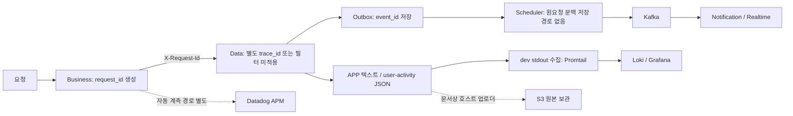
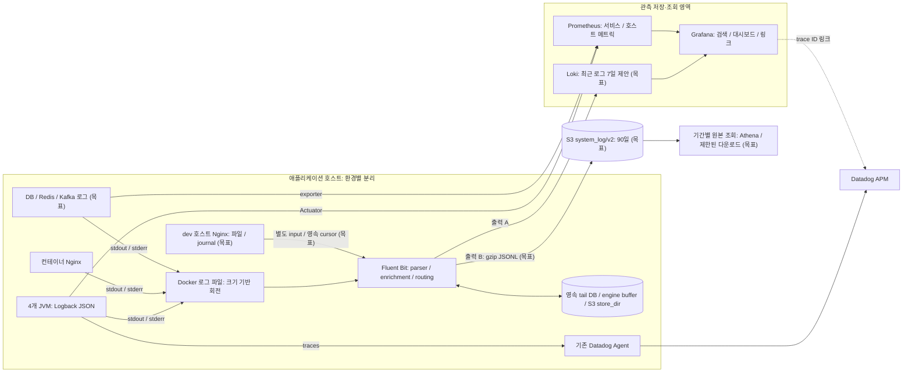
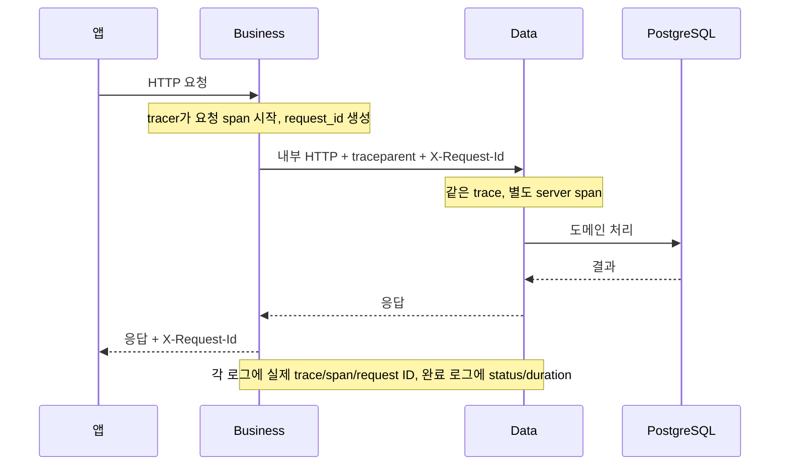
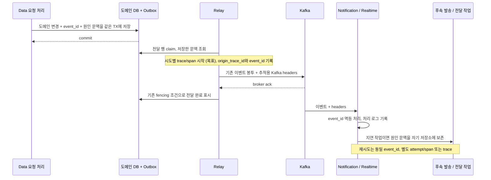
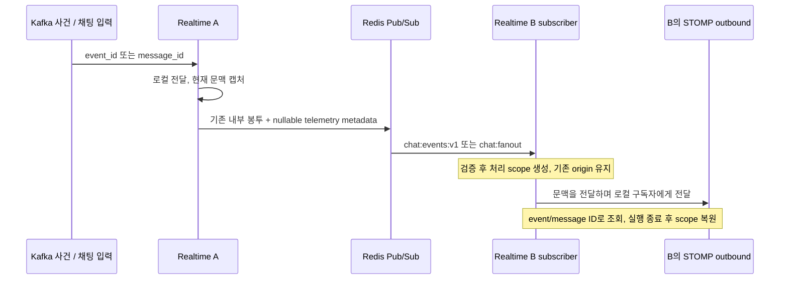
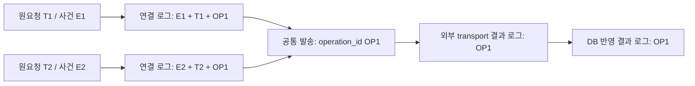
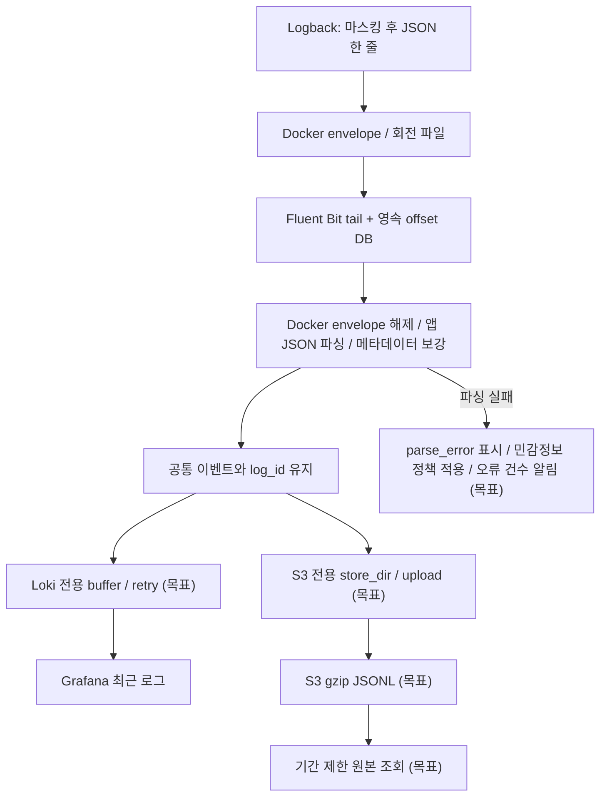
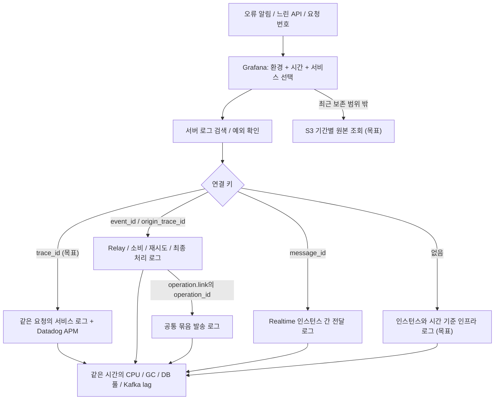

# 서버 로그 통합·장애 추적 아키텍처

> 작성·검토: 2026-10-29. 상태: **설계 검토 완료·요청 로그 연결 1차 구현 중**. 운영 배포나 실측 완료를 의미하지 않는다.
> 초기 조사 기준: `2cca31b7582c8a73751321ede75f4c0482f1eb1c`. 구현 기준: 최신 main `81ef2140ab87f3c0f2bfb741bc3c6ae09f3c9932`. 코드 변경·검증 범위는 [티켓·구현 현황](implementation-status.md)을 따른다.

사용자가 원하는 것은 평소 서버 로그를 읽고, 성능 저하나 장애가 발생하면 요청 하나가 여러 컴포넌트에서 어떻게 처리됐는지 찾는 것이다. **일반 로그 검색 → 요청 타임라인 → 느린 호출·오류 구간 → 당시 자원 상태**로 이동하도록 만든다. S3에는 마스킹된 원본 이벤트를 보관한다.

- [티켓 목록·의존 관계·현재 구현·검증 결과](implementation-status.md)
- [구현 계획·완료 조건·검증 시나리오](implementation-plan.md)
- [V01–V23 검증 결과와 로컬 전후 측정](verification-results.md)
- [dev 검증 → prod 전환 → 롤백 절차](rollout.md)
- [로그 이중 적재·dev S3 자격 방식 결정 문서(제안 — 재영님 확정 전)](decisions-ingest-and-s3-credentials.md)
- [Logback 설정·스레드 문맥 전파·로그 JOIN 상세](implementation-details.md)
- [공식 문서 조사와 설계 검토 근거](research.md)
- [재검토에서 발견한 공백·수정·잔여 검증](review-2026-10-29.md)
- 기존 정본: [시스템 아키텍처](../system-architecture.md), [서비스 아키텍처](../service-architecture.md), [보존 정책](../../prd/fishcat/account/policy.md#로그분석-보존-기간)

흐름도 원본은 이 문서의 Mermaid이며, 아래 SVG는 같은 소스를 렌더링한 정적 사본이다. 흐름을 바꾸면 두 형식을 함께 갱신한다. 노드·엣지의 «(목표)»는 피처 브랜치 현재 상태에서 코드가 없거나, 모듈 스위치 기본 꺼짐(dev S3 출력·호스트 Nginx 수집)이거나, dev에서 미가동(Loki)인 경로다. Grafana는 dev에서 가동 중이지만 Loki는 아니므로, Loki 노드가 없는 06 그림의 Grafana 경로에는 라벨을 붙이지 않는다. 근거는 [구현 현황](implementation-status.md)이다. 02 의 "DB / Redis / Kafka 로그 (목표)" 노드의 (목표)는 로그 수집 기준이며, 같은 노드에서 나가는 exporter 메트릭 경로는 로그 수집과 별개로 구성돼 있다(`server/observability/prometheus/prometheus.yml` scrape 대상, dev 가동 기록은 `runtime-inventory.md` 52·53행).

| 그림 | 읽을 내용 |
| --- | --- |
| [현재 구성](diagrams/01-current.svg) | 요청 ID와 로그 연결이 끊기는 경계 |
| [목표 아키텍처](diagrams/02-target.svg) | 호스트·수집·검색·S3·APM의 역할과 연결 |
| [HTTP 요청](diagrams/03-http.svg) | Business→Data→DB 문맥 전파 |
| [비동기 이벤트](diagrams/04-async.svg) | Outbox·Kafka·후속 작업과 재시도 |
| [로그 적재](diagrams/05-ingestion.svg) | JSON 출력부터 Loki/S3 독립 저장까지 |
| [장애 조사](diagrams/06-investigation.svg) | 검색에서 요청·사건·지표·과거 원본으로 이동 |
| [Realtime 인스턴스 간 전달](diagrams/07-realtime.svg) | Redis Pub/Sub를 건너는 사건·채팅 문맥 |
| [발송 시도 연결](diagrams/08-bundled-send.svg) | 원사건과 기기별 외부 호출(operation)의 연결. 그림은 설계 시점의 묶음 구조다(현재는 구성원 1개, 티켓 2421) |

## 1. 범위와 설계 결정

| 항목 | 제안 |
| --- | --- |
| 애플리케이션 | Business API·Data API·Notification·Realtime의 일반 서버 로그, 접근 로그, 예외 |
| 인프라 | 컨테이너 PostgreSQL·Redis·Kafka, prod 컨테이너 Nginx, dev 호스트 Nginx의 별도 파일/journal 경로. RDS 로그는 별도 export 확인 |
| 연결 | HTTP는 trace/request 문맥, 비동기는 event/origin ID, 기기별 발송 시도는 operation ID, Realtime Redis는 event/message ID와 내부 carrier |
| 조회 | Loki/Grafana로 최근 로그를 검색하고 기존 Datadog APM으로 호출 시간 확인 |
| 보관 | Fluent Bit에서 S3로 압축 JSON Lines 원본 적재. 정상 상태 가시성 목표 5분 이내 |
| 보존 | dev Loki 7일·시스템 로그 S3 90일은 기존 정책 유지. prod Loki 신규 도입의 7일 제안은 정책 정본 반영 후 적용 |
| 제외 | 사용자 행동 분석 통합, 실시간 스트림 JOIN 엔진, Elasticsearch·Tempo 신규 도입, Logback의 직접 S3 업로드 |

로그를 물리적으로 한 레코드로 합치지 않는다. 공통 스키마로 수집한 **이벤트들의 합집합**에서 `trace_id` 등을 필터해 한 화면에 보여준다. `trace_id`로 APM과 요청 로그를 잇는 것은 목표 상태(JSON 로그 티켓 이후 실제 tracer ID)이며, 현재(2553 시점) 서비스 간 연결 키는 `request_id`다. 서비스별 로그 테이블을 서로 SQL JOIN하면 여러 줄 사이의 조합이 늘어나 중복이 생길 수 있다. 서비스 간 시계 오차도 있으므로 타임스탬프 정렬만으로 인과관계를 단정하지 않는다.

수집기는 기존 Fluent Bit 전환 구상과 S3 출력 지원을 활용한다. Promtail은 2026-03-02 지원이 종료됐다([공식 안내](https://grafana.com/docs/loki/latest/send-data/promtail/)). 기존 Datadog tracer를 먼저 활용하며 같은 JVM에 OTel Java agent를 추가로 설치하지 않는다. 실제 사용 라이브러리의 자동 계측 지원은 P0/P1에서 확인한다.

## 2. 현재 상태 검토

아래는 **초기 조사 커밋의 코드·설정 존재 여부**다. 링크는 현재 작업 트리를 가리키므로 최신 변경은 표 아래와 구현 현황을 함께 읽는다. 원격 서버·S3·Datadog에는 접속하지 않았으며 현재 가동 여부를 보증하지 않는다.

| 확인한 근거 | 확인 결과 | 설계에 반영할 사항 |
| --- | --- | --- |
| [Logback](../../../server/data-api/src/main/resources/logback-spring.xml) | APP은 텍스트 콘솔/파일, user-activity는 별도 JSON. 파일 AsyncAppender는 `neverBlock=true` | APP 공통 JSON 전환, 큐 포화 유실 계측. user-activity의 기존 분리·보존 유지 |
| [Data TraceIdFilter](../../../server/data-api/src/main/java/com/oneorthree/phone/config/TraceIdFilter.java)·[등록](../../../server/data-api/src/main/java/com/oneorthree/phone/config/FilterConfig.java) | 기준 커밋은 `/api/*`에 인증 뒤 등록. `X-Trace-Id` 또는 UUID로 MDC `trace_id` 생성, 종료 시 `MDC.clear()` | `/internal/*` 및 인증 거절을 포함한 적용 범위, agent MDC와의 공존, 문맥 복원 보완 |
| [Business 요청 필터](../../../server/business-api/src/main/java/com/oneorthree/business/config/RequestEnvelopeFilter.java)·[내부 HTTP](../../../server/business-api/src/main/java/com/oneorthree/business/common/http/InternalHttpClient.java) | 요청마다 `request_id` 생성·응답, 내부 호출은 `X-Request-Id` 전달 | `request_id`와 APM trace ID를 분리하고 두 서비스에서 함께 기록 |
| [Outbox 엔티티](../../../server/data-api/src/main/java/com/oneorthree/phone/outbox/repository/domain/EventOutbox.java)·[Relay](../../../server/data-api/src/main/java/com/oneorthree/phone/outbox/service/OutboxRelayService.java)·[Kafka 발행](../../../server/data-api/src/main/java/com/oneorthree/phone/outbox/client/KafkaOutboxTransport.java) | `event_id`와 전달 행은 있으나 원요청 trace 문맥 전용 저장 필드는 확인되지 않음. 발행은 scheduler에서 수행 | Kafka 자동 계측만으로 원요청까지 연결된다고 가정하지 않음. 문맥 영속화와 재시도 모델 필요 |
| [Notification 발송](../../../server/notification/src/main/java/com/oneorthree/notification/DispatchService.java) | delivery 1개 × 기기 N개, 기기별 `transport.send` (티켓 2421로 묶음 제거) | 원사건→기기별 operation 연결 로그와 그 operation의 전송·반영 로그 분리 |
| [Realtime Redis 구성](../../../server/realtime/src/main/java/com/oneorthree/realtime/config/RedisConfig.java) | `chat:fanout`·`chat:events:v1`의 subscriber는 별도 thread/인스턴스에서 동작 | 내부 wire 문맥, 채팅 message ID, 구버전 호환·두 인스턴스 검증 추가 |
| [Notification 소비](../../../server/notification/src/main/java/com/oneorthree/notification/KafkaInbound.java)·[Realtime 소비](../../../server/realtime/src/main/java/com/oneorthree/realtime/event/KafkaEventInbound.java) | listener·DLT 처리 존재 | 수신·재시도·DLT·최종 작업 단계에서 event ID와 attempt 로그 보강 |
| [관측 compose](../../../server/scripts/docker-compose.observability.yml)·[Loki](../../../server/observability/loki/loki-config.yml) | dev Promtail→Loki, filesystem 저장, 168h retention과 compactor | dev 자산 재사용, 수집기 교체. prod 운영 구성은 별도 검증 |
| [Datadog 설명](../../../server/observability/datadog/README.md)·[dev 설정](../../../server/scripts/docker-compose.datadog.yml)·[prod 설정](../../../server/scripts/docker-compose.prod.yml) | README의 20% 설명과 달리 dev 설정은 `1.0`, prod Data는 `0.2`. 위성·Realtime 기본값은 `1.0` | README와 설정 차이 기록. 합성 compose와 실제 agent 설정을 검증한 뒤 서비스별 유효값 확정 |
| [S3 보관 설명](../../../server/scripts/README.md#10-로그-s3-적재본-수명-주기)·[lifecycle 기록](../../../server/scripts/s3-log-archive-lifecycle.json) | 기존 호스트 타이머·Fluent Bit 예정 경로 기록. Terraform 정본과 lifecycle 차이 기록도 존재 | 실제 업로더·버킷 정책·IAM 확인이 배포 선행 조건 |
| [MaskingConverter](../../../server/data-api/src/main/java/com/oneorthree/phone/common/logging/MaskingConverter.java) | `%mask`는 formatted message를 마스킹하는 패턴 변환기 | JSON encoder로 바꾸면 자동 적용되지 않는다. exception·중첩 필드·MDC에도 별도 검사 필요 |

최초 조사 폴더에는 대규모 미커밋 변경이 있었고 Data `FilterConfig`가 `/internal/*`만 등록하도록 바뀌어 있었다. 기준 커밋의 `/api/*`와 다르므로 이를 현재 배포 상태로 취급하지 않는다. 구현 시작 시 최신 main을 다시 확인했다. `/internal/*` 등록과 `X-Request-Id` fallback, `InternalCall`의 예약 헤더 차단은 이미 main에 반영돼 있다. 이번 2553 구현은 별도 `request_id` MDC·작업 스레드 전달·키별 복원을 추가한다. 어느 쪽에서도 기존 앱 UUID와 APM trace ID가 동일하다고 볼 근거는 없다.

### 초기 조사 시점의 흐름과 연결 공백



## 3. 목표 아키텍처와 배치



- 호스트마다 수집기 한 개를 두고 tail DB·engine buffer·S3 `store_dir`를 재생성 후에도 남는 볼륨에 저장한다. source 파일은 읽기 전용으로 마운트한다.
- dev는 기존 관측 overlay로 먼저 검증한다. prod는 현재 용량 확인 전 관측 스택을 앱 호스트에 추가하지 않는다. [기존 메모리 결정 A14/A25](../decisions.md)의 자원 한도를 기준으로 독립 관측 호스트와 동거 배치를 비교한다.
- 환경별 버킷 또는 IAM prefix 경계를 둔다. AWS에서는 인스턴스 역할을 우선하며, GCP dev→S3는 단기 자격 연동을 P0에서 결정한다. 새 장기 액세스 키를 계획의 기본값으로 두지 않는다.
- Grafana/Loki는 인증된 운영 접근 경로에 둔다. 기존 dev compose의 공개 포트·기본 자격을 prod에 그대로 복사하지 않는다.
- 기존 Datadog 로그 수집은 전환 검증 동안 유지할 수 있지만, 완료 후 같은 APP 로그의 상시 중복 적재 여부를 명시적으로 결정한다. 기본 목표는 Loki에 일반 로그, Datadog에는 APM·기존 필요한 메트릭이다. Datadog 내 Logs 화면과의 양방향 연결이 아니라 Grafana→APM 링크를 먼저 검증한다.
- RDS 원본 로그·클라우드 서비스 로그는 해당 서비스의 export 경로를 별도 확인한다. 요청 trace가 없는 인프라 로그는 시간·인스턴스 기준으로 함께 본다.

수집 source 목록을 먼저 확정한다. [실행 안내](../../../server/scripts/README.md)는 dev 공개 라우팅이 호스트 systemd Nginx라고 설명한다. dev Nginx의 실제 파일/journald 경로와 회전·권한을 확인하고 Docker input과 별도 cursor를 둔다. prod Nginx도 컨테이너 이미지의 access/error 출력 목적지를 확인한다. Docker wildcard만으로 모든 서버 로그가 수집된다고 하지 않는다. Fluent Bit 자신의 오류 로그를 같은 수집 출력에 재투입하는 순환을 피하도록 source allowlist를 구성하고, 자체 장애는 별도 메트릭·로컬 회전 로그로 조사한다.

## 4. 이벤트 스키마와 연결 규칙

| 필드 | 규칙 |
| --- | --- |
| `schema_version`, `log_kind` | 초기 버전 `1`. 앱 JSON의 `log_kind`는 `application` / `access`, 수집기가 JSON이 아닌 줄에 붙이는 값은 `raw`(`parse_error=true`). `infrastructure`는 2556의 Nginx error 로그에만 쓴다(Kafka·DB·Redis 등 다른 인프라 컨테이너는 아직 수집 대상이 아니다). Nginx access는 `access`다. user-activity 계약은 별도 유지 |
| `log_id` | 로그 **한 건**의 식별자. JVM에서는 encoder가 출력 전에 부여하고 수집·재전송 동안 보존. 도메인 event ID와 다름 |
| `timestamp`, `observed_at` | 발생 시각(밀리초)과 수집 시각, UTC RFC3339. `observed_at`은 Fluent Bit 필터가 줄을 **처음 처리한 시각**이며 초 단위다. 필터 뒤 chunk가 디스크에 저장되므로 Fluent Bit 재시도에서는 보존된다. tail DB가 사라지거나 처음부터 다시 읽으면 새 값이 붙는다 |
| `service`, `env`, `instance_id`, `version` | 서비스·환경·실행 인스턴스·배포 revision. 검증된 실행 메타데이터로 보강 |
| `level`, `logger`, `thread`, `message`, `exception` | 평소 서버 로그와 예외를 유지. JSON 한 줄 안에서 개행 escape |
| `trace_id`, `span_id` | 실제 tracer의 ID. 32자리/16자리 소문자 hex. 32자리 hex trace와 10진 span만 변환하고, 10진 trace는 canonical 없이 `dd` 원문만 낸다 |
| `dd` | 중첩 객체 `dd{trace_id, span_id}`. agent가 제공한 값을 문자열로 보존(Loki `\| json`에서는 `dd_trace_id`·`dd_span_id`로 보인다). 숫자로 파싱하거나 앱 UUID로 덮어쓰지 않음 |
| `request_id`, `origin_request_id`, `origin_trace_id` | 현재 요청 번호 / 최초 원인 요청 번호 / 최초 원인 trace. 다단계 작업에서도 기존 origin 우선 |
| `event_id`, `delivery_id`, `attempt` | 도메인 사건 / 전달 대상별 작업 / 시도 횟수. 한 사건의 여러 로그는 제거 대상 중복이 아님 |
| `operation_id`, `event_name` | 기기별 외부 호출 한 번의 식별자(묶음 복귀 시 여러 원사건이 공유) / `operation.link` 등 허용된 로그 사건명 |
| `message_id`, `edge_request_id` | Realtime 채팅 식별자 / Nginx에서 시작하는 요청 식별자. 업무 event ID와 구분 |
| `http_method`, `http_route`, `status_code`, `duration_ms` | 접근 로그의 검색 필드. route는 `/items/{id}` 템플릿. 지연은 monotonic clock으로 측정 |
| `user_id` | 필요하고 인증된 경우만 기록. 외부 `X-User-Id`를 신뢰하지 않음 |

`trace_id`는 일반 로그의 필수값이 아니다. 기동·스케줄러·인프라 로그에는 없을 수 있다. agent가 꺼져 있으면 `request_id`로 연결하고 trace가 없다고 표시한다. 임의 UUID를 실제 APM trace처럼 넣지 않는다.

Loki label은 `env`, `service`, `log_kind`처럼 값의 종류가 제한된 필드로 시작한다(2556: `service` 값에는 앱 4종 외에 `nginx`와 합성 `canary`가 더해진다). 여러 호스트가 같은 stream에 쓰는 경우 고정 호스트/서비스 슬롯을 나타내는 bounded `source` label을 추가해 독립 source의 지연·재전송을 구분한다(dev는 단일 호스트라 아직 적용하지 않았다). 요청별 ID나 매 배포 바뀌는 컨테이너 ID를 source label로 쓰지 않는다. `trace_id`, `request_id`, `user_id`, `log_id`, `event_id`, `operation_id`, `message_id`, `instance_id`, `version`은 JSON 필드 또는 structured metadata로 둔다. 상세 근거는 [조사 기록](research.md)을 따른다.

### HTTP 요청 흐름



경계에서 외부 추적 헤더의 문법·길이·신뢰 정책을 정한다. 내부 서비스 간에는 검증된 문맥을 이어간다. 앱 헤더는 인증 근거가 아니며 `X-Trace-Id`의 임의값은 `legacy_trace_id` 등으로 격리할 수 있다. 인증 이전에 요청 문맥을 만들고 인증 이후 사용자 정보만 보강해 401/403/413도 연결한다. executor·future 경계에서는 MDC 복사뿐 아니라 tracer context를 전달한다. 종료 시 자신이 추가한 문맥을 복원하고 전체 `MDC.clear()`로 agent·상위 문맥을 지우지 않는다.

### Outbox·Kafka·지연 작업 흐름



수시간 지연·재시도가 가능한 비동기 작업은 새 trace로 시작하고 `origin_trace_id`·`event_id`로 원요청과 연결하는 것을 기본으로 한다. 사용 tracer가 지원하면 span link도 남긴다. UI는 단일 trace 조회와 사건 전체 조회를 구분한다. HTTP 응답을 기다리며 전체 비동기 완료를 하나의 JSON으로 합치지 않는다.

추적 metadata는 기존 이벤트 봉투·idempotency fingerprint·체크섬에 섞지 않고 Outbox 내부 nullable 필드와 Kafka/내부 HTTP headers로 전달하는 안을 우선한다. trace 문맥이 없는 과거 행도 기존 방식대로 처리한다. Notification이 수신 후 별도 스케줄러에서 발송하면 그 저장 경계를 다시 건너야 한다. 실제 schema·DTO·계약 영향은 P3에서 검증한다. 로그 수집 성공을 도메인 commit이나 Kafka ack의 조건으로 만들지 않는다.

### Realtime의 Redis 프로세스 경계



그림과 구현의 차이: 실제 scope는 역직렬화 직후, 자기 echo 판정 **전**에 만들고 결과를 `delivered|self_echo|invalid|failed` 한 줄로 남긴다(역직렬화 실패인 `invalid`는 scope 없음). 아웃바운드로 넘기는 키는 request/origin/event/message ID이며 `user_id`는 제외한다. 그림에는 STOMP 수신 프레임 scope와 `consumer.accept`·`fanout.publish` 로그가 없다.

Redis subscriber가 새 thread에서 실행된다는 점과 프로세스가 다르다는 점을 각각 처리한다. wire 변경은 내부 carrier에 한정하며 클라이언트의 기존 봉투·자기 메아리 제외·수신 권한을 유지한다. publish 성공을 클라이언트 수신 확인으로 해석하지 않는다.

### Notification의 복수 원인



위 그림은 설계 시점(묶음 존재)의 구조다. 티켓 2421로 묶음이 제거돼 현재는 한 operation의 구성원이 1개이고, 기기마다 operation이 따로 생긴다.

발송은 원인을 한 값으로 축약하지 않는다. 각 사건 조회에서 연결 로그를 찾고 OP1로 추가 조회한다. 실제 외부 호출은 한 번 기록하고 collapse 키(`event_id`)와 로그 operation ID를 구분한다. 상세 규칙과 Athena semijoin은 [구현 상세](implementation-details.md)에 있다.

## 5. 로그 수집·보관 데이터 흐름



- APP 수집 원천은 stdout/stderr 한 경로로 정한다. 같은 메시지의 `app.log`도 tail하지 않는다. user-activity는 콘솔에 없는 환경이 있으므로 기존 별도 수집을 유지한다.
- 수집기가 `parse_error`로 보관하는 raw 줄의 마스킹은 일반 단어 키(`token`·`refresh`·`authorization`)도 가린다. 앱이 마스킹하지 못한 줄이라 Java 규칙보다 넓게 잡았고, 그래서 `refresh: 30s` 같은 일반 값도 가려진다(앱 JSON에는 적용하지 않는다).
- Java 예외는 JSON 문자열 안에 둔다. Docker 분할 메시지 재조립과 실제 multiline 처리를 구분해 검증한다. 비정상 JSON은 버리지 않고 `parse_error`로 구분하되, 원문 무조건 우회 보관으로 마스킹을 깨지 않는다.
- 인프라 로그의 `log_id`는 원천의 안정적인 커서가 제공되면 컨테이너 ID·파일 세대·offset 등으로 만든다. 불가능하면 수집 시 부여하되 재수집 dedup 한계를 기록한다. **현재 구현(2555)은 raw 줄에 `log_id`를 부여하지 않는다.** Nginx 줄(2556)만 수집기가 무작위 UUID를 부여하며, 같은 파일을 처음부터 다시 읽으면 새 id가 붙어 중복이 된다. 앱 JSON의 `log_id`만 보존하고, raw 줄은 Loki의 «같은 시각·같은 줄» 중복 제거에 기대므로 재읽기 때 중복이 생길 수 있다. 메시지 내용만 해시하면 정상적으로 반복된 로그까지 지울 수 있다.
- 실제 컨테이너가 출력한 JSON의 service/env/version 확인과 `parse_error` 건수 알림은 아직 없다(2556·2560 범위).
- 두 출력은 독립적이며 원자적으로 commit되지 않는다(2556: S3 출력은 `rewrite_tag` 복제본을 받아 청크·재시도·한도가 Loki와 따로이고, 로컬 시험에서 한쪽 정지가 다른 쪽 도착에 영향을 주지 않았다. S3 출력은 `Retry_Limit`을 양수로 둬야 짧은 S3 정지에서 원본이 유실되지 않는다 — [런북](ingestion-runbook.md)). Loki 성공·S3 실패 및 그 반대 모두 가능하다. 디스크·source 회전 한계를 넘으면 유실될 수 있으므로 **무유실·exactly-once를 약속하지 않는다**. 같은 `log_id` 재전송 중복과 서로 다른 재시도 로그를 구분한다.
- tail DB는 읽은 위치이지 모든 sink에 영구 저장됐다는 증명이 아니다. engine disk buffer와 S3 buffer의 crash 복구 범위도 따로 검증한다.
- Loki의 재전송 수용 시간창과 source 시계 오차를 별도 검증한다. `reject_old_samples: false`만으로 stream의 out-of-order 제한이 사라지지 않는다. 보관 예산 안의 재전송은 통과해야 하며, 창 밖에서 영구 거절되는 로그는 원본 시각을 바꿔 억지로 넣지 않고 S3 적재 확인·경보·archive 조사로 처리한다. [Loki 시간창 설명](https://grafana.com/blog/new-feature-in-loki-2-4-no-more-ordering-constraint/)
- APP JSON의 최대 UTF-8 크기, Docker escape·분할 재조립 후 크기, Fluent Bit line/chunk 한도, Loki line/metadata 한도를 하나의 표로 맞춘다. stack/message만 안전하게 자르고 `truncated=true`와 원래 크기를 남기며 ID 필드와 JSON 문법은 유지한다. 하나의 큰 로그가 해당 파일의 후속 로그 수집까지 중단시키지 않는지 시험한다.

S3 키 제안:

```text
system_log/v2/env=prod/service=data-api/date=2026-10-29/hour=14/<unique-id>.json.gz
```

날짜·시간은 **파일 첫 레코드의 Fluent Bit event time, UTC**다. APP parser는 로그의 `timestamp`를 event time으로 읽도록 하고 최초 수집 시각은 별도 `observed_at`에 둔다(2556 구현은 Loki 시각을 바꾸지 않으려 `Time_Key`를 주지 않아 event time이 Docker가 줄에 찍은 시각이다 — 앱 `timestamp`와 밀리초~초 차). S3 출력의 시간 치환은 첫 레코드를 기준으로 하므로 한 객체에 다른 시간대·지연 도착 로그가 섞일 수 있다. 이 접두를 정확한 발생 시간 또는 수집 시간 파티션이라고 취급하지 않는다. 서비스 값은 allowlist로 제한한다. 업로드 객체 키는 고유해야 하며 파일/객체 단위에 여러 요청 로그를 묶는다. 초기 크기·시간 후보는 10 MiB 또는 5분, 정확한 옵션 단위와 timeout 의미는 고정한 Fluent Bit 버전으로 검증한다.

`system_log/`는 기존 90일 lifecycle 범위 안이다. dev를 별도 버킷으로 만들면 같은 정책을 별도로 정의한다. S3 업로드 시각 기준 만료는 발생 시각 기준 90일 삭제와 같지 않으며, 오래된 자료 재적재는 보존 만료를 연장할 수 있다. 버전 관리·미완료 multipart 정리·Terraform 정본 동기화를 P0/P2에서 확인한다.

**Loki 내부 chunk/index를 S3에 저장하는 것과 위 JSONL archive는 다르다.** 초기 dev Loki는 기존 filesystem을 활용한다. 향후 Loki를 S3 backend로 바꾸면 전용 버킷/접두와 Loki compactor 정책을 두며 JSONL의 lifecycle을 그대로 적용하지 않는다.

## 6. 조회·장애 분석 흐름



위 흐름도의 «공통 묶음 발송 로그»는 «기기별 발송 로그»(operation_id 단위)를 뜻한다. 묶음은 티켓 2421로 제거됐다. `trace_id` 분기는 목표 상태(JSON 로그 티켓 이후 실제 tracer ID)다. 현재 서비스 간 연결 키는 `request_id`다.

초기 LogQL 예시(목표 스키마 기준, 아직 배포되지 않은 쿼리. `trace_id` 쿼리는 실제 tracer ID가 실린 뒤에만 유효하다):

```logql
{env="prod", service=~"business-api|data-api"} | json | request_id="REQUEST_ID"
{env="prod"} | json | trace_id="TRACE_ID"
{env="prod"} | json | event_id="EVENT_ID"
{env="prod", log_kind="access"} | json | duration_ms > 1000
```

반드시 조회 시간 범위를 함께 제한한다. APM에 없는 trace는 샘플링·전송 실패·보존 만료 가능성을 표시하고 로그를 계속 읽을 수 있게 한다. duration 합산으로 전체 요청 시간을 계산하지 않는다. 병렬 호출은 겹치므로 APM의 호출 관계와 임계 경로를 확인한다.

7일 이전~90일 원본은 Athena 외부 테이블의 환경·서비스·객체 일자/시간 파티션으로 범위를 제한해 조회한다. 시간 경계는 인접 파티션까지, 장애 후 지연·재전송은 관측한 최대 지연만큼 더 넓히고 본문 `timestamp`로 최종 필터링한다. 지연 상한을 모르면 해당 환경·서비스의 보존 범위 전체로 확대해야 누락 없는 조사를 할 수 있다. P2에서 schema version별 테이블/뷰, JSON SerDe 호환, partition projection 또는 partition 등록, workgroup 스캔 상한, 결과 버킷 보존을 실제 샘플로 검증한다. 작은 JSON gzip 파일 조회 비용이 커지면 이후 Parquet 변환과 정확한 시간별 재파티셔닝을 검토한다. **Parquet 최적화는 첫 배포 선행 조건이 아니다.** 긴급 단건은 제한된 prefix 다운로드로 조사할 수 있으나 로컬 사본 만료도 운영 절차에 포함한다.

## 7. 설계 검토 결론

| 초기 계획의 빈틈 | 반영한 보완 |
| --- | --- |
| 헤더 이름만 맞추면 연결된다고 오해할 수 있음 | tracer 문맥·필터 적용 범위·인증 이전 로그·executor 전파 검증 포함 |
| 모든 비동기 처리를 같은 trace로 묶음 | 원인 trace + event ID + 시도별 trace 모델, 후속 저장 경계 포함 |
| JSON 전환으로 기존 마스킹이 유지된다고 가정 | message·exception·MDC·구조화 필드별 회귀 검증 |
| 수집기 성공 지표를 S3 저장 성공으로 취급 | 실제 S3 canary 객체 확인, 전용 buffer와 업로드 지연 감시 |
| 7일 Docker 보관 또는 무유실 수집을 단정 | 크기 회전·버퍼 포화·노드 디스크 손실 한계 명시 |
| S3에 있으니 최근 로그처럼 조회 가능하다고 가정 | Loki와 원본 archive 조회·권한·보존 경로 분리 |
| 기존 문서의 샘플링·운영 상태를 그대로 사용 | 커밋·미커밋·설정·원격 실측 상태 분리 |

이 문서는 구현 방향을 검토한 제안이며 기존 아키텍처 결정 장부를 자동 변경하지 않는다. 구현 착수 시 P0 결과로 배치·비용·보존·추적 규약을 확정하고, 채택한 변경을 [결정 장부](../decisions.md)와 시스템 아키텍처에 함께 반영한다.
