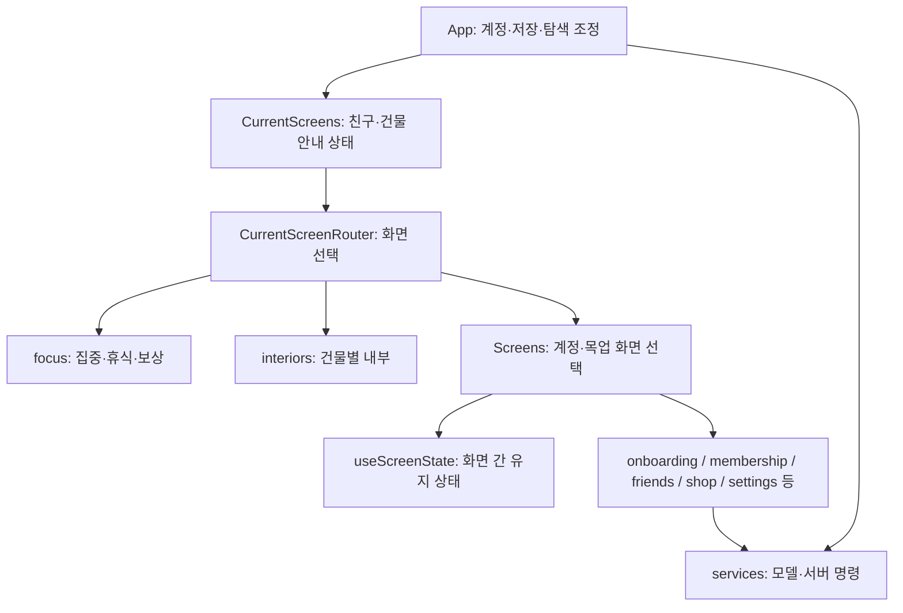

# 앱 리팩토링 구조와 유지한 경계

대상은 활성 2.0 앱 `app/app-dev`다. 서버·백오피스·동결된 1.x 앱은 이 에픽의 변경 대상이 아니다.
기준 SHA는 `fd2881a4f6527004ac8422ef3d3d245c78405f3e`다.

## 앱과 상태

- `App.tsx`: 계정 채택·저장소 소유권·앱 내 탐색의 조정자다. 세션 세대와 계정 교체가 얽힌 부팅은 기존 순서를 보존한다.
- `app/routePolicy.ts`: 화면 제목, 딥링크 보류, 섬 없는 계정의 허용 화면 목록이다.
- `app/useScreenTimeSync.ts`: 스크린타임 조회·보고와 앱 차단 동기화의 구독·재시도 소유자다. 요청 순서·인증 세대 검사를 유지한다.
- `app/useIslandAudio.ts`: 곡 교체, 늦게 끝난 seek, 볼륨·미리듣기의 생명주기를 관리한다.
- `hooks/useSystemReduceMotion.ts`: OS 접근성 설정을 구독한다. 사용자 설정에 OS 값을 영속 저장하지 않는 정책은 그대로다.
- `services/model.ts`: 기존 호출자가 쓰는 공개 API다. 구현은 `model/types`, `catalog`, `time`, `fixtures`, `islandPolicy`, `focusPolicy`, `routes`, `intentKeyPool`, `reducer`로 나눴다. 저장 키·상태 형식·reducer action은 바꾸지 않았다.

## 화면

- `CurrentScreens.tsx`: 공용 친구 상태와 계정별 건물 안내를 유지한다. 실제 화면 선택은 `island/navigation/CurrentScreenRouter.tsx`다.
- 권한 화면은 `screens/permissions`, 집중 흐름은 `screens/focus`, 공용 시트는 `screens/shared`가 맡는다.
- `Screens.tsx`: 기존 목업·계정 화면을 선택하는 작은 진입점이다. 온보딩, 섬 가입, 홈, 음원, 전망대, 방문, 상점, 뗏목, 꾸미기, 친구, 설정을 각 기능 폴더로 분리했다.
- `island/navigation/useScreenState.tsx`: 화면 이동 중 유지해야 하는 폼·명령 상태를 소유한다. 조건부 훅이나 화면 변경 때 폼을 잃는 새 마운트 경계를 만들지 않았다. 렌더러의 `undefined`는 해당 화면이 아니라는 뜻이고 `null`은 유효한 빈 화면이다.
- `interiors/BuildingInteriors.tsx`: 건물 라우팅·검토 진입점이다. 장면 프레임은 `InteriorScreen`, 회관은 `hall`, 게시판은 `board`, 우체통은 `mail`, 전망대는 `observatory`, 상점·축음기는 `shop`, 공용 기하·모션·스크롤·그림은 `shared`가 맡는다.
- `navigation/ScreenEnvironment.ts`: 루트가 화면에 주는 상태·명령 계약이다. 명령 타입은 서비스 반환 타입을 재사용한다. 작은 화면은 필요한 필드만 요구한다. 검토실 입력은 `previewEnvironment.ts`에서 완성하고, 실제 앱은 이 팩토리를 사용하지 않는다.

파일 수는 분리 때문에 늘어난다. 큰 파일을 일정 줄 수 아래로 자르는 것보다 상태 소유자와 기능의 경계가 드러나는 것을 우선했다. `WorldMap`, `Hall`, 게시판의 복잡한 상호작용과 앱 계정 채택은 여전히 큰 모듈이다. 크기가 줄었다는 이유만으로 복잡도가 모두 해결됐다고 보지 않는다.

## 합치지 않은 것

게시판·우체통·상점의 서버 조회 훅은 요청 취소처럼 비슷한 문장이 있어도 계정 세대, 섬 권한, 수정 경합, 재시도 정책이 다르다. 이들을 범용 CRUD 훅 하나로 바꾸지 않았다. `auth/client/session`의 순환도 인증 재시도·세션 해제 계약이 얽혀 있어 유지했다. 타일 지도와 디버그 시계 사이의 타입 역참조만 필요한 구조 타입으로 좁혀 제거했다. 이것은 런타임 순환 제거에 따른 성능 개선이 아니다.
