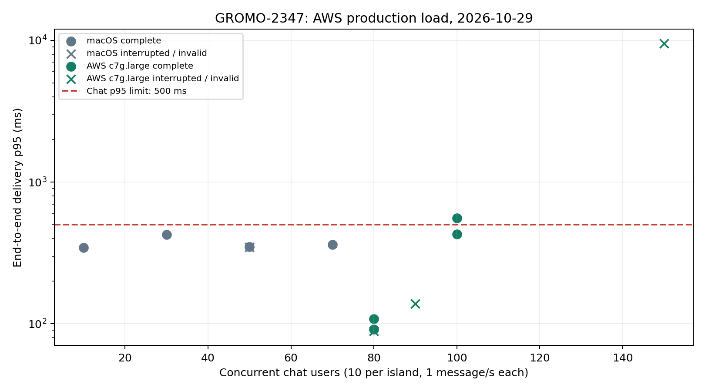

# GROMO-2347 AWS 추가 부하 실측 — 2026-10-29

이 문서는 2026-10-29 AWS 운영 부하 측정 당시의 결과다. 시간은 별도 표시가 없으면 UTC다. 측정 후 시험 데이터의 추가 물리 정리와 최종 잔존 검사 결과는 [시험 데이터 정리 기록](cleanup.md)을 따른다. 아래의 탈퇴·대기 건수는 추가 정리 전 관측값이며 현재 잔존 건수로 해석하지 않는다.

## 결론

채팅 80명(방당 10명, 사용자당 초당 1발신)은 120초 재시험과 300초 유지 시험을 통과했다. 300초 결과는 p95 91.42ms, 23,999발신·239,990수신, 누락·오류 0이다. 다만 첫 80명 시도는 비정상 연결 종료로 중단됐으므로 무중단 보장 수치로 쓰지 않는다.
100명은 120초 두 번에서 p95 558.80ms 실패 / 429.28ms 통과가 섞였다. 150명은 29.02초에 전달 타임아웃으로 중단됐고, 관측된 부분 수신 p95 9,493.31ms·마감 내 미수신 14,970건이었다. 따라서 70명 또는 80명을 고정 최대 수용량으로 확정할 수 없다.
전체 서비스 동시 수용량은 확정하지 않는다. 70명 채팅+홈 5진입/s+집중 2회/s 혼합은 집중 여정 p95 911.20ms로 실패했고, 이동은 FullState 준비 단계에서 실패한다. 이번 결과로 30분×3회·200명/300연결 기준이나 가입자/DAU 수용량을 충족했다고 볼 수 없다.

## 환경·행동·판정 기준

- 운영: 서울 t4g.large, catus-v2.1.0 / 소스 6a22c3d30a972b94fc97791898e5ab8a24eae622. 기존 이미지·ACL·컨테이너 제한으로 측정했다.
- 발생기: 초기 macOS Node 26.3.1, 이후 서울 전용 c7g.large Node 22.23.4 / k6 2.0.0. 공개 Cloudflare HTTPS/WSS 경로를 사용했다. 발생기와 네트워크 경로가 달라 두 집단을 하나의 지연 분포로 합치지 않는다.
- 새 시험 계정 400개·섬 40개·10명/섬. 초기 총 활성 사용자 관측 663명. 일반 사용자 활동이 있는 공유 운영 환경이며, 등록 데이터 100/1,000/10,000명 및 동일 시드 전후 비교는 수행하지 않았다.
- 채팅: 사용자당 1연결·1Hz, 분산 발신, fan-out 10. p95 500ms. 오류·누락·조기 종료가 있으면 지연이 낮아도 통과로 세지 않는다.
- 홈: 신규 사용자 화면의 첫 요청 뒤 4개 병렬, 진입당 5 HTTP 요청. 전체 여정 p95 500ms. 진입/s와 HTTP RPS를 구분한다.
- 집중: 시작→200ms 대기→pause→resume→current 조회→finish의 5 HTTP 요청. 전체 여정 p95 500ms. 대기와 순차 왕복을 포함하므로 개별 액션 p95와 구분한다.
- 혼합 runner는 기존 여정 1,000ms 설정을 이번 티켓의 500ms로 좁힌 임시 사본을 사용했다. 원래 소스 파일은 수정하지 않았다. 사본 SHA는 원시 증거 ZIP의 `aws-results/mixed/mixed-meta.json`에 있다.
- HTTP 오류 5%·HTTP p95 2초·미발신 중단 기준과 WS 준비/전달 타임아웃을 적용했다. 중단 이후 예정했던 발신을 실제 오류로 만들지 않는다. 부분 단계의 지연과 처리량은 안정 용량이 아니다.

## 채팅 원시 결과 요약

|발생기|명|계획/실측 초|p50 ms|p95 ms|p99 ms|발신/수신|미수신|오류|판정|
|---|---:|---:|---:|---:|---:|---:|---:|---:|---|
|macOS|10|60/60.00|285.06|344.02|355.44|600/6000|0|0|통과|
|macOS|30|60/60.00|285.00|425.89|558.31|1799/17990|0|0|통과|
|macOS|50|60/50.77|285.15|347.07|371.93|2537/25209|161|2|중단: WEBSOCKET_ERROR|
|macOS|50|120/120.00|286.29|349.19|379.45|5997/59970|0|0|통과|
|macOS|70|120/120.00|294.72|362.67|438.03|8397/83970|0|0|통과|
|AWS c7g.large|80|60/2.70|76.68|88.84|100.14|214/2100|40|1|중단: EARLY_CLOSE|
|AWS c7g.large|80|120/120.00|16.28|108.44|276.05|9600/96000|0|0|통과|
|AWS c7g.large|100|120/120.00|163.57|558.80|685.83|12000/120000|0|0|지연 기준 실패|
|AWS c7g.large|100|120/120.00|115.67|429.28|468.40|12000/120000|0|0|통과|
|AWS c7g.large|90|120/103.15|18.14|138.27|250.45|9282/92809|11|1|중단: EARLY_CLOSE|
|AWS c7g.large|80|300/300.00|16.83|91.42|203.90|23999/239990|0|0|통과|
|AWS c7g.large|150|60/29.02|4965.70|9493.31|9931.89|4339/28420|14970|0|중단: DELIVERY_TIMEOUT|

50/80/90명에서 관측된 비정상 연결 종료 코드는 1006이며 원인은 미확정이다. 수신 실행기·압축·프록시·클라이언트 중 어느 하나로 단정하지 않는다. 재시작·OOM·outbound 강제 차단/큐 초과 카운터 증가 근거는 확인하지 못했다.

[확대용 SVG](chat-p95.svg) · [12회 실행 CSV](ws-summary.csv). CSV의 `file`은 원시 증거 ZIP 안의 경로이고 `runId`는 시험 실행 식별자다. 계정·섬 식별자는 포함하지 않는다.

## HTTP 원시 결과 요약

|구분|시나리오|목표 회/s|실측 초|HTTP RPS|완료 회/s|HTTP p95 ms|전체 p95 ms|미발신 수|판정|
|---|---|---:|---:|---:|---:|---:|---:|---:|---|
|단독|focus_lifecycle|1|60.57|5.04|1.01|112.14|650.85|0|SLO_LIMIT|
|단독|focus_lifecycle|5|60.77|24.76|4.95|235.47|1,163.23|0|SLO_LIMIT|
|단독|focus_lifecycle|50|11.53|43.81|5.99|1,681.87|7,122.06|447|PARTIAL|
|단독|app_home_new_user|1|60.14|5.07|1.01|95.25|192.04|0|PASS|
|단독|app_home_new_user|5|60.14|25.02|5.00|82.72|194.36|0|PASS|
|단독|app_home_new_user|10|60.43|49.72|9.94|163.31|381.60|0|PASS|
|단독|app_home_new_user|25|11.52|59.27|11.11|2,415.65|4,728.43|101|PARTIAL|
|혼합|focus_lifecycle|2|120.53|10.00|2.00|183.77|911.20|0|SLO_LIMIT|
|혼합|app_home_new_user|5|120.29|24.98|5.00|147.12|402.77|0|PASS|

홈 25진입/s 및 집중 50회/s는 약 12초의 부분 단계다. 표의 완료 회/s를 지속 처리 한계로 읽지 않는다. droppedRate의 분모는 전체 계획 도착 수이므로 조기 중단 구간의 실제 미발신 비율과 다르다. p50/p99와 개별 HTTP 액션 지연은 [9개 측정 단계 CSV](http-summary.csv)와 원시 증거 ZIP의 k6 요약을 함께 본다. CSV는 warm-up 단계를 제외한다.

## 혼합·이동·원장

- 혼합 공통 측정 구간: 02:20:59.105~02:22:57.015 UTC, 117.91초(계획 90초 이상). 구성요소별 집계창은 서로 달라 이 공통 구간만의 합산 RPS/TPS로 환산하지 않는다.
- 홈 5진입/s: 120초, 601여정·3,005요청, 여정 p95 402.77ms, 오류·미발신 0.
- 집중 2회/s: 120초, 241여정·1,205요청, 여정 p95 911.20ms, 개별 HTTP p95 183.77ms, 오류·미발신 0. 집중 SLO 실패로 감독기가 중단했다.
- 채팅 70명: 계획 150초 중 134.89초, 9,437발신·94,370수신·누락 0, 관측 p95 333.21ms. 감독기의 SIGINT 종료이며 전체 계획을 완료하지 못해 valid=false다.
- 이동: 10연결, FullState 준비 완료 0/10, 준비 시간 초과. 발신 0이므로 이동 지연 분위수·용량을 만들지 않는다. [운영 ACL 통합시험 PR #1376](https://github.com/OneOrThree/phone/pull/1376)의 main 병합과 [Infra ACL 수정 PR #15](https://github.com/OneOrThree/cattus-infra/pull/15)의 운영 적용은 별개다. 이 측정은 기존 운영 ACL에서 수행했다.
- DB 원장: 집중 run별 시작/완료/정산 65/65/65, 305/305/305, 132/132/132, 혼합 245/245/245. 합계 747건, 활성/일시정지·열린 interval·완료 후 미정산 0.
- 50회/s 중단 직후 클라이언트 원장에는 정산 미확인 16건이 남았고 정리 API가 44건을 종료했다. 별도 서버 원장 대조에서 해당 run 132건 모두 완료·정산임을 확인했다. 원시 클라이언트 파일을 사후 성공으로 덮어쓰지 않았다.

## 자원·회복·제한

- 측정 구간 CloudWatch: EC2 CPU 관측 최대 73.06%, CPU credit 최저 860.27, surplus 0. RDS CPU 최대 23.48%, 연결 25~26, CPU credit 576. EC2 기본 지표는 5분 집계여서 순간 포화를 배제하는 근거가 아니다.
- 운영 서비스 health 관측 정상, 신규 restart/OOM 0. Realtime 기존 restartCount=1을 기준으로 비교했다. CPU cgroup throttling 관측 0.
- Realtime 메모리 첫 관측 682.5MiB / 768MiB, 측정 중 최대 93.3%, 마지막 관측 709.9MiB / 768MiB. 초기 메모리로 완전히 복귀하거나 장시간 누수가 없다는 증거는 아니다.
- 150명 중단 후 CPU가 5% 아래인 최초 관측까지 16.39초였다. 실행별 시간은 원시 증거 ZIP의 `resource-summary.json`에 있다. 샘플링 상한이며 큐·E2E 지연까지 같은 순간 회복했다고 단정하지 않는다.
- 기존 Outbox 기준선: LINK 27, REALTIME 13, SCORE 88 pending. 채팅 뒤 REALTIME은 13으로 유지됐다. 공유 운영의 일반 활동으로 SCORE가 91로 변했으며 이를 시험 원인으로 단정하지 않는다. 계정 정리 후 신규 탈퇴 전달 대기는 아래 최종 DB 증거와 구분한다.

## 측정 직후 탈퇴 확인 — 추가 물리 정리 전 관측

이 절은 **2026-10-29 02:35:49 UTC(11:35:49 KST)**의 `fixture-final.json` 결과다. 탈퇴는 계정 사용 중지와 세션 폐기를 확인한 상태였으며, 그 시점에는 시험 이력까지 물리 삭제한 상태가 아니었다. 사용자 요청에 따른 이후 삭제 범위와 잔존 검사 결과는 [시험 데이터 정리 기록](cleanup.md)에 별도로 남긴다.

|검사 대상|탈퇴 직후 관측|
|---|---:|
|시험 계정|400개 탈퇴 처리|
|활성 시험 계정·유효 세션·활성 멤버십·살아 있는 시험 섬|각 0|
|진행 중 시험 집중·열린 interval|각 0|
|완료 집중 / 정산 이력|747 / 747건 존재|
|시험 섬을 목적지로 참조한 일반 사용자 개인 SEA 기록|5건 보존|
|탈퇴 사건 KAFKA 전달|400건 완료|
|탈퇴 사건 LINK / REALTIME / SCORE 전달 대기|각 400건, 합계 1,200건|

- 여기서 **탈퇴 후처리**는 `user.withdrawn` 사건을 다른 서비스에 보내 그 서비스의 사용자 관련 상태도 정리하도록 하는 비동기 전달이다. Data DB의 계정 비활성화와 다른 서비스의 처리 완료는 별도 검사 대상이다. 위 표의 대기 건수는 당시 전달 장부 관측이며 실제 다른 서비스에 데이터가 그 수만큼 존재한다는 뜻은 아니다.
- 유효기간 내 기존 토큰 400개 모두 HTTP 401/404로 거절됨을 확인했다(404 390개, 401 10개). 정리용 재발급은 탈퇴 전 활성 시험 계정에만 수행했고 탈퇴한 계정을 되살리지 않았다.
- 탈퇴 응답 `404 USER_NOT_FOUND` 및 `400 UPSTREAM_TIMEOUT`이 DB 커밋 뒤 발생했다. 응답 코드만으로 성공/실패를 판단하지 않고 고정한 시험 계정 목록으로 삭제·세션 폐기를 대조했다. 같은 섬 동시 탈퇴를 중단한 뒤 섬을 분산하고 속도를 낮췄다.
- LINK·REALTIME·SCORE의 전달 대기 원인을 모두 ACL로 단정하지 않는다. 문서 작성 시점 main에서는 LINK 대상이 제거돼 있고 SCORE는 소비자·transport 없이 보류하는 설계다. REALTIME 처리 여부는 별도로 확인해야 한다.
- 임시 c7g.large 종료 및 EBS·ENI·보안 그룹·IAM role/profile 부재를 독립 조회로 확인했다. 원시 증거는 `loadgen-cleanup-verified.json`이다.
- 개인 SEA 기록은 시험 계정 원장과 분리했다. 배포된 `IslandPurgeService`는 개인 집중 기록을 보존하며 SEA finish는 목적지 멤버십·섬 생존을 요구하지 않는다. 일반 사용자의 개인 기록은 시험 데이터 삭제 대상에 포함하지 않는다.

## 남은 완료 조건

GROMO-2347은 진행 중을 유지한다. 이동 ACL 준비 실패 해소, 현재 main 개선의 운영 반영 여부 확인, 30분×3회 혼합, 100/1,000/10,000 등록 데이터·이력 단계별 동일 조건 전후 비교, 인스턴스 교체 및 장시간 회복 검증이 남았다. 이번 부하는 현재 배포의 경계를 추가로 측정한 자료이며 전체 티켓 완료나 전체 앱 최대 사용자 수 보장이 아니다.

## 이미 구현된 변경과 추가 확인

코드 확인 기준은 `origin/main`의 `81ef2140ab87f3c0f2bfb741bc3c6ae09f3c9932`이며, 위 측정의 운영 배포 `6a22c3d30a972b94fc97791898e5ab8a24eae622`와 다르다. main 병합을 운영 반영 또는 이번 측정의 개선 효과로 간주하지 않는다.

|항목|확인한 상태|다음 확인|
|---|---|---|
|WebSocket 연결 종료·수신 예산|[PR #1299](https://github.com/OneOrThree/phone/pull/1299), `a641e8db4` main 포함. 무압축 핸드셰이크·수신 실행기 분리·끝난 세션 가드·연결 진단 로그 구현|운영 반영 후 같은 부하 재측정. 이번 1006 종료의 원인은 아직 미확정|
|운영 Redis ACL 통합시험|[PR #1376](https://github.com/OneOrThree/phone/pull/1376), `af74aa5cc` main 포함|Infra ACL 변경의 운영 적용 및 이동 FullState 준비 성공 검증|
|혼합 부하 최초 종료 원인·중단 결과 보존|[PR #1296](https://github.com/OneOrThree/phone/pull/1296), `0cc6d3220` main 포함|보존한 실패 증거로 원인 분석. 결과 보존 기능 자체를 다시 구현할 필요는 없음|
|집중 최초 오류 진단·소유한 잔류 집중 정리|[PR #1297](https://github.com/OneOrThree/phone/pull/1297), `ac022af60` main 포함|여정 지연의 단계별 원인 분석과 개선 후 재측정. 진단 구현과 p95 충족을 구분|

부하 도구에는 생성 manifest·소유 PK 동결·Data/Chat/Notification/Redis 잔존 검사를 포함한 자동 정리 절차를 추가해야 한다. 일반 탈퇴만으로 익명 기록과 채팅이 남았기 때문이다. 구체적인 근거는 [정리 기록의 재발 방지 구현](cleanup.md#재발-방지-구현)에 있다.

이번 결과만으로 추가 제품 코드 수정이 필요 없다고 결론 내리지 않는다. 운영 적용 후에도 재현되는 연결 종료·홈 및 집중 지연·탈퇴 응답 오류의 원인을 좁혀야 수정 범위를 정할 수 있다. 시험 데이터 삭제는 별도의 정리 작업이며 전체 운영 설정 변경이나 기능 배포를 수행했다는 뜻이 아니다.

## 증거 위치와 재현 가능한 대조

- [Jira 측정 결과 댓글](https://romance.atlassian.net/browse/GROMO-2347?focusedCommentId=12003)
- [원시 증거 ZIP 다운로드](https://romance.atlassian.net/rest/api/3/attachment/content/11251) — Jira 접근 권한 필요. 파일명 `GROMO-2347-aws-20261029-continuation-evidence.zip`, **872,062 bytes**.
- ZIP SHA-256: `ca86cbdd4f2ce41dec68df971bc030711c344c9b5d04c423adcc639530b9f66e`.
- ZIP 내부 `SHA256SUMS`로 개별 파일을 대조한다. `aws-results/`는 AWS k6·WS 원시 결과, 루트 `chat-1hz-*.json`은 macOS WS 결과다. `observations.jsonl`, `resource-summary.json`, `cloudwatch-measurement-final.json`은 자원 관측 근거이며 `focus-ledger-final.json`은 747건 원장 대조 근거다.
- 이 디렉터리의 CSV·PNG·SVG는 첨부본과 동일 바이트다. 표는 CSV 값을 표시 자리수로 반올림했다. 원시 측정 파일을 후속 정리 결과로 덮어쓰지 않는다.
- ZIP의 `fixture-final.json`과 이 문서의 탈퇴 직후 표는 추가 물리 정리 **이전** 증거다. 최신 정리 결과는 [시험 데이터 정리 기록](cleanup.md)을 확인한다.

