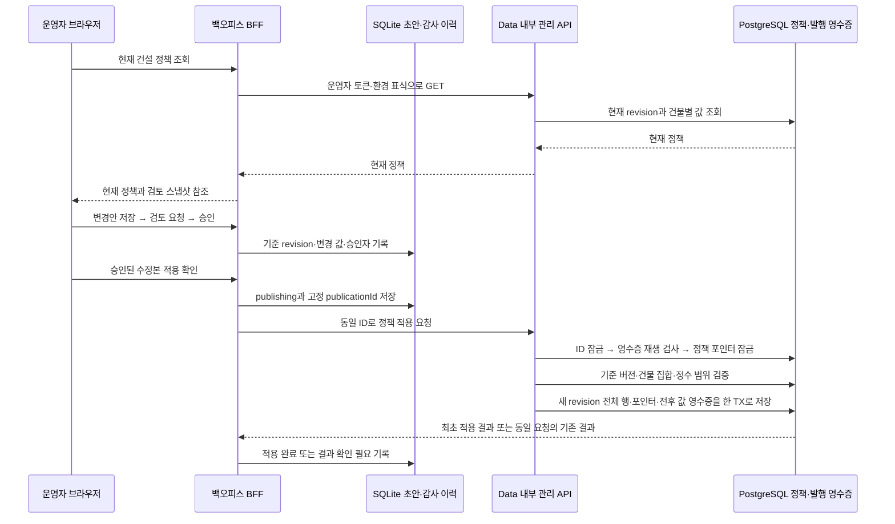

# 백오피스 건설 비용·공사 시간 관리

GROMO-2578. 건물별 물고기 비용과 공사 시간을 기존 백오피스의 작성·검토·승인·적용 절차로 관리한다. 운영 값 자체를 이번 개발 작업에서 바꾸지는 않는다.

## 현재 구조와 변경 범위

`construction_buildings`가 건물 목록의 정본이며 현재 7개다. 비용과 공사 시간은 `construction_cost_policies(revision, building_id)`의 불변 행에 있고, `construction_cost_policy_publication` 한 행이 적용 중인 revision을 가리킨다. 착공은 이 포인터를 잠근 뒤 사용자가 본 `expectedCostPolicyVersion`을 검사한다. 비용·사용한 revision·완료 시각은 착공할 때 시설 행에 고정된다.

백오피스에 **건설 정책**을 추가한다. 건물 이름·현재 비용·공사 시간을 조회하고 전체 건물의 변경안을 작성한다. 화면의 시간 단위는 초이며 분·시간으로 환산한 설명을 함께 보여준다. 공사 중인 건물의 가격이나 완료 시각은 바꾸지 않는다. 모금 방식·선행 건물·건설 권한도 기존 규칙을 따른다.

## 데이터 흐름

## 계약과 동시성

- 현재 조회: `GET /internal/admin/content/construction-policy`. 건물 ID·표시 이름·cost·buildSeconds, `costPolicyVersion`, 적용 시각을 반환한다. UI에서 값이 없을 때 임의의 운영 기본값을 넣지 않는다.
- 적용: `PUT /internal/admin/content/construction-policy/{publicationId}`. 기준 `expectedCostPolicyVersion`과 건물별 cost·buildSeconds를 받는다. 현재 건물 집합과 정확히 같아야 하고 중복·누락·알 수 없는 건물은 거부한다. 비용은 1 이상, 공사 시간은 0 이상 32비트 정수다. 기존 착공 지갑 차감이 0을 거부하므로 비용 0은 등록하지 않는다. 0초 공사도 기존 완공 스케줄러가 처리한다.
- 전체 정책을 한 번에 새 revision으로 발행한다. 포인터를 기존 착공과 같은 행 잠금으로 직렬화한다. 기준 버전이 달라졌으면 409로 재검토를 요구한다. 기존 revision을 덮어쓰거나 재사용하지 않는다.
- 요청 ID 잠금과 발행 영수증은 기존 `ContentStore`를 사용한다. `CONSTRUCTION` 종류를 새 Flyway 마이그레이션으로 허용한다. 현재 정책이 이후 바뀌더라도 동일 요청의 재시도는 버전 검사보다 먼저 기존 영수증을 반환한다. 같은 ID에 다른 내용은 409다.
- 정책 행·포인터·전후 값과 변경자를 담은 영수증은 같은 DB 트랜잭션이다. 영수증 저장 실패도 전체 롤백한다. `internal/service`에서 도메인을 조합해 낮은 계층의 역행 의존을 만들지 않는다.
- 실제 착공은 기존 `IslandConstructionService.start`를 사용한다. 이전 정책을 본 착공은 버전 충돌로 거절하고 재조회한다. 이미 착공한 시설의 `cost_revision`, 지출액, `completes_at`은 변경하지 않는다.

## 인증·검토·복구

기존 운영자별 내부 자격·경로 허용목록·환경 표식을 재사용한다. 새 경로는 console-member-1/2/3에만 허용한다. 브라우저는 내부 토큰을 받지 않고, BFF는 세션·Origin·CSRF를 검사한다. 일반 business 자격은 관리 경로를 호출할 수 없다.

초안 수정은 기존 승인을 무효화한다. 적용은 승인된 수정본으로만 가능하고 확인 화면에 전후 값과 전체 건물 적용 범위를 표시한다. 같은 운영자의 검토·승인은 기존 백오피스 정책대로 허용한다. 승인자·변경 이력은 SQLite에, 실제 적용자·시각·전후 값은 서버 영수증에 남긴다.

응답 유실은 실패로 단정하지 않고 `uncertain`으로 남긴다. 최초 적용자가 같은 수정본과 publicationId로 재시도한다. 그 상태에서 초안 수정이나 새 요청으로의 교체는 막는다. 최초 요청의 확정적인 버전 충돌은 현재 정책을 다시 읽어 새 수정본을 검토·승인해야 한다. 롤백도 이전 값을 복사한 **새 정책**을 동일 절차로 적용한다.

로컬 모드는 별도 모의 정책과 모의 영수증을 영구 저장해 재시작 후에도 재시도 결과가 일관되게 유지되도록 한다. 화면에 로컬임을 표시하며 실제 Data·Notification을 호출하지 않는다.

## 검증

격리된 로컬 PostgreSQL에서 전체 목록 검증, 음수·소수·범위 초과, 버전 충돌, 같은 ID 재시도, 다른 본문 충돌, 동시 적용, 영수증 실패 시 롤백, 진행 중 공사 보존을 확인한다. 관리 자격·환경 검증과 계층 검사도 실행한다. BFF에서는 승인 우회·수정 후 승인 취소·CSRF·불확실 결과 재시도와 로컬 영속화를, 브라우저에서는 조회→수정→검토→승인→적용 흐름을 확인한다. AWS 부하와 부하 데이터 생성은 금지한다.

운영 이력 탭은 공지·잡지·알림 원장을 조회한다. 건설 정책은 작성·검토 목록에서 적용된 항목을 열어 변경 전후 값과 운영자 감사 기록을 확인한다.
