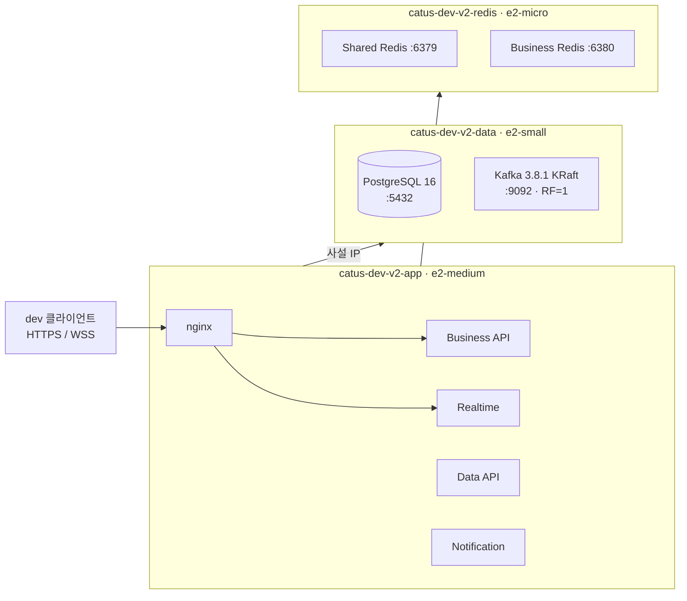
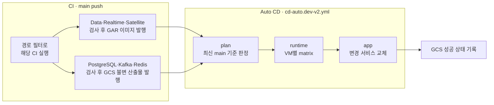

# dev V2 파이프라인

GCP VM 3대로 나눈 dev V2의 CI/CD 현행 정리다. 2026-10-31 코드와 Infra `main`을 대조해 썼다. 실제 판정은 워크플로와 `.github/scripts/v2/dev/`가 정본이다.

운영 쪽은 [prod V2 파이프라인](prod-v2-pipeline.md)을 본다.

## 현재 상태

- 공개 주소는 `oneorthree-v2.dev.mooo.com`이다.
- `*.dev-v2.yml` 워크플로는 모두 켜져 있다. 기존 dev의 `data-api-ci·cd.dev`, `realtime-ci.dev`, `satellite-ci·cd.dev`, `ops-smoke.dev`는 `disabled_manually`다. main 머지는 dev V2에만 자동 반영된다.
- 기존 `gromo-dev-app` VM과 `oneorthree.dev.mooo.com`은 남아 있다.

아직 끝나지 않은 일은 [남은 일](#남은-일)에 모았다.

## 구성

| VM | 사양 | 디스크 | 실행 대상 |
| --- | --- | --- | --- |
| `catus-dev-v2-app` | e2-medium | 부팅 20 GiB | nginx, Data, Realtime, Business, Notification |
| `catus-dev-v2-data` | e2-small | 부팅 20 GiB + `pd-standard` 30 GiB | PostgreSQL 16.14, Kafka 3.8.1 |
| `catus-dev-v2-redis` | e2-micro | 부팅 10 GiB + `pd-balanced` 10 GiB | Redis 7.4.11 두 개 |

컨테이너 메모리 상한은 다음과 같다.

| 컨테이너 | `mem_limit` | 비고 |
| --- | --- | --- |
| Data | 512 MiB | `memswap_limit` 1 GiB |
| Realtime | 512 MiB | `memswap_limit` 1 GiB |
| Business | 640 MiB | `memswap_limit` 1280 MiB |
| Notification | 384 MiB | `memswap_limit` 768 MiB |
| nginx | 64 MiB | |
| Kafka | 1 GiB | 힙 512 MiB |
| Shared Redis | 384 MiB | `maxmemory` 192 MiB, `noeviction` |
| Business Redis | 160 MiB | `maxmemory` 64 MiB, `noeviction` |

빌드는 기존 `gromo-dev-build`의 `[self-hosted, ci, spot]` 러너가 맡는다. dev 백오피스는 없다.

### 파일 소유권

| 대상 | 위치 |
| --- | --- |
| VM·디스크·IAM·버킷 | Infra `dev/runtime-v2.tf`, `dev/deployment-v2.tf`, `dev/backup-v2.tf` |
| 앱 Compose·nginx | Infra `dev/runtime-v2/` |
| PostgreSQL·Kafka·Redis Compose | phone `server/scripts/v2/dev/` |
| 앱 호스트 배포 스크립트 | phone `server/scripts/v2/dev/app/deploy.py` |
| 판정·배포 스크립트 | phone `.github/scripts/v2/dev/` |

`server/scripts/nginx-dev-2.0-routes.conf.example`은 기존 dev와 로컬 nginx용이며 dev V2는 읽지 않는다. dev V2의 공개 경로를 바꾸려면 Infra `dev/runtime-v2/nginx.conf.template`을 고친다.

VM 초기 구성, 백업, 인증서는 Infra `dev/runtime-v2/README.md`를 따른다. 그 문서의 「발행과 배포」는 최초 수동 검증 순서이며, 평소 배포는 아래 Auto CD다.

## 전체 흐름

- PR에서는 검사만 하고 이미지와 산출물을 발행하지 않는다.
- 기준 브랜치는 `main`뿐이다. `release`는 dev V2와 무관하다.
- 모든 CD는 concurrency 그룹 `catus-dev-v2-deploy`를 공유해 동시에 돌지 않는다.
- 인증은 GCP WIF와 AWS OIDC다. AWS는 Secrets Manager 조회에 쓴다.

## CI

| 워크플로 | 트리거 경로 | 산출물 |
| --- | --- | --- |
| `data-api-ci.dev-v2.yml` | `server/data-api/**`, `server/realtime/**`, 공용 빌드 입력 | GAR `data-api`, `realtime` amd64 이미지 |
| `realtime-ci.dev-v2.yml` | Data CI가 호출하는 검사 | 없음 |
| `satellite-ci.dev-v2.yml` | `server/business-api/**`, `server/notification/**`, `server/scripts/**`, `.github/scripts/**` 등 | GAR `business-api`, `notification` amd64 이미지 |
| `postgres-ci.dev-v2.yml` | `server/scripts/v2/dev/postgres/**`, `common/**` | `releases/postgres/<릴리스>/` |
| `kafka-ci.dev-v2.yml` | `server/scripts/v2/dev/kafka/**`, `common/**` | `releases/kafka/<릴리스>/` |
| `redis-ci.dev-v2.yml` | `server/scripts/v2/dev/redis/**`, `common/**` | `releases/redis/<릴리스>/` |

정확한 경로는 각 워크플로가 정본이다.

- 이미지 태그는 `dev-v2-<SHA>-<run>-<attempt>`이고, 배포는 digest로 한다.
- 런타임 산출물은 dev V2 배포 버킷에 `--if-generation-match=0`으로 올린다. 같은 경로를 덮어쓰지 못한다.
- Infra `main`의 `dev/runtime-v2/**`가 바뀌면 Infra의 `App runtime publish (dev)-v2`가 `infra/<릴리스>/manifest.json`을 발행한다.

## Auto CD

`Auto CD (dev)-v2`는 위 CI가 main에서 성공했을 때, 또는 수동 실행으로 시작한다. job은 세 개다.

### plan

`dev-auto-cd-V2.py`가 판정한다.

1. 실행 커밋이 최신 main이 아니면 자신을 다시 실행하고 끝낸다.
2. 런타임 세 종류를 각 성공 상태의 커밋과 비교한다. 입력이 같으면 건너뛴다.
3. 입력이 다르면 현재 커밋에 맞는 산출물을 찾는다. 산출물이 없으면 해당 CI 상태로 나눈다.
   - 실행 중: 기다리고, CI 완료 때 다시 판정한다.
   - 없음 또는 취소: CI를 수동 실행하고 기다린다.
   - 실패, 또는 성공했는데 산출물 없음: Auto CD를 실패시킨다.
4. 런타임이 모두 준비되면 앱 대상을 정한다. 필요한 이미지 CI가 없으면 같은 방식으로 실행하고 기다린다.

토큰으로 시작한 CI는 `workflow_run`을 깨우지 못한다. 그래서 수동 실행된 CI는 마지막 `auto-cd` job에서 Auto CD를 직접 다시 부른다.

### runtime

런타임을 VM별로 묶어 matrix로 돌린다. Redis VM과 data VM은 병렬이고, data VM 안에서는 Kafka, PostgreSQL 순서로 적용한다.

`dev-deploy-runtime-V2.py`의 적용 순서는 다음과 같다.

1. manifest, tar 해시, main 소스와의 일치를 확인한다.
2. VM ID가 `catus/dev/cicd-v2` 값과 같은지 확인한다.
3. 실행 중 이미지와 Compose 이미지가 다르면 멈춘다. 이미지 버전 교체는 데이터 호환 계획을 세워 따로 한다.
4. IAP SSH로 파일을 옮기고 `common/apply.sh`를 실행한다. 데이터 디스크 마운트를 확인한 뒤 호스트 잠금 안에서 `docker compose up --wait`을 돌린다.
5. 런타임별로 검증한다. Kafka는 토픽 4개를 3파티션·RF=1로 준비한 뒤 검증한다.
6. 검증이 끝나면 `deployments/<역할>/current.json`을 GCS 세대 조건으로 기록한다.

Redis는 실행마다 ACL 파일 경로가 달라, 같은 산출물을 다시 적용해도 컨테이너를 재생성해 새 ACL을 반영한다.

### app

앱 대상은 `dev-plan-V2.py`가 정한다.

| 변경 | 빌드 대상 | 배포 대상 |
| --- | --- | --- |
| Business 입력 | Business | Business |
| Notification 입력 | Notification | Notification |
| Data 또는 Realtime 입력 | Data + Realtime | Data + Realtime |
| 공용 입력(`.dockerignore`, `be-gradle.yml`, `ci-jar` 등) | 네 서비스 | 네 서비스 |
| Infra 산출물 커밋 변경 | 변경분만 | 네 서비스 |
| 최초 배포 | 네 서비스 | 네 서비스 |
| App CD `force_redeploy` | 변경분만 | 네 서비스 |

서비스 지문은 `dev-fingerprint-V2.py`가 Git 트리에서 만든다. 지문이 같은 서비스는 직전 digest를 그대로 쓴다.

`dev-deploy-app-V2.py`는 VM·이미지·Infra 산출물과 런타임 선행 배포를 확인한 뒤 호스트의 `deploy.py`를 실행한다. 호스트 쪽 순서는 다음과 같다.

1. 서비스 env를 root 전용 tmpfs `/run/catus-dev-v2/releases/`에 쓴다.
2. 대상 이미지를 먼저 받는다. 여기서 실패하면 기존 컨테이너는 그대로다.
3. 저널에 `applying`을 쓰고 대상 서비스와 nginx를 올린다.
4. 15분 안에 네 서비스 모두 healthy여야 한다.
5. `nginx -t`와 HTTPS `/health`를 확인하고 저널을 `healthy`로 바꾼다.

성공 후 `deployments/app/current.json`을 기록한다. 기존 dev와 달리 nginx 중지, V0 전환, 위성 중지 단계가 없다. Data와 Realtime은 함께 교체한다.

## 시크릿

시크릿 표는 Infra `dev/runtime-v2/README.md`가 정본이다. 시크릿은 Infra가 소유한다.

서비스별로 나갈 키는 `.github/scripts/write-compose-env.py`의 허용목록이 정한다. Realtime 키는 `dev-env-V2.py`의 `rtkeys`가 따로 정한다. 새 키는 시크릿과 코드에 함께 추가한다.

## 수동 작업

| 상황 | 할 일 |
| --- | --- |
| Infra 앱 구성만 바뀜 | Infra 발행 성공 후 Auto CD를 main에서 수동 실행한다. Infra 발행은 Auto CD를 부르지 않는다 |
| 앱 시크릿 변경 | `App CD (dev)-v2`를 최신 Infra manifest URI와 `force_redeploy`로 실행한다 |
| Redis 비밀번호·ACL 변경 | `Redis CD (dev)-v2`를 실행한 뒤 앱을 `force_redeploy`로 재배포한다 |
| DB 비밀번호 변경 | 파이프라인 밖에서 `ALTER ROLE`을 실행한 뒤 앱을 재배포한다 |
| 런타임 단독 재시도 | `kafka·postgres·redis-cd.dev-v2.yml`에 manifest URI를 넣어 실행한다 |

- 시크릿 변경은 지문에 잡히지 않아 Auto CD가 감지하지 못한다.
- 수동 CD는 끝날 때 Auto CD를 다시 부른다. 대기 중 취소된 자동 배포를 메우기 위해서다.
- 수동 CD를 한꺼번에 제출하지 않는다. GitHub concurrency는 대기 실행을 하나만 보존한다.
- `dev-provision-db-V2.py`는 워크플로가 부르지 않는다. 빈 DB와 서비스 계정을 처음 준비할 때 쓴다.

## 실패와 복구

자동 롤백은 없다.

| 증상 | 의미 | 대응 |
| --- | --- | --- |
| `미완료 배포 저널이 있어 복구 확인이 필요합니다` | 저널이 `applying` 또는 `failed`다 | 호스트에서 컨테이너 health, 실제 digest, 로그, Flyway 이력을 확인한다. 저널만 지우지 않는다 |
| `성공 상태와 호스트 배포 저널의 기준 릴리스가 다릅니다` | GCS 기록과 호스트가 어긋났다 | 같은 run을 재시도해 상태를 다시 확인한다 |
| `성공 상태 갱신 실패` | 호스트 배포는 성공했을 수 있다 | 같은 run을 재시도한다. 재시도는 같은 릴리스 ID를 쓰고 health를 다시 검사한다 |
| `런타임 이미지 변경은 별도 데이터 호환 계획이 필요합니다` | Compose 이미지 버전이 바뀌었다 | 호환성을 검토한 뒤 사람이 교체한다 |
| `<역할> CI는 성공했지만 일치하는 산출물이 없습니다` | 재실행으로 풀리지 않는다 | 발행 로그와 버킷을 확인한다 |
| `같은 호스트의 배포가 진행 중입니다` | `apply.sh` 잠금이 잡혀 있다 | 진행 중 실행이 끝난 뒤 재시도한다 |

DB migration이 이미 적용됐을 수 있으므로 이전 이미지로 자동 복귀하지 않는다. 복구 절차와 백업 복원은 Infra `dev/runtime-v2/README.md`를 따른다.

## 초기 설계와 달라진 점

2026-10-30 「GCP dev 최소 비용 VM 3대」 검토안과 비교했다.

| 항목 | 검토안 | 현재 |
| --- | --- | --- |
| 앱 VM | e2-small | e2-medium |
| 컴퓨팅 월 추정 | 약 $39.22 | 앱 VM 상향으로 이 금액은 더 맞지 않는다. 재계산이 필요하다 |
| Kafka·DB 동거 | 같은 VM, 컨테이너·디렉터리 분리 | 같다. Compose 파일을 나누고 호스트 잠금을 공유 |
| Redis | Shared·Business 프로세스 2개, ACL, AOF | 같다 |

검토안의 판단 기준은 유지한다. dev는 부하 대응보다 비용이 우선이다. 기동 실패나 메모리 부족이 확인되면 해당 VM만 올린다. swap 크기는 이 저장소에서 알 수 없으므로 VM에서 `swapon --show`로 확인한다.

## 남은 일

- **데이터 이전**: 기존 dev 데이터를 복사할지, 새 DB를 유지할지 정해지지 않았다.
- **앱 dev 빌드 주소**: Android CI, iOS 스크립트, `.env.example`, `smoke/` 문서는 아직 `oneorthree.dev.mooo.com`을 가리킨다.
- **스모크**: dev V2용 자동 스모크가 없다. 배포 검증은 컨테이너 health와 HTTPS `/health`까지다.
- **배지**: README의 dev 배지 2개는 기존 dev 기준이다.
- **관측**: dev V2 호스트는 Datadog에 보고하지 않는다.
- **nginx 차이**: Infra 템플릿의 `/ws/realtime`에는 기존 dev와 달리 `proxy_send_timeout`이 없어 기본 60초다. 추가가 필요하다.
- **외부 IP**: data·redis VM은 이미지와 GCS 접근용 외부 IP를 아직 쓴다.
