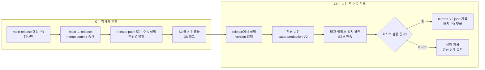

# prod V2 파이프라인

AWS EC2 4대로 나눈 Catus V2 운영의 CI/CD 현행 정리다. 2026-10-31 코드와 Infra `main`을 대조해 썼다. 실제 판정은 워크플로와 `.github/scripts/v2/prod/catus-runtime-V2.py`가 정본이다.

- DB 마이그레이션이 든 배포는 [DB 전환이 든 V2 배포](../prd/fishcat/server-separation/deployment.md#db-전환이-든-v2-배포)를 따른다.
- 관측 스택을 켜는 절차는 [서버 로그 관측 rollout](../architecture/server-log-observability/rollout.md)을 따른다.
- dev는 [dev V2 파이프라인](dev-v2-pipeline.md)을 본다.

기존 워크플로 `prod-ci.yml`, `prod-cd.yml`은 `disabled_manually`다. 백오피스 발행·배포 워크플로는 저장소에서 제거했다.

꺼진 것은 배포 워크플로뿐이다. 2026-10-31 기준 기존 EC2 `catus-prod`, `catus-backoffice-prod`는 켜져 있다. 운영 DB `catus-prod-db`와 앱 시크릿 원본도 기존 서버와 V2가 함께 쓴다. 기존 서버 종료 일정은 정해지지 않았다.

## 구성

| 호스트 | 인스턴스 | 디스크(gp3) | 실행 대상 |
| --- | --- | --- | --- |
| `catus-prod-V2` | m6g.large | 부팅 30 GiB | nginx, Data, Realtime, Business, Notification |
| `catus-kafka-prod-V2` | m6g.medium | 부팅 20 GiB + 데이터 30 GiB | Kafka 3.8.1 |
| `catus-redis-prod-V2` | m6g.medium | 부팅 20 GiB + 데이터 20 GiB | Redis 7.4.11 두 개 |
| `catus-backoffice-prod-V2` | t4g.small | 부팅 20 GiB + 데이터 10 GiB | 백오피스 |
| RDS `catus-prod-db` | db.t4g.small | 20 GiB | 운영 DB. 기존 Catus 서버와 공유 |
| RDS `catus-prod-db-v2` | db.t4g.small | 20 GiB, 최대 50 GiB | 전용 DB로 만들어 뒀지만 아직 쓰지 않음 |

공개 주소는 `catus-api-v2.oneorthree.world`, `backoffice-v2.oneorthree.world`다.

### 파일 소유권

| 대상 | 위치 |
| --- | --- |
| AWS 자원, SSM 문서, 앱·백오피스 Compose, env 계약 | Infra `prod/catus-v2/` |
| Kafka·Redis Compose와 설정 | phone `server/scripts/v2/prod/` |
| 발행·배포 스크립트 | phone `.github/scripts/v2/prod/catus-runtime-V2.py` |
| 앱 변경 판정 | phone `.github/scripts/catus-plan.py` |

시크릿 표, 인증서 발급, Grafana 수동 설정은 Infra `prod/catus-v2/README-V2.md`를 따른다. 시크릿은 Infra가 소유한다.

앱 env는 배포할 때 시크릿에서 만든다. 값을 바꿔도 실행 중 컨테이너는 그대로이고, 다음 앱 배포 때 반영된다. Redis 비밀번호를 바꾸면 Redis CD를 앱보다 먼저 실행한다.

## 단위별 파이프라인

| 단위 | CI | CD | 태그 |
| --- | --- | --- | --- |
| 앱 4종 | `prod-ci-V2.yml` | `prod-cd-V2.yml` | `catus-vX.Y.Z-V2` |
| Kafka | `kafka-ci.prod-V2.yml` | `kafka-cd.prod-V2.yml` | `kafka-vX.Y.Z-V2` |
| Redis | `redis-ci.prod-V2.yml` | `redis-cd.prod-V2.yml` | `redis-vX.Y.Z-V2` |

공통 흐름은 다음과 같다.

- 발행과 배포는 분리돼 있다. release 머지는 산출물만 만들고 운영을 바꾸지 않는다.
- 배포는 항상 수동 CD다. 환경 `catus-production-V2`의 승인을 거친다.
- CD는 `release` 브랜치에서만 돈다. 단위마다 concurrency 그룹이 달라 앱과 Kafka 배포가 서로를 막지 않는다. 동시 실행은 피한다.
- 승격 PR의 검사 범위는 [PR 대상에 따른 서버 CI 정책](pr-ci-policy.md)을 따른다.

### 처음 구성할 때의 순서

Redis → Kafka → 앱 순서로 배포한다. 앱 배포는 V2 DB 시크릿이 없을 때만 전용 RDS를 준비한다. 지금은 공유 DB용 시크릿이 있어 이 단계가 돌지 않는다.

Redis CD는 먼저 앱 호스트에서 비밀번호를 파생 Redis 시크릿으로 옮긴 뒤 Redis 호스트에 적용한다. 앱은 원본과 파생 자격이 다르면 Redis 선행 배포를 요구한다.

## 앱

### 빌드 대상

PR에서는 base와 head의 변경으로 검사 대상을 고른다. release 발행에서는 마지막 운영 성공 상태 `deployments/app/current-V2.json`의 서비스별 지문과 비교한다. 마지막 커밋 하나와 비교하면 여러 PR의 누적 변경을 놓치기 때문이다.

| 변경 | 빌드 대상 |
| --- | --- |
| `server/business-api/**` | Business |
| `server/notification/**` | Notification |
| `server/data-api/**` 또는 `server/realtime/**` | Data + Realtime |
| `catus-plan.py`의 `SHARED` 경로(`ci-jar`, `be-gradle.yml`, `.dockerignore`, `server/gradle*` 등) | 네 서비스 |
| Markdown, `/docs/` 아래 일반 문서 | 없음. Data의 DB 전환 도구는 예외 |
| Kafka·Redis | 없음. 각자의 CI가 담당 |
| 백오피스 | 없음. 발행 경로가 없다 |

새 공통 모듈을 추가하면 `SHARED`도 갱신한다.

이미지는 `linux/arm64`로 빌드해 ECR `catus-prod/<service>`에 digest로 올린다. 릴리스에는 재사용 이미지까지 네 서비스 digest 조합을 기록한다. `prod-ci-V2.yml`은 `CATUS_PROD_INFRA_REVISION_V2`로 Infra 커밋을 고정한다.

### 버전

`publish`는 기존 태그와 S3 `versions/` 중 가장 큰 버전의 patch를 1 올린다. 앱 기본 시작값은 `catus-v2.0.0-V2`, 나머지는 `v1.0.0-V2`다.

`release:major·minor·patch` 라벨은 V2 스크립트가 읽지 않는다. 지금 V2에서는 patch만 오른다. 스크립트에 버전 지정 인자가 있지만 워크플로가 넘기지 않는다.

### 배포

`prod-cd-V2.yml`의 입력은 세 개다.

| 입력 | 뜻 |
| --- | --- |
| `version` | 배포할 `catus-vX.Y.Z-V2` 태그. 필수 |
| `rollback` | 이전 태그로 명시적 복구 |
| `allow_migration` | DB 마이그레이션이 든 릴리스 승인. `rollback`과 함께 쓸 수 없고 앱에서만 유효 |

앱 CD는 서비스를 고르지 못한다. Infra `deploy-V2.py`가 네 서비스를 모두 `up -d --no-deps`로 넘기고, Compose가 이미지·env·라벨이 바뀐 서비스만 재생성한다. Infra 버전 고정값만 바뀌고 앱 설정이 같으면 재시작하지 않는다.

마이그레이션 지문이 직전 성공과 다르면 기본으로 멈춘다. 절차는 [DB 전환이 든 V2 배포](../prd/fishcat/server-separation/deployment.md#db-전환이-든-v2-배포)를 따른다.

### 배포 후 확인

CI는 코드와 빌드를 검사하지만 운영의 자격 증명, 네트워크, DB 연결, nginx 라우팅은 보증하지 않는다. 그래서 CD가 실제 요청 경로까지 확인한 뒤 성공으로 기록한다.

앱 최소 점검은 공개 HTTPS와 60초 진단 토큰의 WSS/STOMP CONNECT·DISCONNECT, 무인증 CONNECT 거부다. 고객 DB 행을 만들거나 메시지를 발행하지 않는다. 사용자 생성, 집중 시작, 채팅 발송 같은 쓰기는 CD에서 돌리지 않는다.

## Kafka·Redis

- PR과 release push에서 단위 테스트와 `plan`을 돌린다. 이미지를 빌드하지 않고 구성 산출물만 발행한다.
- 지문은 `server/scripts/v2/prod/`에서 역할 이름이 든 `*-V2.*` 파일로 만든다.
- `CATUS_PROD_INFRA_REVISION_V2`가 바뀌어도 이 두 단위는 자동으로 다시 배포되지 않는다. 필요하면 CD를 수동 실행한다.
- 공식 이미지 버전을 바꾸는 복구나 Kafka 다운그레이드는 별도 호환 계획이 필요하다.

## 백오피스

- 백오피스 발행·배포 워크플로는 이 저장소에서 제거했다. 다른 담당자가 관리할 영역이며, 이관 대상은 정해지지 않았다.
- `catus-backoffice-prod-V2`는 계속 실행되지만 이 저장소로는 배포할 수 없다.
- 남은 것은 PR 검사 `backoffice-ci.yml`뿐이다.
- 앱 배포는 백오피스 운영자 시크릿을 계속 읽는다.

## 복구

- 앱 적용이 실패하면 Infra `deploy-V2.py`가 직전 릴리스로 자동 복구를 시도한다. Kafka·Redis는 자동 복구하지 않는다.
- CD의 `rollback` 입력은 지정한 이전 태그로 복구한다. 첫 배포에는 복구할 V2 버전이 없다.
- 수동 `rollback`은 현재 성공 기록과 마이그레이션 지문이 다르면 거부된다. `allow_migration` 승인이 있어도 같다.
- 자동 복구는 `allow_migration` 배포가 실패해도 동작한다. 실패한 배포는 성공 기록을 바꾸지 않아 복구 대상과 지문이 같기 때문이다. 이미 적용된 스키마는 되돌리지 않으므로 이전 이미지가 새 스키마와 호환돼야 한다. 절차는 [DB 전환이 든 V2 배포](../prd/fishcat/server-separation/deployment.md#db-전환이-든-v2-배포)를 따른다.
- 실패나 부분 적용은 `failed_or_partial`로 남기고 성공 상태로 기록하지 않는다.
- SSM 응답이 유실되면 S3의 전송 의도를 조회해 재사용한다. 확인되지 않은 명령을 자동으로 다시 보내지 않는다.
- 배포는 성공했는데 기록 job만 실패했다면 운영을 재배포하지 말고 `record` job만 다시 실행한다.
- 스키마 복구는 [DB 전환이 든 V2 배포](../prd/fishcat/server-separation/deployment.md#db-전환이-든-v2-배포)의 복구 항목을 따른다.

## 사양 판단: Kafka를 m6g.medium으로 둔 이유

2026-10 설계 판단이다. 작업별 경로에 근거한 초기 사양이며, 축소한 서버에서 같은 부하를 통과했다는 뜻은 아니다. 근거는 `OneOrThree/documentation` `77610d9`의 시험 결과와 경로 설명이다.

| 부하 시험 작업 | Kafka 경유 여부 |
| --- | --- |
| 계정·도서관·홈 조회 | 아니다. HTTP·DB·캐시 경로다 |
| 채팅 | 아니다. DB 저장 후 Redis fanout이다 |
| 집중 상태·섬 사건 | REALTIME 기본은 HTTP다. 플래그를 켜면 `realtime-events`를 탄다 |
| 이동·presence | 아니다. Redis·Realtime 경로다 |
| 알림 사건·탈퇴 | 그렇다. `notification-events`와 Notification 소비 경로다 |

Kafka는 전체 서비스 RPS가 아니라 알림 사건률과 배치 피크로 크기를 정한다.

디스크는 7일 보관, RF=1, 이벤트 2 KiB를 가정한 원시 payload로 계산했다. 측정값이 아닌 민감도 계산이다.

| 평균 이벤트 | 7일 원시 payload | 데이터 30 GiB 판단 |
| --- | --- | --- |
| 1건/초 | 약 1.15 GiB | 여유 있음 |
| 10건/초 | 약 11.54 GiB | 초기 후보. 실제 증가량 확인 |
| 50건/초 | 약 57.68 GiB | 부족. 보관 기간·볼륨 재산정 |

사용률 60%를 재검토 기준으로 두면 평균 약 15.6건/초가 예산 18 GiB에 해당한다.

다음이 보이면 m6g.large 이상을 검토한다.

- REALTIME Kafka나 SCORE 스트림 활성화
- 지속 CPU 포화, consumer lag 증가, 발행 지연, 메모리 압박
- 복구·재처리 구간의 부족

앱과 Redis에는 이 축소 논리를 적용하지 않는다. 둘 다 채팅과 presence 부하를 직접 받는다.

## 설계안과 현재의 차이

EC2별 CI/CD 설계안과 비교했다.

| 항목 | 설계안 | 현재 |
| --- | --- | --- |
| 앱 EC2 | 8 GiB 메모리 유지 | m6g.large. 같다 |
| 앱 CD 대상 | `deploy_services`만 pull·교체 | 네 서비스를 넘기고 Compose가 변경분만 재생성 |
| DB 변경 | 호환 마이그레이션 적용 | 기본 중단, `allow_migration` 승인 시 통과 |
| 일부 서비스 실패 | 호환되는 이전 조합 복구 | 같다. 호환 여부는 사람이 승격 전에 검토한다 |

`docs/conventions/git-pr-conventions.md`는 release PR의 `release:*` 라벨로 버전을 올린다고 적지만, V2 발행은 이 라벨을 읽지 않는다.

Infra `README-V2.md`는 Kafka·Redis 구성을 `server/scripts/runtime-V2/`로 적지만 실제 위치는 `server/scripts/v2/prod/`다.
