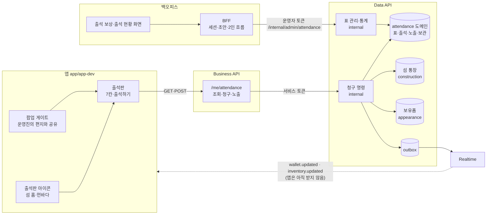
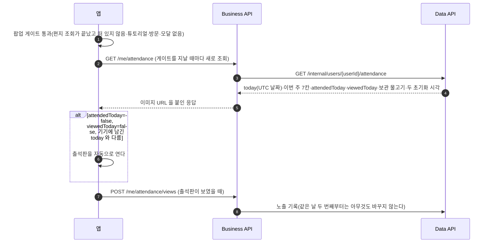
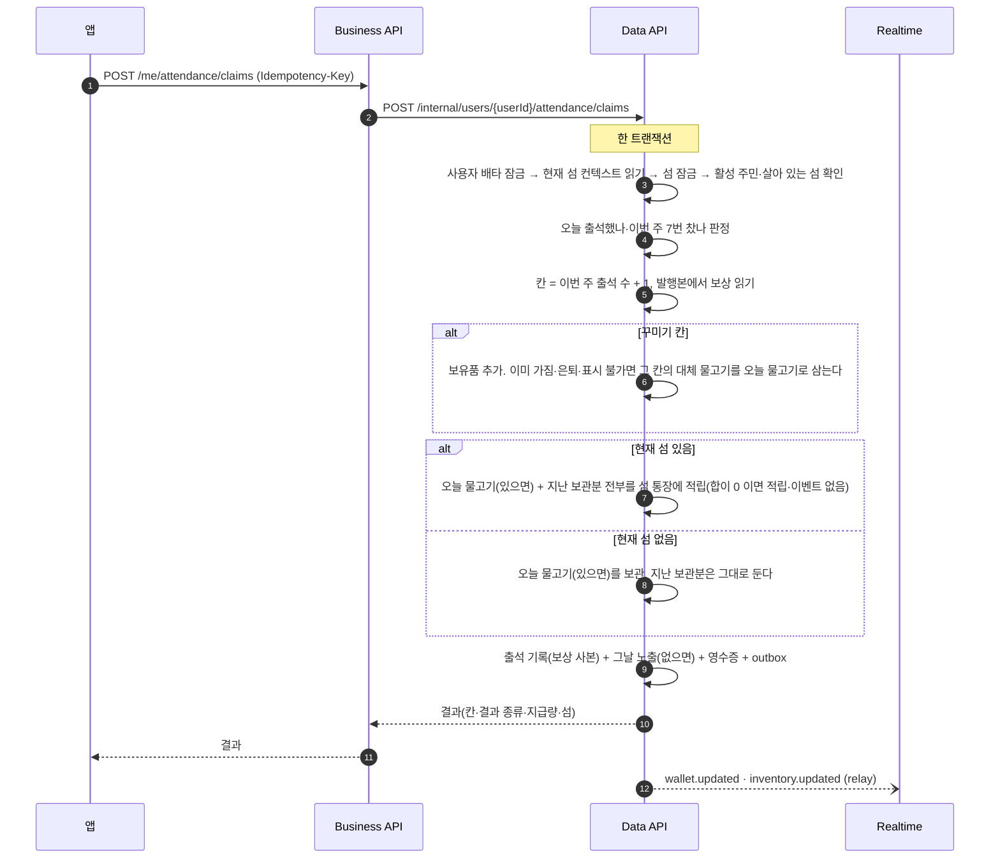
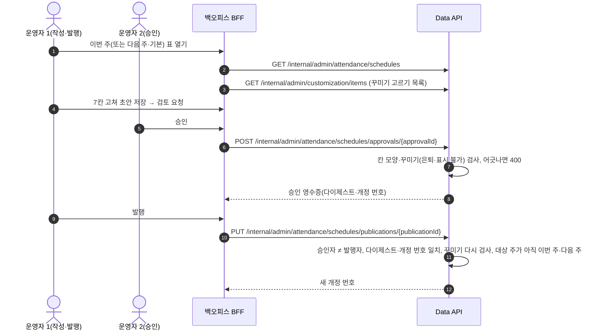

# 출석 보상 High-level Design

상태: 목표 설계, 미적용. 작성일: 2026-11-12. GROMO-2857. 규칙의 정본은 [정책](policy.md)이다.

## 현재 구조와 변경 경계

지금 쓰는 경로를 그대로 탄다.

- 앱은 Business API 만 부른다. Business API 는 도메인 DB 가 없고 Data API `/internal/users/{userId}/**` 를 서비스 토큰으로 부른다.
- 백오피스 BFF 는 Business API 를 거치지 않는다. 운영자별 토큰으로 Data API `/internal/admin/**` 를 부른다. 운영자 로그인과 각 Data 호출 직전에 Data 가 광고하는 capability 목록을 `backoffice/server/contract.json` 과 대조하고(`upstream.mjs` `verifyEnvironment`), 하나라도 없으면 503 으로 거절한다.
- 섬 통장과 보유품이 바뀌면 Data 가 같은 트랜잭션에서 outbox 에 `wallet.updated`·`inventory.updated` 를 적고, relay 가 Realtime 까지 전한다. 지금 앱은 이 두 사건을 받지 않는다.

이번에 새로 생기는 것과 바뀌지 않는 것은 아래와 같다.

| 구분 | 내용 |
| --- | --- |
| 새로 생김 | Data 도메인 `attendance`(표·출석·노출·보관 저장), Data `internal` 의 청구·관리·통계 조합, Business `/me/attendance` 계열 3개, 백오피스 「출석 보상」·「출석 현황」 화면, 앱 출석판·아이콘 |
| 한 줄만 바뀜 | 섬 통장 원장 사유에 출석(`ATTENDANCE`) 추가, 탈퇴 경로에 출석 기록·노출 기록·보관 물고기 삭제 추가, Data 의 운영자 경로 접두사·allowlist·capability 광고 추가, 백오피스 `contract.json` 의 필수 capability 추가 |
| 바뀌지 않음 | 꾸미기 카탈로그와 이미지 경로, 개인 지갑 없음(재화 단일), Redis, Kafka 토픽, 알림 서비스 |

## 컴포넌트 구조

## 책임과 인터페이스

| 모듈 | 소유 책임 | 금지 |
| --- | --- | --- |
| 앱 출석판 | 서버 응답(`attendedToday`·`viewedToday`·`today`)으로 자동 열림 판정, 자동으로 연 날의 `today` 기기 저장, 노출 기록 호출과 실패 시 `today` 가 같을 때만 재전송, 「출석하기」 요청, 결과 문구 표시, 서버 미지원(404)이면 입구 숨김 | 출석 여부·칸 번호를 스스로 계산해 도장 찍기, 응답 전에 보상 표시, 기기 날짜를 서버에 보내기 |
| Business API | 앱 토큰 검증, `Idempotency-Key` 전달, 꾸미기 이미지 상대 경로에 정적 주소 붙이기, 공개 오류 봉투 | 상태 저장, 출석 판정, 보상 계산 |
| Data `attendance` 도메인 | 표 개정·칸·출석·노출·보관 테이블과 리포지토리, 순수 규칙(주 시작일, 칸 번호, 표 해석) | 다른 도메인 서비스 호출, 섬 통장·보유품 직접 쓰기 |
| Data 청구 명령 | 잠금, 하루 1회·주 7회 판정, 물고기 지급·보관·보관분 지급, 꾸미기 지급·대체, 보상 사본 저장, 이벤트 적재를 한 트랜잭션에서 | 개인 지갑 적립, 앱이 보낸 날짜 사용, 트랜잭션 안의 외부 호출 |
| Data 표 관리·통계 | 이번 주·다음 주·기본 표 조회, 승인·발행(승인자 ≠ 발행자), 참여 현황 SQL | 지난 주 표 고치기, 이미 받은 칸 소급, 운영자 이름 외 개인정보 응답 |
| 백오피스 BFF | 운영자 로그인·CSRF, 초안 저장(SQLite), 2인 흐름 상태, Data 호출 | DB 직접 접속, 승인 없이 발행 |
| 백오피스 화면 | 7칸 편집기(카탈로그에서 꾸미기 고르기), 승인·발행 버튼, 발행 이력, 참여 현황 표 | 이미지 업로드 |

## 데이터 흐름

### 출석판 열기와 노출 기록

출석판을 아이콘으로 열 때도 같은 조회와 노출 기록을 한다. 노출은 보상과 무관하다. 참여율의 분모이자 자동 열림 판정에 쓴다(정책 AT15). 노출 기록이 성공했다면 같은 계정은 기기 두 대·재설치에도 하루 한 번만 자동으로 열린다.

노출 기록은 최선 노력이다. 실패해도 같은 기기에서 다시 열리지 않도록 두 가지를 한다.

- 앱은 자동으로 연 날을 기기에 기억한다. 날짜는 앱이 계산하지 않고 조회 응답의 `today` 를 그대로 저장한다. 다음 조회의 `today` 가 같으면 다시 자동으로 열지 않는다.
- 노출 기록이 실패하면 실패한 날의 `today` 를 기기에 남기고, 다음 앞으로 띄우기(foreground) 때 먼저 조회한다. 조회 응답의 `today` 가 남긴 값과 같을 때만 한 번 더 보내고, 다르면 버린다. 서버는 노출을 도착 시각의 UTC 날짜로 기록하므로, 자정을 넘겨 보내면 보지 않은 날의 노출이 되어 그날 자동 열림을 막고 분모를 부풀린다. 같은 날에는 두 번째부터 아무것도 바꾸지 않으므로 다시 보내도 안전하다.

다른 기기에서는 서버 기록이 없을 때 한 번 더 열릴 수 있다. 이 경우는 받아들인다.

### 출석 청구

- 보관분은 칸 종류와 상관없이 현재 섬이 있는 다음 출석 때 나온다. 꾸미기를 받은 날에도 보관분은 섬 통장에 들어간다(정책 AT08).
- 대체 조건(이미 가짐·`retired_at`·`displayable=false`)은 서버 카탈로그 값으로 판정한다. 사유가 겹치면 「줄 수 없음」을 「이미 가짐」보다 먼저 본다(정책 AT09).
- 섬 통장 원장 행은 적립이 있을 때만 하나 생긴다. 적립 0 이면 원장 행도 이벤트도 없다(정책 AT12).
- 강퇴·나가기·탈퇴·섬 이동은 모두 사용자 행을 먼저 잠그므로(나가기·강퇴는 공유, 탈퇴·이동은 배타) 청구와 섞이지 않는다. 청구 전에 끝났거나 청구 뒤에 시작한다. 현재 섬 컨텍스트를 바꾸는 쓰기도 사용자 행을 먼저 잡으므로 청구는 컨텍스트를 사용자 잠금 아래에서 읽으면 된다.
- 섬 잠금 뒤의 확인은 사용자 행을 잡지 않는 섬 종료 경로에 대한 방어다. 현재 섬이 아니게 됐으면 「현재 섬 없음」 분기로 간다. 청구는 실패하지 않고 보관으로 끝난다. 그런 경로가 실제로 있는지는 LLD 에서 대조한다.
- 탈퇴가 먼저 끝났으면 사용자 조회에서 걸러져 청구가 거절된다. 탈퇴한 계정에 출석 기록이 새로 생기지 않는다.
- 적용 개정은 그 주의 최신 발행 주간 표, 없으면 최신 발행 기본 표다. 미리 발행한 다음 주 표는 그 주가 되면 그대로 쓰인다(정책 AT05·AT11).
- 청구가 성공하면 그날 노출 기록이 없을 때 함께 넣는다. 그래서 출석자는 늘 노출자에 들어간다(정책 AT15).
- 섬 통장 적립량이 0 이면 `wallet.updated` 를 적지 않는다. 꾸미기를 받으면 `inventory.updated` 를 적는다.
- 앱은 청구 응답으로 결과와 섬 통장 잔액을 그리고, 꾸미기를 받았으면 보유품을 다시 읽는다. 지금 앱은 `wallet.updated`·`inventory.updated` 를 받지 않으므로 응답이 앱의 즉시 갱신 경로이고, 두 사건은 앞으로의 소비자를 위한 것이다.
- 같은 요청 키로 다시 보내면 처음 결과를 그대로 돌려준다. 이벤트는 다시 적지 않는다.
- 같은 날 다른 요청 키로 다시 보내면 409 다. 앱은 출석판을 새로 읽어 「오늘 출석 완료」를 보여 준다.

### 백오피스 표 작성·승인·발행

정책이 정하는 것은 「승인자 ≠ 발행자」 하나다. 그림은 작성자가 발행까지 하는 예이고, 작성자가 승인하고 다른 운영자가 발행해도 된다. 꾸미기 추첨 풀과 같은 흐름이다(정책 AT13). 발행하면 그 뒤의 출석부터 새 표를 쓴다(정책 AT12).

### 참여 현황 조회

운영자가 기간을 고르면 BFF 가 `GET /internal/admin/attendance/stats` 를 부른다. Data 가 읽기 전용 트랜잭션에서 노출·출석·보관 테이블을 집계해 일별·주별·지급 합계를 돌려준다. 날짜는 UTC 이고 화면에 「UTC 기준(한국 오전 9시 시작)」을 적는다(정책 AT18). 백오피스는 숫자를 표로 보여 줄 뿐 다시 계산하지 않는다.

## 대상 계정

탈퇴하지 않은 모든 계정이 대상이고 게스트도 포함한다(정책 AT14). 게스트가 소셜 계정으로 올라가도 같은 사용자 행이라 출석 기록이 이어진다.

## 날짜와 주 경계

- 하루는 서버 시각의 UTC 날짜, 주는 UTC 일요일 00:00Z 부터다(정책 AT02·AT03). 랭킹 주와 같은 계산기를 쓴다.
- 한국 사용자에게는 매일 오전 9시에 하루가, 매주 일요일 오전 9시에 주가 바뀐다. 출석판은 다음 출석 가능 시각과 새 주 시작 시각을 둘 다 보여 준다. 두 시각은 서버가 응답에 담는다.
- 앱은 「오늘」을 스스로 계산하지 않는다. 자동 열림도 서버의 `attendedToday`·`viewedToday` 로 판정한다. 기기 날짜(KST)를 쓰면 오전 0~9시 사이에 서버와 하루가 어긋난다.

## 실패와 복구

| 상황 | 동작 |
| --- | --- |
| 청구 응답을 못 받음(네트워크) | 앱이 같은 요청 키로 다시 보낸다. 서버는 날짜 검사보다 먼저 처음 결과를 돌려준다. UTC 자정을 넘긴 재시도도 같다(정책 AT04) |
| 두 기기가 다른 요청 키로 동시에 청구 | 사용자 잠금에서 차례로 처리된다. 하나만 성공하고 나머지는 409 |
| 청구 중 강퇴·나가기 | 사용자 행에서 차례로 처리되어 섞이지 않는다. 강퇴가 먼저면 청구는 현재 섬 없음(보관)으로 끝난다 |
| 사용자 행을 잡지 않는 섬 종료 | 섬 잠금 뒤 확인에서 현재 섬이 아니면 보관으로 끝난다 |
| 계정 탈퇴와 청구가 겹침 | 탈퇴도 사용자 행을 먼저 배타 잠금한다. 둘은 차례로 처리된다. 탈퇴가 먼저면 청구는 거절되고, 탈퇴가 뒤면 방금 만든 출석·노출·보관 기록도 지운다(정책 AT16) |
| 발행과 청구가 겹침 | 청구는 커밋된 개정 하나를 온전히 읽고 그 개정 번호를 출석 기록에 남긴다. 발행은 끝난 청구를 바꾸지 않는다(정책 AT12) |
| 오늘 이미 출석 | 409. 앱은 출석판을 다시 읽는다 |
| 이번 주 7칸을 다 받음 | 하루 1회라 정상 흐름에서는 생기지 않는 방어다. 409 면 출석판은 「이번 주 출석 완료」와 다음 주 시작 시각을 보여 준다 |
| 발행된 표가 하나도 없음 | 503. 기본 표를 마이그레이션이 시드하므로 운영에서는 생기지 않는다 |
| 서버가 출석 API 를 모름(앱이 먼저 나감) | 404. 앱은 출석판과 아이콘을 숨긴다 |
| 승인 뒤 표를 고침 | 승인이 철회된다. 다시 승인받는다. 발행 때 다이제스트가 다르면 409(경합 방어) |
| 승인 요청의 꾸미기가 은퇴했거나 표시 불가 | 승인 400(정책 AT10) |
| 승인과 발행 사이에 꾸미기가 은퇴 | 발행 때 다시 검사해 400. 새 초안을 만든다(정책 AT10) |
| 승인·발행 응답 유실 | 그 단계를 처음 시작한 운영자가 같은 ID 로 다시 시도한다. 다른 운영자가 이어받는 기능은 없고, 처음 운영자의 자격을 복구할 수 없으면 그 표를 보류한다. 보류 중 대상 주가 지나면 버린다(정책 AT13) |
| 승인 뒤 주가 바뀌어 대상 주가 지난 주 | 발행 409(정책 AT11) |
| 백오피스가 새 capability 를 못 찾음 | 운영자 로그인과 Data 호출이 503 으로 거절돼 콘솔 전체를 못 쓴다. 그래서 Data 를 먼저 배포한다 |
| outbox relay 지연 | 지급은 이미 확정됐다. 앱은 응답으로 결과·잔액을 그렸으므로 영향이 없다 |

## 배포 순서

1. **Data API(V16 마이그레이션)와 Business API.** main 머지 뒤 dev V2 에 자동 반영된다. 배포 중 새 Business 가 아직 옛 Data 를 부르는 순간이 있다. 옛 Data 의 출석 경로 404 가 Business 를 지나 앱에 404 로 가야 앱이 입구를 숨긴다. 502 로 바뀌면 오류가 보이므로 LLD 에서 이 전달을 확인한다. 운영은 재영님 요청으로 `prod-cd-V2` 를 돌린다. 마이그레이션은 새 테이블 생성과 기본 표 시드만 해서 기존 기능과 호환된다.
2. **백오피스.** 운영 Data 가 `attendance.schedule.v1`·`attendance.stats.v1` 을 광고하는지 확인한 뒤 머지한다. 이 두 값을 `backoffice/server/contract.json` 에 넣으면, 백오피스는 운영자 로그인과 Data 호출마다 그 값을 확인해 없으면 503 으로 거절한다. 백오피스 머지는 곧 운영 배포다.
3. **표 확인.** 운영자가 기본 표 값을 확인하고(정책 ATQ01) 필요하면 첫 주 표를 발행한다. 이 단계를 건너뛰고 앱이 나가면 아직 「제안」인 기본 표(주 120마리)가 그대로 지급된다. 그래서 앱 출시 전에 둔다.
4. **앱.** `.github/scripts/app-server-gate.py` 가 1차 방어다. `release` 의 최신 `prod-cd-V2` 실행이 성공했는지 보고, 운영에 배포된 커밋과 앱 출시 커밋의 서버 실행 코드(`server/*/src/main/`)가 다르면 막는다. 조회가 실패해도 막는다(fail closed). 게이트를 지나 앱이 서버보다 먼저 나간 경우의 2차 방어가 「출석 API 404 면 입구 숨김」이다. 서버 배포 뒤에도 이미 깔린 구버전 앱에는 입구가 없을 뿐 다른 영향은 없다.

순서를 지키는 이유는 안전이다. 앱이 먼저 나가면 입구가 숨겨져 손해는 없지만, 백오피스가 먼저 나가면 운영자가 로그인하지 못해 운영 콘솔 전체를 못 쓴다.

## 관측

- Data 는 청구 결과 종류별(지급·보관·대체·거절) 건수를 로그 필드로 남긴다. 사용자 식별자 외 개인정보는 남기지 않는다.
- 운영자의 일상 확인은 백오피스 참여 현황이고, 리텐션 목표는 PostHog 로 잰다(PRD 「측정 계획」).

## 단계별 확대

- 출석 알림 푸시(정책 ATQ04): 노출·전환율을 본 뒤 알림 종류를 추가한다.
- 출석판 장식 그림 교체와 이미지 업로드: 범위 밖. 필요해지면 이미지 CDN 경로([이미지 CDN](../image-cdn/README.md))에 맞춰 따로 설계한다.
