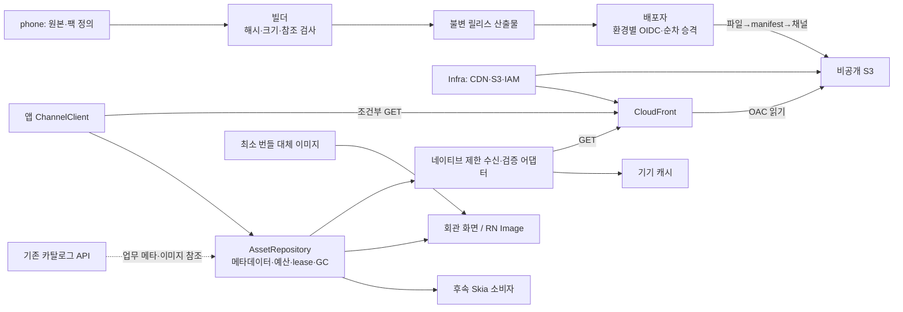
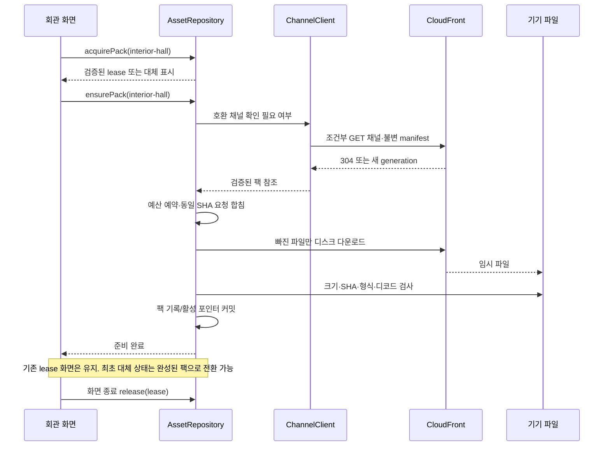

# 이미지 CDN High-level Design

상태: 목표 설계, 미적용. 정책 정본: [policy](policy.md).

## 현재 구조와 변경 경계

앱 `require()` 번들 이미지, 맵 전용 `mapAssets`, 서버 `/static/customization` 이미지/rig의 세 경로가 있다. 맵 캐시는 유지한다. 신규 범용 팩 캐시는 회관 내부부터 도입한다. 꾸미기는 카탈로그 메타 조회를 Business API에 남기고 이미지/rig만 CDN으로 이전한다.

## 컴포넌트 구조

배포 파이프라인은 이미지 바이트 정본을 소유한다. AssetRepository는 기기 캐시 기록만 소유한다. CDN은 공개 정적 자산 경로로 기존 앱→Business API 원칙의 제한된 예외이며, 이 변경은 아키텍처 결정 장부에 제안으로 등록한다. DB 마이그레이션·Redis 저장소·서버 이미지 프록시는 추가하지 않는다.

## 책임과 인터페이스

| 모듈 | 소유 책임 | 금지 |
| --- | --- | --- |
| Asset builder/publisher | 팩 정의→manifest, 파일 공개, 채널 CAS, 롤백 | 공개된 해시 파일 덮어쓰기 |
| ChannelClient | HTTPS·호환성·ETag·6시간/백오프·generation 검증 | 화면 상태/로그인 세션 소유 |
| AssetRepository | ensure/acquire/release, 직렬 메타 갱신, 전역 예산, GC, 부팅 복구 | 지도 통행 JSON을 일반 팩으로 분리 |
| Download/FS/Verifier | 네이티브 디스크 수신·SHA·이미지 검증·검증 가능한 불변 snapshot 어댑터 | 이미지 전체 arrayBuffer를 JS에 적재 |
| 화면 Hook | lease 획득/해제, 대체 표시, 첫 수신 완료 표시 | URL 생성·GC 직접 실행 |
| CloudFront/S3 | 공개 콘텐츠 전달·원본 접근 제어 | 카탈로그 사용자 권한 판단 |

## 다운로드와 표시 데이터 흐름

최신 채널을 못 읽어도 호환되는 저장된 manifest와 정상 팩을 사용할 수 있다. 304를 받았는데 로컬 manifest가 없으면 ETag 없이 한 번 재요청한다. 앱에 없는 팩을 전체 콘텐츠 선다운로드로 해결하지 않는다.

## 배포·롤백 흐름

불변 객체 업로드 → 불변 manifest 업로드 → CDN 실제 GET/해시/헤더 검증 → S3 채널 ETag 조건부 PUT → 성공 기록. 한 채널의 승격은 CI concurrency로 직렬화하고 S3 CAS로 추가 방어한다. 실패한 승격은 최신 포인터를 다시 읽어 임의 덮어쓰기하지 않는다. 롤백도 새 generation으로 기존 릴리스를 참조한다.

CDN min/default/max TTL은 이미지와 채널을 분리한다. 이미지 요청에 토큰/쿠키/query를 전달하지 않는다. HTTPS/OAC, 역할별 쓰기 범위, 오류 TTL과 GET 검증은 [공식 근거](../../../architecture/image-cdn/sources.md)를 따른다.

## 단계별 확대

1. 합성 파일/회관 한 팩을 개발 CDN에서 읽는 배포 경로.
2. 회관 실제 화면에 기기 캐시와 최소 대체 이미지 적용. 원본 require 참조 제거 증명.
3. 재시작/수명/공간 부족/동시 화면·GC·롤백 시나리오 검증.
4. 기존 꾸미기 이미지·rig를 경로 보존으로 CDN 이전하고 팩 캐시를 연결.
5. 측정 결과를 보고 배경/아틀라스 범위를 확대. 맵의 통행/레이아웃 버전은 원래 계약으로 유지.

관측은 팩 식별자·bytes·소요시간·실패 종류·캐시 상태 단위이며 사용자 식별자가 필요하지 않다. 앱/서버 업무 경로가 없는 구성에서도 공개 이미지 전달이 동작해야 한다.

네이티브 bounded download/SHA 모듈은 Android/iOS 바이너리에 함께 배포한다. metadata는 세대별 불변 snapshot을 검증해 선택하며 기존 파일 overwrite를 원자적이라고 가정하지 않는다. lease/직전 정상 snapshot이 참조하는 객체는 GC에서 보호한다. 상세 복구 프로토콜은 LLD §5~7을 따른다.
