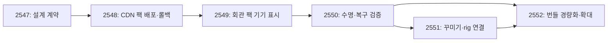

# 구현 티켓·순서·검증 계획

상위 PRD: [GROMO-2546](https://romance.atlassian.net/browse/GROMO-2546). 생성자/담당자: 조재영. Jira 연결 계정 대신 신원이 확인된 로컬 인증으로 생성했다. 티켓 생성은 구현 완료를 뜻하지 않는다.

## 작업 분해

| 티켓 | 산출 행동 | 선행 | 배치 | 현재 상태 |
| --- | --- | --- | --- | --- |
| [GROMO-2547](https://romance.atlassian.net/browse/GROMO-2547) | 이미지 CDN과 기기 캐시의 PRD·HLD·LLD 및 구현 계약을 확정한다 | 없음 | Sprint 17 | 문서 작성·독립 검토 완료, PR 준비 |
| [GROMO-2548](https://romance.atlassian.net/browse/GROMO-2548) | 이미지 한 팩을 전용 CDN에 배포하고 채널 승격·롤백을 검증한다 | GROMO-2547 | Sprint 17 | 미착수 |
| [GROMO-2549](https://romance.atlassian.net/browse/GROMO-2549) | 회관 이미지 한 팩을 기기 캐시로 표시하고 반복 다운로드를 없앤다 | GROMO-2548 | 백로그 | 미착수 |
| [GROMO-2550](https://romance.atlassian.net/browse/GROMO-2550) | 이미지 캐시의 7일·30일 정리와 강제 종료·공간 부족 복구를 보장한다 | GROMO-2549 | 백로그 | 미착수 |
| [GROMO-2551](https://romance.atlassian.net/browse/GROMO-2551) | 꾸미기 이미지와 rig를 CDN으로 옮기고 기기 캐시에서 함께 재사용한다 | GROMO-2550 | 백로그 | 미착수 |
| [GROMO-2552](https://romance.atlassian.net/browse/GROMO-2552) | 검증된 이미지 팩의 번들 참조를 제거하고 배경·아틀라스 확대 기준을 검증한다 | GROMO-2550, GROMO-2551 | 백로그 | 미착수 |

2548은 합성/회관 팩을 CDN에서 검증할 수 있는 전체 경로, 2549는 실제 사용자의 회관 화면 경로, 2550은 같은 경로의 장기 사용/장애 복구, 2551은 기존 꾸미기 사용자 경로다. 앱·서버·인프라 파일 충돌이 생기면 티켓 순서를 유지하며 PR은 저장소별로 분리한다. 2552는 시범 검증 결과에 따라 확대 팩 목록을 확정한다.

## 구현 선택과 적용 순서

1. 스키마·policy·테스트 fixture를 고정하고 2547의 설계 검토를 종료한다.
2. 2548의 Terraform plan, OIDC 범위, 실제 AWS 계정/도메인 설정을 구체적으로 준비한 뒤 적용한다. 운영 설정을 추측하여 만들지 않는다. 공개 배포 전 변경 diff·비용 영향·검증/롤백 절차를 확인한다.
3. 2549에서 native 제한 수신/스트리밍 SHA 모듈과 회관 소비 경로를 함께 구현한다. Android/iOS 새 바이너리 및 native capability gate가 필요하다. Expo Go나 구 바이너리 OTA만으로 지원하지 않는다.
4. CDN 파일→manifest→채널이 먼저 준비되어야 앱 feature flag를 켤 수 있다. 2550 검증 전 전체 사용자 확대를 하지 않는다.
5. 꾸미기 CDN 이전은 원래 `/static/customization/**` URL 모양을 유지한다. nginx 보수 2455, 에셋 정리 2538, OTA 검증 2393은 중복 구현하지 않고 관련 결과를 참조한다.
6. 원본 제거/최소 fallback은 2552에서 검증 후 적용한다. 원본 없는 바이너리에서 플래그 off가 원본을 되살린다고 설명하지 않는다.

## 테스트 경계 및 증거

| 검증 | 방법 | 통과 기준 |
| --- | --- | --- |
| 기존 맵 동작 | 현재 mapAssets Jest suite | 20 tests 통과, 맵 로더 직접 변경 없음 |
| 계약/시간/GC | 주입 가능한 네트워크·FS·시계·native adapter | policy의 6h/7d/30d·상한·lease·동시성·롤백 결과 단언 |
| 네이티브 수신 | Android/iOS oversized·chunked 응답 및 JS stall | native 쓰기 전 상한, native deadline/취소, 해시 검증. 예약 해제 이후 쓰기 없음 |
| 강제 종료 | 객체 쓰기/metadata snapshot 단계별 종료 | 새/직전 정상 snapshot만 채택, 부분 팩 표시 0건 |
| CDN | dev CDN 실제 GET/헤더/해시/CAS 경쟁 | S3 직접 거부·CDN 200, 실패 시 포인터 불변 |
| 앱 경량화 | 같은 빌드 조건의 Expo/AAB/iOS 비교 | 제거한 원본이 산출물 참조에서 제외되고 bytes 차이 기록 |

현재 완료한 검증은 사전 코드/공식 문서 조사, 맵 캐시 20 tests, 자산 690개 집계 및 설계 독립 검토다. 새 CDN/네이티브 런타임/기기 성능 검증은 아직 실행하지 않았다. [검토 기록](review-log.md)에 설계 수정 근거를 남긴다.

## 완료 처리

문서 PR 머지와 실제 기능 배포를 구분한다. 구현 티켓은 각 수용 조건의 코드/CI/기기 증거가 있어야 완료 처리한다. 상위 에픽은 시범→정책/복구→꾸미기→합의된 확대 범위의 검증까지 끝나야 닫는다. 이번 설계 작성만으로 구현 티켓/에픽을 닫지 않는다.
