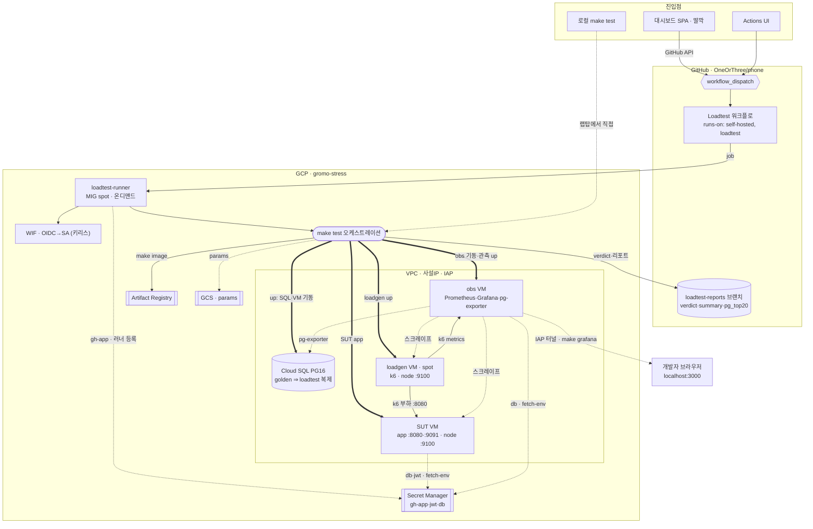
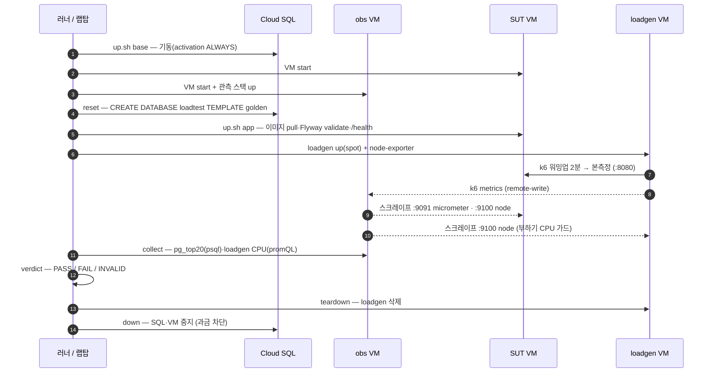

# loadtest — gromo 부하테스트 하네스 (GROMO-548)

버튼 하나(딸깍)로 부하테스트를 실행·판정·비교하는 하네스. 상세 기획은 **[docs/prd.md](docs/prd.md)**,
아키텍처 원천은 `knowledge/topics/부하테스트-아키텍처.md` v2.

## 현재 서버 기준 실행 경로

전체 앱·채팅·이동 부하와 로컬 Grafana 실행은 현재 서버 부하 조사 하네스를 사용합니다.
`make local-up`으로 최신 소스의 격리 스택을 기동하고 `make survey`로 100→1,000→10,000명 규모별 조사를 실행합니다.
**`loadtest/survey/`(조사 스크립트·결과·실험일지)는 gitignored 로컬 자료**라 저장소에 없습니다 — `make survey`·`survey-report` 는 그 폴더가 없으면 안내만 하고 멈춥니다. 핵심 측정값과 조건은 Jira 에픽(2335)과 하위 티켓 본문에 있습니다.
Outbox·Kafka 전송·Realtime 공유는 이 기동 경로에서 기본 활성화됩니다. `make local-down`은 조사 컨테이너만 내리고 데이터를 보존합니다.

실제 실행 결과(로컬 전용, 저장소에 없음): `survey/results/2026-10-18/README.md`,
`survey/results/2026-10-18/experiment-journal.md`. API·실시간·혼합 부하와 후보 인덱스의 성공/실패·원복 기록을 포함합니다.


- `make test`: GCP의 **Data API 단독** 성능 실험입니다. `/api/v1` 잔존 계약을 사용하며 전체 앱 경로 측정과 구분합니다.
- `make test-existing`: 이미 구성된 **현재 공개 API → Business → Data** 조회 부하입니다. DB 초기화나 서버 기동을 하지 않습니다.
  Notification·Realtime·Redis·Kafka의 자원 사용량은 전체 컴포넌트 대시보드에서 함께 관측합니다.
  이 조회 시나리오 자체가 푸시 발송·WebSocket 메시지·Kafka 이벤트 부하를 생성하지는 않습니다.

```bash
cd loadtest
make check # Docker 임시 PostgreSQL에서 최신 전체 마이그레이션·축소 시드·JWT 검증
make test-existing BASE_URL=http://localhost:8088 PARAMS_DIR=/absolute/path/to/params PROFILE=smoke RATE=5 DURATION=1m
```

`test-existing`의 params는 **대상 DB에 존재하는 전용 부하 계정과 활성 세션**이어야 합니다.
`users_uniform.json`에 `{userId, token}` 배열을 넣습니다. 최신 golden 시드의 토큰을 사용하려면 대상 스택의
Data가 해당 DB 복제본을 사용하고 Business·Data의 JWT 키가 시드 발급 키와 같아야 합니다.
`seed-v2`는 `guest`, `sid`, `gen` 클레임과 `auth_sessions`를 함께 준비합니다. 예전 `seed-v1`은 재시드가 필요합니다.

시드 날짜는 기본 UTC 오늘이며 `SEED_DATE=YYYY-MM-DD`로 고정할 수 있습니다. 날짜가 오래된 시드를 사용하면
최근 기간 조회가 빈 데이터를 측정하므로 재시드하세요. 동일 버전의 시드를 다시 만들었으면 기존 baseline과 비교하지 말고
새 `SEED_VERSION`을 지정합니다. 리그 마스터·봇은 최신 Flyway 데이터를 보존하고 부하 계정과 분리합니다.

## 공개 API 커버리지·쓰기 시나리오 (GROMO-2346)

`make coverage`가 공개 OpenAPI(`k6/cases/openapi-public.json`, Business `/v0/api-docs/public` 스냅샷) 전 operation을
`k6/cases/public.json`(조회)·`k6/cases/write.json`(쓰기)과 대조해 `docs/public-api-coverage.csv`를 갱신한다.
스냅샷 갱신은 `scripts/coverage.py --refresh <url>`, CSV가 최신인지만 볼 때는 `make coverage-check`.
구 `/api/v1` 표면 11건이 스펙(`/v0/api-docs/public`)에 노출되어 분모 128에 포함된다(있음 1 · 없음 3 · 제외 7 — 제외는 전부 외부 의존). 따라서 「있음 68」은 신규 쓰기 시나리오 10 + 기존 조회·집중 58이다.
상태는 **있음**(시나리오가 호출) · **제외**(소셜 IdP·FCM/APNs·링크 제공자 등 외부 의존) · **없음**(의존성은 없으나 시나리오 미작성).
실측 여부는 보지 않는다 — 실행 결과는 survey 보고서 소관이다.

외부 의존성 없는 쓰기 시나리오 4종. 모두 VU별 전용 slot(`write_fixture.json`: 계정 2 + 섬 3)을 쓰고, 한 회차가 끝나면 상태를 되돌린다.
**실행·수치는 전용 호스트 뒤**(저장소 안에서는 구문·카탈로그 검증까지만 했다).

| 시나리오 | 요청 순서 | 되돌림 | 되돌릴 수 없는 잔여물 |
|---|---|---|---|
| `island_switch` | `PUT /me/current-island`(hub) → `POST /islands/{내 섬}/arrivals` | 항상 원래 섬 복귀(실패 시 `PUT` 복원) | 없음 |
| `join_approval` | 가입 신청 → 섬장 `GET join-requests` → 섬장 `PATCH … approve` → 신청자 `DELETE memberships/me` | 나가기 / 승인 전 실패는 `DELETE /me/join-requests/{id}` | join_requests 행·승인 안내 시스템 편지 회차당 1건 |
| `letter_exchange` | `POST /letters`(actor→partner) → 수신자 `GET /letters` → `GET /letters/{id}` → `DELETE /letters/{id}` | 수신자가 닫기 | 발송 한도 카운터(loadtest 프로파일 필요 — 기본 한도는 429) |
| `telescope_pin` | `POST /me/telescope/pins`(observatory) → `GET /me/telescope` → `DELETE /me/telescope/pins/{id}` | unpin | 없음 |

```bash
# 로컬 격리 스택(make local-up)에 slot fixture를 만든 뒤 (localhost만 허용; SLOTS ≥ MAX_VUS, 기본 50)
make write-fixture SLOTS=50
make test-existing BASE_URL=http://localhost:18088 PARAMS_DIR=$PWD/.local/params PROFILE=smoke RATE=2 DURATION=1m K6_SCRIPT=k6/scenarios/island_switch.js
```

`join_approval`은 Data의 `ISLAND_MANAGEMENT_COMMANDS_ENABLED=true`가 필요하다(기본 false — 운영 기본에선 승인·나가기가 503 `ISLAND_MANAGEMENT_NOT_READY`). 로컬 compose(`infra/local/compose.yml`)는 켜 두었다.

정리 호출(나가기·신청 취소)과 `join_approval`의 첫 신청은 예상 4xx(404·409)를 `http_req_failed`에서 제외한다.

**쓰기 시나리오는 한 번에 하나만 실행한다** — 같은 slot을 공유해 `join_approval`이 남기는 시스템 편지가 `letter_exchange`의 `GET /letters` 응답 시간을 오염시킨다.

fixture 전제: ① actor·partner를 회원으로 전환하고 친구로 맺고 섬의 전망대를 완공(`seed/60_write_fixture.sql`, `make check`가 최신 스키마에서 검증) ② actor는 소속 2곳(상한 3 이하)
③ 토큰 만료 전에 실행(만료되면 `write-fixture` 재실행). 쓰기 시나리오는 `k6/cases/public.json`이 아닌 `k6/cases/write.json`에 두었다 — 조사 러너(`survey/run.py --cases all`)가 slot fixture 없이 집어 들지 않게 한다.
대시보드 카탈로그(`scenarios.json`·`recipes-manifest.json`)는 `/api/v1` 레시피 러너용 생성 산출물이라 등록하지 않았다(공개 경로·다중 계정 흐름을 그 러너가 실행하지 못한다).

API 카탈로그 갱신은 대상 Data의 `/v0/api-docs/legacy`를 `dashboard/public/openapi.json`에 저장한 다음
`node recipes/gen-recipes.mjs && node scenarios/gen-scenarios.mjs`로 수행합니다.
스키마만 보고 성공 요청을 만들 수 없는 엔드포인트는 실행 불가로 표시합니다. 신규 API는 시드·상태 전이 검증 후
생성기의 지원 목록에 추가합니다. 기본 제공 공개 조회 시나리오는 `k6/scenarios/business_reads.js`입니다.

관측: [전체 컴포넌트 대시보드 안내](../server/observability/README.md#전체-컴포넌트-부하-대시보드).
DB 커넥션, 스레드, CPU, GC, 컨테이너 리소스와 인프라 병목을 한 시간축에서 비교할 수 있습니다.

## 퀵스타트 (Phase 0 완성 후)

```bash
# 1회: GCP 부트스트랩 + 인프라 + 시드
make bootstrap        # 프로젝트·API·TF 상태·WIF (수동 단계는 infra/bootstrap/README.md)
make infra-up         # terraform apply
make seed             # golden DB (~6,500만 건, 수십 분)

# 딸깍
make test PROFILE=smoke TARGET=scenarios/daily_mix.js   # 로컬 딸깍
make dashboard                                          # 대시보드(트리거·히스토리·판정·diff)
# 또는 GitHub Actions → loadtest.yml → Run workflow
```

## 아키텍처

**딸깍(트리거) → GitHub Actions → GCP** 전체 흐름. 진입점 3개(대시보드·Actions UI·로컬 make)가 같은
`make test` 파이프라인을 실행한다. 원격 2개는 GitHub Actions의 **전용 self-hosted 러너**(온디맨드 spot)를
타고, 러너는 **WIF(키리스)** 로 gromo-stress를 조종한다.

### 전체 구성



### make test 런타임 순서



- **golden 템플릿**: 시드 1회 → `IS_TEMPLATE` 동결, run마다 `TEMPLATE` 복제(reset). 부하는 복제본(loadtest)에만.
- **온디맨드 러너**: 평시 MIG 0대(비용 0), `make runner-up`으로 1대 → 자기 등록(GitHub App creds from Secret Manager). loadgen(spot)도 run마다 생성·삭제.
- **관측**: Prometheus가 SUT(micrometer·node)·loadgen(node)·Cloud SQL(pg-exporter)을 스크레이프하고 k6는 remote-write. Grafana는 인터넷 노출 0, IAP 터널로만 접근.

## 디렉토리

| 경로 | 내용 |
|---|---|
| `docs/` | PRD 등 기획 문서 |
| `infra/bootstrap/` | GCP 1회 부트스트랩 스크립트 |
| `infra/terraform/` | 상시 인프라 (VPC·Cloud SQL·SUT·관측 VM·템플릿) |
| `infra/sut/` `infra/obs/` | SUT·관측 VM docker compose |
| `seed/` | golden DB 시드 파이프라인 (Flyway 스키마 + SQL 데이터 + params/JWT) |
| `k6/` | 부하 스크립트 (lib/profiles/matrix/scenarios) |
| `grafana/` | 부하테스트 전용 대시보드 JSON |
| `scripts/` | run 오케스트레이션 (loadgen·run·collect·verdict) |
| `dashboard/` | 개발자 대시보드 SPA (Vite+React) |
| `reports/baseline/` | 회귀 비교 기준 (사람 승인 PR로만 갱신) |

## 운영 원칙

- **평시 전부 중지** — `make down`이 곧 과금 차단. 부하 VM(spot)은 run마다 생성·삭제.
- run 비교는 **메타(sha·seed·스펙) 동일**할 때만 유효 — 다르면 verdict가 diff를 거부한다.
- 실부하 DB에 `EXPLAIN ANALYZE` 금지 — 심층 분석은 `analysis` 클론에서.

## 외부 대상 혼합 시험의 중단 증거

명시한 대상에서 HTTP와 WebSocket을 함께 측정하고 중단된 단계의 원시 결과를 보존하는 방법은
[혼합 부하의 중단 결과와 종료 진단](docs/mixed-results.md)을 참고한다. 실제 공통 측정 시간이 부족하면 개별 단계가 통과했어도 혼합 시험은 통과하지 않는다.

집중 세션의 응답 유실 진단·소유권 기반 정리·서버 원장 대조는 [집중 실패 원장](docs/aws-focus-failure-ledger.md)을 참고한다.
