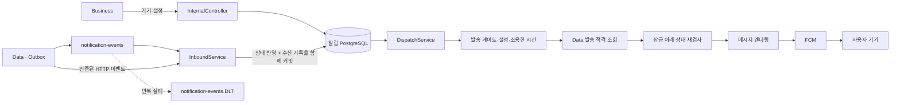

# Notification

> 이벤트를 받아 사용자의 설정과 현재 상태에 맞춰 푸시를 전달하는 알림 서버입니다.

[서버 전체 보기](../README.md) · [내부 API 계약](../../docs/contracts/business-satellite-api.yaml) · [운영 API 계약](../../docs/contracts/notification-admin-api.yaml)

## 1. 역할과 구현 범위

Notification은 기기 토큰, 알림 설정, 수신 이벤트, 예약 발송, 발송 이력과 운영 제어를 소유합니다. Java 17·Spring Boot 4.0.6 기반의 독립 서비스이며 전용 PostgreSQL에 JDBC로 접근하고 Flyway로 스키마를 관리합니다.

앱은 Business를 통해 기기와 설정을 변경합니다. Notification은 앱 JWT를 발급·검증하지 않으며, 호출자별 서비스 토큰과 경로 허용목록으로 내부·운영 API를 보호합니다.

| 기능 | 구현 내용 |
| --- | --- |
| 이벤트 수신 | Kafka·HTTP 공통 처리, `eventId` 중복 제거, 버전 기반 투영 |
| 기기 · 설정 | 세션·세대에 따른 기기 소유권, 수신 동의, 설정 변경 |
| 예약 · 발송 | 조용한 시간, 기한, 현재 발송 적격 검사 |
| 푸시 생성 | ICU 메시지 렌더링, FCM HTTP v1 |
| 운영 | 발송 게이트, 감사 기록, 사용자 상태 재조정 |

## 2. 알림 전달 구조



그림은 주요 처리 단계를 설명합니다. 실제 발송은 스케줄러와 DB 발송 게이트가 모두 허용하는 경우에만 진행합니다. FCM 요청 수락은 사용자가 알림을 읽었다는 뜻이 아닙니다.

### 중복 · 장애 처리

- 같은 `eventId`와 같은 봉투는 이미 수신한 결과로 처리합니다. 같은 ID에 다른 내용이 오면 충돌로 거절합니다.
- 상태 반영과 수신 기록을 같은 DB 트랜잭션으로 묶습니다.
- Kafka 실패 메시지는 원본 파티션의 `.DLT`로 전달합니다. DLT 발행 실패를 성공으로 삼키지 않습니다.
- 발송 전 외부 조회와 DB 잠금 단계를 분리하고, 다시 잠근 뒤 게이트·기기 소유권를 재검사합니다.
- Data 조회는 스냅샷 재조정, 발송 적격 판정의 제한된 용도입니다. 코어 DB를 직접 조회하지 않습니다.

## 3. 코드 탐색

기준 패키지는 [`com.oneorthree.notification`](src/main/java/com/oneorthree/notification)입니다.

| 진입점 · 구성 | 읽을 코드 |
| --- | --- |
| 내부 인증과 API | `ServiceAuth`, `InternalController` |
| 이벤트 수신 | `KafkaInbound`, `InboundService`, `Envelope` |
| 기기·설정 | `DeviceService`, `SettingsService` |
| 발송 | `DispatchScheduler`, `DispatchService`, `QuietHours` |
| 메시지·전송 | `Renderer`, `FcmPayload`, `FcmTransport` |
| 운영 | `AdminController`, `AdminService`, `DispatchControlService`, `SnapshotReconciler` |
| DB | `Store`, [Flyway 마이그레이션](src/main/resources/db/migration) |

## 4. 실행과 설정

### 먼저 통합 테스트 실행

Java 17과 Docker를 준비한 뒤 서비스 폴더에서 실행합니다. PostgreSQL·Kafka 통합 테스트는 Testcontainers를 사용합니다.

```bash
cd server/notification
./gradlew test
./gradlew checkstyleMain spotbugsMain
```

### 개발 서버 실행

전용 DB를 만들고 아래 환경변수를 주입한 상태에서 실행합니다. 전체 키와 기본값은 [`application-dev.yml`](src/main/resources/application-dev.yml)이 기준입니다.

| 설정 | 용도 |
| --- | --- |
| `NOTI_DB_URL`, `NOTI_DB_USERNAME`, `NOTI_DB_PASSWORD` | 알림 DB 접속 |
| `KAFKA_BOOTSTRAP_SERVERS` | 브로커 주소 |
| `SVC_TOKEN_BIZ_TO_NOTI`, `SVC_TOKEN_DATA_TO_NOTI`, `SVC_TOKEN_CONSOLE_TO_NOTI` | 호출자별 수신 자격 |
| `DATA_API_BASE_URL`, `SVC_TOKEN_NOTI_TO_DATA` | Data 조회 |
| `FCM_PROJECT_ID`, `FCM_SERVICE_ACCOUNT_JSON` | 실제 FCM 발송 자격 |

```bash
# server/notification 기준, 위 환경변수 주입 후
./gradlew bootRun --args='--spring.profiles.active=dev'
```

기본 서비스 포트는 `8082`, 상태 확인은 `/health`, 관리 포트는 내부 `9091`입니다. 배포용 설정·DB 준비는 [Scripts](../scripts/README.md)를 참고합니다.

### 수신 · 발송 활성화 상태

[`application.yml`](src/main/resources/application.yml)의 기본값은 다음과 같습니다.

| 설정 | 기본값 | 의미 |
| --- | --- | --- |
| `NOTIFICATION_KAFKA_ENABLED` | `false` | Kafka 소비자 활성화 여부 |
| `NOTIFICATION_SCHEDULING_ENABLED` | `false` | 예약 작업 활성화 여부 |
| `NOTIFICATION_GENERATION_REQUIRED` | `false` | 세대 정보 필수 여부 |
| `NOTIFICATION_LEGACY_DEVICE_REGISTRATION` | `true` | 기존 기기 등록 호환 |

서비스가 실행됐다는 이유만으로 발송이 시작되지는 않습니다. DB의 발송 게이트와 예약 잡 활성화를 [운영 API 계약](../../docs/contracts/notification-admin-api.yaml)에 따라 설정합니다. dev는 상시 열어 둡니다([dev 발송 게이트](#dev-발송-게이트)).

## 현재 알림과 운영 경로

지원하는 알림은 `FRIEND_REQUEST`, `FRIEND_ACCEPTED`, `MAIN_ISLAND_TRANSFERRED`, `MAGAZINE_PUBLISHED`, `ISLAND_KICKED`입니다.
V10은 과거 kind·템플릿을 비활성화하고 대기 발송을 억제하며 발송 이력은 보존합니다.
결과 확인·묶음 완료·정지 스냅샷 반입 전용 `result_ack`, `result_bundle_manifests`,
`imports`, `migration_snapshots`, `migration_state` 테이블은 삭제합니다.
기기·설정·사용자 폐기 펜스·수신 이벤트·현재 발송 이력은 유지합니다.

V12는 `FRIEND_REQUEST`, `FRIEND_ACCEPTED`, `MAIN_ISLAND_TRANSFERRED`, `ISLAND_KICKED`의 표시 문구(4종 × 4로케일)에서 닉네임과 섬 이름을 뺍니다.
`counterpartNickname`·`islandName`은 계약 안정성 때문에 계속 받지만 표시 문구에는 쓰지 않습니다.

V13은 기기 등록마다 수신 확인 태그(`deliveryTag`)를 새로 발급해 등록 응답과 그 기기로 가는 모든 푸시 data에 싣습니다.
같은 `Idempotency-Key`의 재생은 같은 태그를 돌려줍니다. V13 전에 등록한 기기 행에는 태그가 없어 그 기기로 가는 푸시에도 키를 싣지 않습니다.
V13 뒤에 이 서비스를 이전 이미지로 되돌리면 Flyway 기본값(이미 적용된 미래 버전은 검증에서 무시)으로 기동은 되지만, 이전 이미지는 푸시 data에 `deliveryTag`를 싣지 않습니다. 태그를 저장한 2.0 iOS 앱은 태그 없는 푸시를 버리므로 다시 등록하기 전까지 알림을 받지 못합니다. 이미지를 되돌리지 말고 고친 이미지를 새로 배포합니다.

관리자 서비스 자격과 `Idempotency-Key`로 다음 경로를 사용합니다.

- `GET /internal/admin/dispatch`: 발송 게이트 상태
- `POST /internal/admin/dispatch/open`: 발송 개방. 종료 이후에는 새 멱등 키가 필요합니다.
- `POST /internal/admin/dispatch/close`: 발송 종료. 진행 중인 발송이 제한 시간 안에 끝났는지는 `drained`로 확인합니다.
- `POST /internal/admin/jobs/{jobId}/replay`: 놓친 예약 실행 등록. 현재 잡은 `delivery-dispatch`, `user-reconcile`입니다.

기존 `/internal/admin/migration/**`와 `/internal/users/{userId}/result-ack/**` 경로는 제거했습니다.
기존 `bundle-flush` 잡의 활성 여부·크론·실행 이력은 `delivery-dispatch`로 승계합니다.
사용자 설정 저장과 기기 등록은 발송 게이트가 닫혀 있어도 동작합니다.

### dev 발송 게이트

dev는 2026-10-27부터 발송 게이트를 상시 열어 둡니다(티켓 2522). 운영은 바꾸지 않았습니다. 새로 만든 dev DB는 기본값(닫힘)으로 시작하므로 다음 순서로 다시 엽니다.

1. Secrets Manager `gromo/dev/env`에 `NOTIFICATION_SCHEDULING_ENABLED=true`를 두고(`NOTIFICATION_KAFKA_ENABLED=true`도 필요) `ops-redeploy.dev`로 notification을 재기동합니다.
2. 열기 전 대기 발송을 `GET /internal/admin/deliveries?status=PENDING`·`status=DEFERRED`로 확인합니다. 쌓인 발송은 열자마자 한꺼번에 나갑니다.
3. `PUT /internal/admin/jobs/delivery-dispatch`로 잡을 켭니다. PUT은 전체 수정이라 `GET /internal/admin/jobs`의 지금 값에서 `enabled`만 바꿔 `{"enabled":true,"cron":"0/5 * * * * *","config":{}}`처럼 보냅니다.
4. `POST /internal/admin/dispatch/open`을 새 멱등 키로 보냅니다.
5. `GET /internal/admin/dispatch`가 `enabled=true`이고 `delivery-dispatch`의 `lastCompletedAt`이 5초마다 전진하는지 확인합니다.

관리 API는 공개 nginx에 없습니다(`/internal/`은 404). dev VM에서 `docker exec phone-notification-1`로 컨테이너 안의 `localhost:8082`를 부르고, 콘솔 토큰(`SVC_TOKEN_CONSOLE_TO_NOTI`)은 컨테이너 안에서만 읽어 출력하지 않습니다.

### FCM 프로젝트 불일치(`SENDER_ID_MISMATCH`)

FCM이 `403 SENDER_ID_MISMATCH`로 답하면 그 토큰은 서버의 `FCM_PROJECT_ID`와 다른 Firebase 프로젝트에서 발급된 것입니다. `UNREGISTERED`처럼 그 기기의 `transport_invalid`만 켜고 소유권은 유지하며, 로그에 `FCM 프로젝트 불일치(SENDER_ID_MISMATCH)` 경고를 한 줄 남깁니다(토큰·응답 본문은 남기지 않습니다).
경고 줄 수로 판정합니다. 기기 하나에서만 나면 그 앱의 `GoogleService-Info.plist` 프로젝트가 틀린 것이니 앱을 고치고, 여러 기기에서 한꺼번에 나면 서버의 `FCM_PROJECT_ID`·`FCM_SERVICE_ACCOUNT_JSON`이 틀린 것입니다. 앱은 같은 유저·같은 토큰이면 다시 등록하지 않아 설정을 고쳐도 저절로 돌아오지 않으므로, 서버 설정을 고친 뒤 DB에서 무효 표시를 되돌립니다.

```sql
-- 먼저 대상 수를 확인한다(경고 줄 수와 비슷해야 한다). 크게 다르면 실행하지 말고 첫 경고 시각을 다시 확인한다.
SELECT count(*) FROM device_tokens WHERE active AND transport_invalid AND updated_at >= '<첫 경고 시각>';
UPDATE device_tokens SET transport_invalid=false WHERE active AND transport_invalid AND updated_at >= '<첫 경고 시각>';
```

`<첫 경고 시각>`은 첫 경고 로그의 시각이며, `updated_at`이 `timestamptz`이므로 오프셋까지 씁니다. `active` 조건은 로그아웃·삭제로 소유권이 끝난 행을 건드리지 않게 합니다. 진짜 무효 토큰은 다음 발송에서 다시 표시되며 FCM 호출 1회만 낭비됩니다. 다만 `NO_ACTIVE_DEVICE`로 60초마다 재시도 중이던 발송이 이어서 나가므로 오래된 알림이 한꺼번에 갈 수 있습니다.
