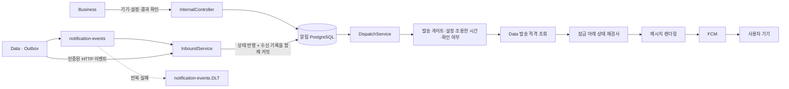

# Notification

> 이벤트를 받아 사용자의 설정과 현재 상태에 맞춰 푸시를 전달하는 알림 서버입니다.

[서버 전체 보기](../README.md) · [내부 API 계약](../../docs/contracts/business-satellite-api.yaml) · [운영 API 계약](../../docs/contracts/notification-admin-api.yaml)

## 1. 역할과 구현 범위

Notification은 기기 토큰, 알림 설정, 수신 이벤트, 예약 발송, 발송 이력과 운영 제어를 소유합니다. Java 17·Spring Boot 4.0.6 기반의 독립 서비스이며 전용 PostgreSQL에 JDBC로 접근하고 Flyway로 스키마를 관리합니다.

앱은 Business를 통해 기기와 설정을 변경합니다. Notification은 앱 JWT를 발급·검증하지 않으며, 호출자별 서비스 토큰과 경로 허용목록으로 내부·운영 API를 보호합니다.

| 기능 | 구현 내용 |
| --- | --- |
| 이벤트 수신 | Kafka·HTTP 공통 처리, `eventId` 중복 제거, 버전 기반 투영 |
| 기기 · 설정 | 세션·세대에 따른 기기 소유권, 수신 동의, 설정 변경 |
| 예약 · 발송 | 조용한 시간, 기한, 결과 확인 여부, 현재 발송 적격 검사 |
| 푸시 생성 | ICU 메시지 렌더링, 묶음 결과 처리, FCM HTTP v1 |
| 운영 · 이관 | 발송 게이트, 감사 기록, 스냅샷 반입·대조, 재조정 |

## 2. 알림 전달 구조



그림은 주요 처리 단계를 설명합니다. 실제 발송은 스케줄러와 DB 발송 게이트가 모두 허용하는 경우에만 진행합니다. FCM 요청 수락은 사용자가 알림을 읽었다는 뜻이 아닙니다.

### 중복 · 장애 처리

- 같은 `eventId`와 같은 봉투는 이미 수신한 결과로 처리합니다. 같은 ID에 다른 내용이 오면 충돌로 거절합니다.
- 상태 반영과 수신 기록을 같은 DB 트랜잭션으로 묶습니다.
- Kafka 실패 메시지는 원본 파티션의 `.DLT`로 전달합니다. DLT 발행 실패를 성공으로 삼키지 않습니다.
- 발송 전 외부 조회와 DB 잠금 단계를 분리하고, 다시 잠근 뒤 게이트·기기 소유권·확인 상태를 재검사합니다.
- Data 조회는 스냅샷 재조정, 결과 확인 수렴, 발송 적격 판정의 제한된 용도입니다. 코어 DB를 직접 조회하지 않습니다.

## 3. 코드 탐색

기준 패키지는 [`com.oneorthree.notification`](src/main/java/com/oneorthree/notification)입니다.

| 진입점 · 구성 | 읽을 코드 |
| --- | --- |
| 내부 인증과 API | `ServiceAuth`, `InternalController` |
| 이벤트 수신 | `KafkaInbound`, `InboundService`, `Envelope` |
| 기기·설정·결과 확인 | `DeviceService`, `SettingsService`, `AckService` |
| 발송 | `DispatchScheduler`, `DispatchService`, `QuietHours` |
| 메시지·전송 | `Renderer`, `FcmPayload`, `FcmTransport` |
| 운영·이관 | `AdminController`, `AdminService`, `MigrationService`, `SnapshotReconciler` |
| DB | `Store`, [Flyway 마이그레이션](src/main/resources/db/migration) |

## 4. 실행과 설정

### 먼저 통합 테스트 실행

Java 17과 Docker를 준비한 뒤 서비스 폴더에서 실행합니다. PostgreSQL·Kafka 통합 테스트는 Testcontainers를 사용합니다.

```bash
cd server/notification
./gradlew test
./gradlew checkstyleMain spotbugsMain
```

### 개발 서버 실행

전용 DB를 만들고 아래 환경변수를 주입한 상태에서 실행합니다. 전체 키와 기본값은 [`application-dev.yml`](src/main/resources/application-dev.yml)이 기준입니다.

| 설정 | 용도 |
| --- | --- |
| `NOTI_DB_URL`, `NOTI_DB_USERNAME`, `NOTI_DB_PASSWORD` | 알림 DB 접속 |
| `KAFKA_BOOTSTRAP_SERVERS` | 브로커 주소 |
| `SVC_TOKEN_BIZ_TO_NOTI`, `SVC_TOKEN_DATA_TO_NOTI`, `SVC_TOKEN_CONSOLE_TO_NOTI` | 호출자별 수신 자격 |
| `DATA_API_BASE_URL`, `SVC_TOKEN_NOTI_TO_DATA` | Data 조회 |
| `FCM_PROJECT_ID`, `FCM_SERVICE_ACCOUNT_JSON` | 실제 FCM 발송 자격 |

```bash
# server/notification 기준, 위 환경변수 주입 후
./gradlew bootRun --args='--spring.profiles.active=dev'
```

기본 서비스 포트는 `8082`, 상태 확인은 `/health`, 관리 포트는 내부 `9091`입니다. 배포용 설정·DB 준비는 [Scripts](../scripts/README.md)를 참고합니다.

### 수신 · 발송 활성화 상태

[`application.yml`](src/main/resources/application.yml)의 기본값은 다음과 같습니다.

| 설정 | 기본값 | 의미 |
| --- | --- | --- |
| `NOTIFICATION_KAFKA_ENABLED` | `false` | Kafka 소비자 활성화 여부 |
| `NOTIFICATION_SCHEDULING_ENABLED` | `false` | 예약 작업 활성화 여부 |
| `NOTIFICATION_GENERATION_REQUIRED` | `false` | 세대 정보 필수 여부 |
| `NOTIFICATION_LEGACY_DEVICE_REGISTRATION` | `true` | 기존 기기 등록 호환 |

서비스가 실행됐다는 이유만으로 발송이 시작되지는 않습니다. DB의 발송 게이트와 이관 검증 절차까지 [운영 API 계약](../../docs/contracts/notification-admin-api.yaml)에 따라 확인합니다.

### 독립 백오피스 API (선별 운영 이식)

백오피스는 Notification DB에 직접 연결하지 않고 다음 HTTP 계약을 사용합니다. 서버와 백오피스의 커밋 SHA는 같을 필요가 없습니다.

| 경로 | 계약 |
| --- | --- |
| `GET /internal/admin/publications/environment` | `environment`, `fcmProjectId`, `contractVersion: "1"`, `capabilities` 반환 |
| `POST /internal/admin/publications/{publicationId}` | `ADMIN_ANNOUNCEMENT` 승인 본문을 고정하여 명시적 수신자 최대 100명에게 적재 |
| `GET /internal/admin/publications/history` | 기존 발송 전체 원장의 최신순 커서 페이지 (`cursor`, `limit`) |
| `GET /internal/admin/templates` | 기존 템플릿 목록 |

capabilities는 `notification.publication.v1`, `notification.history.v1`, `notification.templates.v1`입니다.
인증은 기존 `SVC_TOKEN_CONSOLE_TO_NOTI=member-1:토큰,member-2:토큰,...`을 사용합니다. actor는 토큰으로 결정됩니다.
발행에는 `Idempotency-Key`가 필수이고, 발행·이력에는 `X-Backoffice-Environment` 및 `X-Backoffice-Fcm-Project`가 필요합니다.
발행 ID와 본문이 같으면 다른 요청 키의 재시도도 기존 결과를 반환하며 본문 변경은 충돌로 거절합니다.
적재 결과 `PENDING`은 전송 완료가 아닙니다. 기존 게이트·수신 설정·조용한 시간·Data의 사용자 적격 판정을 통과해야 발송됩니다.

실제 `dev` 또는 `prod` 프로파일 하나와 Notification DB의 `gromo.environment`, `gromo.fcm_project_id` 표식이 일치해야 합니다.
표식은 운영자가 해당 DB를 확인한 뒤 `ALTER DATABASE <알림DB> SET gromo.environment='prod'` 및
`ALTER DATABASE <알림DB> SET gromo.fcm_project_id='<운영 FCM 프로젝트>'`로 설정합니다. 세션의 `SET` 값은 표식으로 인정하지 않습니다.
실제 FCM transport는 **모든 발송 직전**에 이 표식을 재확인합니다. 불일치는 `ENVIRONMENT_MISMATCH`로 기록하고
임대를 해제하여 60초 뒤 재검사하며 발송 시도 횟수를 소진하지 않습니다. 환경 표식은 새 서버 배포 전에 준비해야 합니다.

이 선별 릴리스는 `V9_1__backoffice_publications.sql`만 추가합니다. 기존 V1–V9 이력과 종류·묶음 잡·이관 경로를 보존합니다.
V10–V13을 함께 실행하거나 임의로 마이그레이션 번호를 바꾸지 않습니다. 이후 main의 V14·V15와 중복되지 않도록
후속 DB 전환 절차 및 호환 검증이 완료되기 전까지 이 마이그레이션의 운영 적용을 차단합니다.
