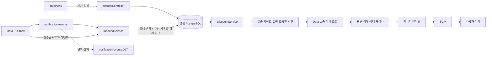

# Notification

> 이벤트를 받아 사용자의 설정과 현재 상태에 맞춰 푸시를 전달하는 알림 서버입니다.

[서버 전체 보기](../README.md) · [내부 API 계약](../../docs/contracts/business-satellite-api.yaml) · [운영 API 계약](../../docs/contracts/notification-admin-api.yaml)

## 1. 역할과 구현 범위

Notification은 기기 토큰, 알림 설정, 수신 이벤트, 예약 발송, 발송 이력과 운영 제어를 소유합니다. Java 17·Spring Boot 4.0.6 기반의 독립 서비스이며 전용 PostgreSQL에 JDBC로 접근하고 Flyway로 스키마를 관리합니다.

앱은 Business를 통해 기기와 설정을 변경합니다. Notification은 앱 JWT를 발급·검증하지 않으며, 호출자별 서비스 토큰과 경로 허용목록으로 내부·운영 API를 보호합니다.

| 기능 | 구현 내용 |
| --- | --- |
| 이벤트 수신 | Kafka·HTTP 공통 처리, `eventId` 중복 제거, 버전 기반 투영 |
| 기기 · 설정 | 세션·세대에 따른 기기 소유권, 수신 동의, 설정 변경 |
| 예약 · 발송 | 조용한 시간, 기한, 현재 발송 적격 검사 |
| 푸시 생성 | ICU 메시지 렌더링, FCM HTTP v1 |
| 운영 | 발송 게이트, 감사 기록, 사용자 상태 재조정 |

## 2. 알림 전달 구조



그림은 주요 처리 단계를 설명합니다. 실제 발송은 스케줄러와 DB 발송 게이트가 모두 허용하는 경우에만 진행합니다. FCM 요청 수락은 사용자가 알림을 읽었다는 뜻이 아닙니다.

### 중복 · 장애 처리

- 같은 `eventId`와 같은 봉투는 이미 수신한 결과로 처리합니다. 같은 ID에 다른 내용이 오면 충돌로 거절합니다.
- 상태 반영과 수신 기록을 같은 DB 트랜잭션으로 묶습니다.
- Kafka 실패 메시지는 원본 파티션의 `.DLT`로 전달합니다. DLT 발행 실패를 성공으로 삼키지 않습니다.
- 발송 전 외부 조회와 DB 잠금 단계를 분리하고, 다시 잠근 뒤 게이트·기기 소유권를 재검사합니다.
- Data 조회는 스냅샷 재조정, 발송 적격 판정의 제한된 용도입니다. 코어 DB를 직접 조회하지 않습니다.

## 3. 코드 탐색

기준 패키지는 [`com.oneorthree.notification`](src/main/java/com/oneorthree/notification)입니다.

| 진입점 · 구성 | 읽을 코드 |
| --- | --- |
| 내부 인증과 API | `ServiceAuth`, `InternalController` |
| 이벤트 수신 | `KafkaInbound`, `InboundService`, `Envelope` |
| 기기·설정 | `DeviceService`, `SettingsService` |
| 발송 | `DispatchScheduler`, `DispatchService`, `QuietHours` |
| 메시지·전송 | `Renderer`, `FcmPayload`, `FcmTransport` |
| 운영 | `AdminController`, `AdminService`, `DispatchControlService`, `SnapshotReconciler` |
| DB | `Store`, [Flyway 마이그레이션](src/main/resources/db/migration) |

## 4. 실행과 설정

### 먼저 통합 테스트 실행

Java 17과 Docker를 준비한 뒤 서비스 폴더에서 실행합니다. PostgreSQL·Kafka 통합 테스트는 Testcontainers를 사용합니다.

```bash
cd server/notification
./gradlew test
./gradlew checkstyleMain spotbugsMain
```

### 개발 서버 실행

전용 DB를 만들고 아래 환경변수를 주입한 상태에서 실행합니다. 전체 키와 기본값은 [`application-dev.yml`](src/main/resources/application-dev.yml)이 기준입니다.

| 설정 | 용도 |
| --- | --- |
| `NOTI_DB_URL`, `NOTI_DB_USERNAME`, `NOTI_DB_PASSWORD` | 알림 DB 접속 |
| `KAFKA_BOOTSTRAP_SERVERS` | 브로커 주소 |
| `SVC_TOKEN_BIZ_TO_NOTI`, `SVC_TOKEN_DATA_TO_NOTI`, `SVC_TOKEN_CONSOLE_TO_NOTI` | 호출자별 수신 자격 |
| `DATA_API_BASE_URL`, `SVC_TOKEN_NOTI_TO_DATA` | Data 조회 |
| `FCM_PROJECT_ID`, `FCM_SERVICE_ACCOUNT_JSON` | 실제 FCM 발송 자격 |

```bash
# server/notification 기준, 위 환경변수 주입 후
./gradlew bootRun --args='--spring.profiles.active=dev'
```

기본 서비스 포트는 `8082`, 상태 확인은 `/health`, 관리 포트는 내부 `9091`입니다. 배포용 설정·DB 준비는 [Scripts](../scripts/README.md)를 참고합니다.

### 수신 · 발송 활성화 상태

[`application.yml`](src/main/resources/application.yml)의 기본값은 다음과 같습니다.

| 설정 | 기본값 | 의미 |
| --- | --- | --- |
| `NOTIFICATION_KAFKA_ENABLED` | `false` | Kafka 소비자 활성화 여부 |
| `NOTIFICATION_SCHEDULING_ENABLED` | `false` | 예약 작업 활성화 여부 |
| `NOTIFICATION_GENERATION_REQUIRED` | `false` | 세대 정보 필수 여부 |
| `NOTIFICATION_LEGACY_DEVICE_REGISTRATION` | `true` | 기존 기기 등록 호환 |

서비스가 실행됐다는 이유만으로 발송이 시작되지는 않습니다. DB의 발송 게이트와 예약 잡 활성화를 [운영 API 계약](../../docs/contracts/notification-admin-api.yaml)에 따라 설정합니다. dev는 상시 열어 둡니다([dev 발송 게이트](#dev-발송-게이트)).

## 현재 알림과 운영 경로

지원하는 알림은 `FRIEND_REQUEST`, `FRIEND_ACCEPTED`, `MAIN_ISLAND_TRANSFERRED`, `MAGAZINE_PUBLISHED`, `ISLAND_KICKED`입니다.
V10은 과거 kind·템플릿을 비활성화하고 대기 발송을 억제하며 발송 이력은 보존합니다.
결과 확인·묶음 완료·정지 스냅샷 반입 전용 `result_ack`, `result_bundle_manifests`,
`imports`, `migration_snapshots`, `migration_state` 테이블은 삭제합니다.
기기·설정·사용자 폐기 펜스·수신 이벤트·현재 발송 이력은 유지합니다.

V12는 `FRIEND_REQUEST`, `FRIEND_ACCEPTED`, `MAIN_ISLAND_TRANSFERRED`, `ISLAND_KICKED`의 표시 문구(4종 × 4로케일)에서 닉네임과 섬 이름을 뺍니다.
`counterpartNickname`·`islandName`은 계약 안정성 때문에 계속 받지만 표시 문구에는 쓰지 않습니다.

V13은 기기 등록마다 수신 확인 태그(`deliveryTag`)를 새로 발급해 등록 응답과 그 기기로 가는 모든 푸시 data에 싣습니다.
같은 `Idempotency-Key`의 재생은 같은 태그를 돌려줍니다. V13 전에 등록한 기기 행에는 태그가 없어 그 기기로 가는 푸시에도 키를 싣지 않습니다.
V13 뒤에 이 서비스를 이전 이미지로 되돌리면 Flyway 기본값(이미 적용된 미래 버전은 검증에서 무시)으로 기동은 되지만, 이전 이미지는 푸시 data에 `deliveryTag`를 싣지 않습니다. 태그를 저장한 2.0 iOS 앱은 태그 없는 푸시를 버리므로 다시 등록하기 전까지 알림을 받지 못합니다. 이미지를 되돌리지 말고 고친 이미지를 새로 배포합니다.

관리자 서비스 자격과 `Idempotency-Key`로 다음 경로를 사용합니다.

- `GET /internal/admin/dispatch`: 발송 게이트 상태
- `POST /internal/admin/dispatch/open`: 발송 개방. 종료 이후에는 새 멱등 키가 필요합니다.
- `POST /internal/admin/dispatch/close`: 발송 종료. 진행 중인 발송이 제한 시간 안에 끝났는지는 `drained`로 확인합니다.
- `POST /internal/admin/jobs/{jobId}/replay`: 놓친 예약 실행 등록. 현재 잡은 `delivery-dispatch`, `user-reconcile`입니다.

기존 `/internal/admin/migration/**`와 `/internal/users/{userId}/result-ack/**` 경로는 제거했습니다.
기존 `bundle-flush` 잡의 활성 여부·크론·실행 이력은 `delivery-dispatch`로 승계합니다.
사용자 설정 저장과 기기 등록은 발송 게이트가 닫혀 있어도 동작합니다.

발송 실패는 60초 간격으로 재시도하며, 이번 실패로 시도 횟수가 60회에 닿으면 `FAILED`로 끝납니다. `NO_ACTIVE_DEVICE`도 같은 상한을 따릅니다. 크기 초과로 일부 기기만 건너뛴 경우에는 `푸시가 크기 한도를 넘는 기기` WARN의 `deviceKey`를 해당 기기의 `device_tokens.device_key`와 대조해 찾습니다.

이 상한은 기존 대기 행에도 적용됩니다. 배포 전에는 `SELECT count(*) FROM deliveries WHERE status IN ('PENDING','DEFERRED') AND attempts >= 59;`로 다음 실패에 곧바로 종결될 행 수를 확인합니다. 기기 등록이 늦어 60회 안에 수신 기기가 생기지 않는 `NO_ACTIVE_DEVICE` 알림도 자동 재시도에서 제외됩니다.

### 발송 게이트

dev는 2026-10-27부터, 운영은 2026-10-30부터 발송 게이트를 열어 둡니다. V17 이후 새 DB는 게이트가 열린 상태로 시작합니다. 기존 DB에서 명시적으로 닫은 게이트는 재배포나 V17 적용으로 다시 열리지 않습니다. 게이트 상태와 예약 잡·스케줄러 설정은 별개이므로 새 환경이나 의도적으로 닫은 환경은 다음 순서로 확인합니다.

1. Secrets Manager `gromo/dev/env`에 `NOTIFICATION_SCHEDULING_ENABLED=true`를 두고 `ops-redeploy.dev`로 notification을 재기동합니다. 실발송에는 `FCM_PROJECT_ID`(dev는 `catus-dev`)와 FCM 서비스 계정 자격이, 사건이 들어오려면 `NOTIFICATION_KAFKA_ENABLED=true`가 있어야 합니다. 프로젝트가 앱과 어긋나면 열자마자 [FCM 프로젝트 불일치](#fcm-프로젝트-불일치sender_id_mismatch) 증상이 납니다.
2. 열기 전 대기 발송을 `GET /internal/admin/deliveries?status=PENDING`·`status=DEFERRED`로 확인합니다. 쌓인 발송은 열자마자 한꺼번에 나갑니다.
3. `PUT /internal/admin/jobs/delivery-dispatch`로 잡을 켭니다. PUT은 전체 수정이라 `GET /internal/admin/jobs`의 `delivery-dispatch` 항목에서 `cron`·`config`를 그대로 두고 `enabled`만 `true`로 바꿔 보냅니다(예: `{"enabled":true,"cron":"0/5 * * * * *","config":{}}`).
4. `POST /internal/admin/dispatch/open`을 보냅니다.
5. `GET /internal/admin/dispatch`가 `enabled=true`이고 `delivery-dispatch`의 `lastCompletedAt`이 5초마다 전진하는지 확인합니다.

쓰기(3·4단계)에는 `Idempotency-Key`(1~200자)가 필요합니다. 요청마다 새 값을 씁니다(예: `uuidgen`). 같은 키에 다른 본문을 보내면 `409 IDEMPOTENCY_KEY_CONFLICT`, 닫힌 뒤 예전 open 키를 다시 보내면 `409 DISPATCH_CLOSED`입니다.

관리 API는 공개 nginx에 없습니다(`/internal/`은 404). dev VM에서 notification 컨테이너(이름은 `docker ps`로 확인 — 지금은 `phone-notification-1`) 안의 `localhost:8082`를 부릅니다. `Authorization: Bearer`에는 `SVC_TOKEN_CONSOLE_TO_NOTI`(`member-1:<토큰>,member-2:<토큰>` 목록)에서 자기 행위자 항목의 `<토큰>` 부분만 넣습니다. 토큰은 컨테이너 안에서만 읽고 출력하지 않습니다.

### FCM 프로젝트 불일치(`SENDER_ID_MISMATCH`)

FCM이 `403 SENDER_ID_MISMATCH`로 답하면 그 토큰은 서버의 `FCM_PROJECT_ID`와 다른 Firebase 프로젝트에서 발급된 것입니다. `UNREGISTERED`처럼 그 기기의 `transport_invalid`만 켜고 소유권은 유지하며, `notification.fcm.sender_mismatch` 카운터를 올리고 `FCM 발송 실패 status=403 errorCode=SENDER_ID_MISMATCH` 경고를 한 줄 남깁니다(토큰·응답 본문은 남기지 않습니다).
경고 줄 수와 카운터 증가량으로 판정합니다. 기기 하나에서만 나면 그 앱의 `GoogleService-Info.plist` 프로젝트가 틀린 것이니 앱을 고치고, 여러 기기에서 한꺼번에 나면 서버의 `FCM_PROJECT_ID`·`FCM_SERVICE_ACCOUNT_JSON`이 틀린 것입니다. 앱은 같은 유저·같은 토큰이면 다시 등록하지 않아 설정을 고쳐도 저절로 돌아오지 않으므로, 서버 설정을 고친 뒤 DB에서 무효 표시를 되돌립니다.

```sql
-- 먼저 대상 수를 확인한다(경고 줄 수와 비슷해야 한다). 크게 다르면 실행하지 말고 첫 경고 시각을 다시 확인한다.
SELECT count(*) FROM device_tokens WHERE active AND transport_invalid AND updated_at >= '<첫 경고 시각>';
UPDATE device_tokens SET transport_invalid=false WHERE active AND transport_invalid AND updated_at >= '<첫 경고 시각>';
```

`<첫 경고 시각>`은 첫 경고 로그의 시각이며, `updated_at`이 `timestamptz`이므로 오프셋까지 씁니다. `active` 조건은 로그아웃·삭제로 소유권이 끝난 행을 건드리지 않게 합니다. 진짜 무효 토큰은 다음 발송에서 다시 표시되며 FCM 호출 1회만 낭비됩니다. `NO_ACTIVE_DEVICE`로 재시도 중인 발송 중 60회 상한에 닿지 않은 건은 무효 표시 복구 뒤 이어서 나갑니다. 이미 `FAILED`가 된 건은 원본의 `deviceCount` 또는 `delivery_devices`를 먼저 확인합니다. 콘솔 resend는 새 발송을 만들므로 일부 기기에 이미 전달됐으면 중복 푸시가 갈 수 있습니다. FCM 수락 뒤 기록이 실패했을 가능성도 고려해 건별로 재전송을 판단합니다.

### 백오피스 승인 발행

`POST /internal/admin/publications/{publicationId}`는 백오피스에서 승인한 최종 문구를 명시적 수신자에게 적재합니다.
기존 행위자별 콘솔 인증과 `Idempotency-Key`가 필요합니다. `publicationId`는 UUID이며, 같은 발행 id에 다른 본문을 보내면 `409 IDEMPOTENCY_KEY_CONFLICT`입니다. 요청 키를 바꿔 재시도해도 동일 발행은 중복 적재하지 않습니다.

```json
{
  "kind": "ADMIN_ANNOUNCEMENT",
  "locale": "ko",
  "title": "서비스 공지",
  "body": "검토하고 승인한 최종 문구",
  "data": {},
  "silent": false,
  "params": {},
  "userIds": ["22222222-2222-4222-8222-222222222222"]
}
```

- `userIds`는 중복 없는 UUID 1~100개이며 전체 사용자 자동 선택은 지원하지 않습니다. `data`는 문자열 값만 허용하고 `eventId`, `deliveryTag`는 서버 전용입니다.
- 응답은 `{publicationId, status: "PENDING", deliveryIds, recipientCount, dispatchEnabled}`입니다. 적재 성공은 실제 발송 완료가 아닙니다. 발송 이력에서 각 delivery 상태를 확인합니다.
- `reviewed_push`에 최종 title/body/data/silent를 저장하므로 승인 이후 템플릿·딥링크 변경으로 문구가 달라지지 않습니다. 수신 기기의 deliveryTag와 서버 eventId만 발송 단계에서 더합니다.
- 발송 게이트를 자동으로 열지 않습니다. 기존 활성 기기, 탈퇴, 수신 설정, 조용한 시간, 종류별 현재 적격성, 사건 만료 검사를 그대로 거칩니다. 시험 발송의 15분 예외는 적용하지 않습니다.
- 검토 발행 API는 `ADMIN_ANNOUNCEMENT` 서비스 공지만 허용합니다. 다른 종류는 `400 INVALID_PUBLICATION_KIND`로 거부하며 기존 사건 발송 경로를 사용합니다. subjectId는 publicationId로 고정하고, 별도 사건 시한이 없어 params는 빈 객체를 사용할 수 있습니다. 자격 없는 대상은 공통 발송 경로에서 제외됩니다.
- 승인 상태와 승인된 버전의 불변성은 호출하는 백오피스가 관리합니다. 이 내부 API는 콘솔 자격만 신뢰하며 공개 브라우저에 서비스 토큰을 배포하지 않습니다.
- V14는 nullable JSONB 컬럼만 추가합니다. 이 기능으로 적재한 PENDING 행이 있으면 이전 이미지로 되돌리지 않습니다. 이전 발송기는 고정 문구를 읽지 않고 템플릿을 다시 렌더링하기 때문입니다.

### V9.1 선택 릴리스에서 정규 V15로 전환

선택 배포한 `V9_1__backoffice_publications.sql`은 정규 V14·V15와 같은 스키마 변경을 미리 적용한 이력입니다.
이 DB에 main 이미지를 바로 기동하면 기본 Flyway 검증이 실패해야 정상입니다. `repair`, validation 비활성화,
`outOfOrder=true`로 우회하지 않습니다. 원본 V1–V15 SQL과 이미 적용한 V9.1 SQL은 변경하지 않습니다.

이미지 안의 `/app/bridge-release`는 Spring을 띄우지 않는 명시적 JDBC 전환 도구입니다. 다음 조건을 모두 준비합니다.

1. Notification 및 해당 DB에 접속하는 백오피스·관리 도구·배치 등 모든 DB 클라이언트를 정지하고 재접속을 차단합니다.
2. 정지 상태에서 대상 DB를 `pg_dump -Fc`로 백업합니다. 별도 격리 PostgreSQL에 `pg_restore`하여 복원 가능성과
   DB 이름·환경·FCM 표식·Flyway V1–V9 및 V9.1 원장을 확인합니다. 백업 SHA256과 대상 DB 이름을 운영 기록에 남깁니다.
3. 해당 이미지의 전환 도구를 단독 실행합니다. `NOTI_DB_URL`, `NOTI_DB_USERNAME`, `NOTI_DB_PASSWORD`는 환경변수로
   전달하고 백업 파일을 읽기 전용으로 마운트합니다. 예시는 인자를 설명하며 자동 배포 단계가 아닙니다.

```sh
# 컨테이너 entrypoint를 /app/bridge-release로 바꾸고 아래 인자를 전달한다.
/app/bridge-release --writers-stopped --apply \
  --database gromo_notification --environment prod --fcm-project catus-prod \
  --backup /backup/notification.dump --backup-sha256 '<백업 SHA256>'
```

전환기는 PostgreSQL 16, 실제 DB 이름, DB 수준 환경·FCM 표식, 다른 client 연결 부재, 원본 SQL SHA256,
정확한 Flyway 버전·설명·스크립트·checksum·성공·순서를 검사합니다. `public` 관계·열·제약·인덱스·트리거·함수·정책·시퀀스
정의도 원본 SQL로 만든 구조 manifest와 비교합니다. 소유자·ACL과 데이터 내용 전체를 동등성 검증하는 도구는 아닙니다.
백업 검사 자체는 **custom archive의 PGDMP 헤더와 제공된 SHA256 일치**만 확인합니다. 그 파일의 대상 DB 출처나 복원 가능성은
자동 증명하지 않으므로 위의 격리 복원 검증과 운영 기록이 필수입니다.

전환은 advisory lock과 `public` 테이블 잠금 아래 단일 트랜잭션으로 실행합니다. 정규 V10–V13 SQL을 그대로 실행하되
V10이 건드리는 `ADMIN_ANNOUNCEMENT` 종류의 모든 설정, 해당 템플릿 enabled 및 발송 원장의 status·last_error·lease를
복원하고 원본 스냅샷과 양방향 EXCEPT로 행 집합·값이 모두 같은지 확인합니다. 불일치하면 전체 트랜잭션을 롤백합니다.
승인 문구·payload·수신자·시도 횟수는 그대로 유지합니다. 정규 V15 스키마와 일치하는 것을 확인한 뒤
V9.1만 V14·V15 이력으로 대체하고 V1–V9 원본 이력은 보존합니다. V10–V13의 기존 기능 정리와 데이터 변경은 정규 main 승격 범위입니다.

원본 이력 전체와 백업 SHA·DB 정체성은 별도 `notification_release_bridge.receipt`에 보존합니다. 이 audit 스키마는
애플리케이션 Flyway의 `public` 스키마 밖에 있습니다. 실패하면 DDL·데이터·원장·receipt가 모두 롤백됩니다.
재실행은 최초 실행과 같은 백업 파일의 SHA256, 정확한 target 구조·원장, 기존 receipt가 모두 맞을 때만 아무 변경 없이 성공합니다.
V16 이후에는 이 전환기의 재실행을 거절하며 이행 증거는 receipt를 별도로 조회합니다. V9.1을 제거한 installed_rank 10의 공백은 원본 V1–V9 이력을 보존한 결과이며 정상입니다.
전환 후 일반 main 이미지의 Flyway migrate(검증 포함)가 성공하고 V15 뒤의 정규 migration(V16 이후)만 추가 실행되는지 확인한 뒤 서비스를 재기동합니다.
서비스 정지는 운영자가 보장해야 하며 연결 부재 확인과 DB 잠금만으로 새로운 관리자 연결까지 영구 차단하지는 않습니다.

로컬 검증은 `./gradlew test --tests '*NotificationReleaseBridgeTest' checkstyleMain spotbugsMain`입니다.
테스트는 실제 V9.1 원장에서 정규 V15로 이행하고, 승인 발송/설정 보존, checksum·구조·환경·동시 연결 거절,
정규 SQL 실패 롤백, 재실행, 새 DB의 원본 V1–V15 경로를 검사합니다. 운영 DB에서는 이 테스트를 실행하지 않습니다.
