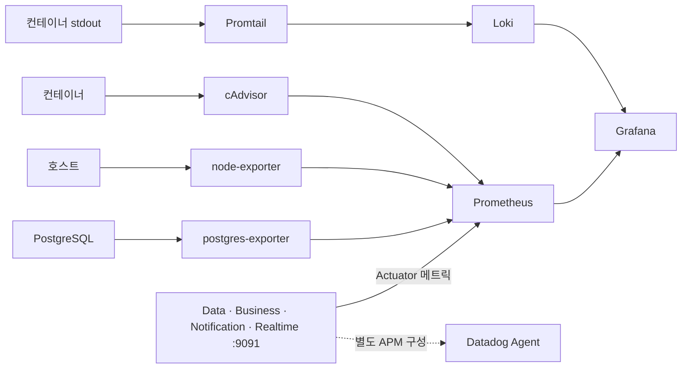

# Observability

> 요청이 느려진 이유를 트래픽·DB·리소스·로그에서 함께 찾는 GROMO 관측 설정입니다.

[서버 전체 보기](../README.md) · [실행·배포 도구](../scripts/README.md) · [Datadog 상세](datadog/README.md) · [부하 테스트](../../loadtest/README.md)

## 1. 수집 구조



현재 [Prometheus 설정](prometheus/prometheus.yml)은 Data API·Business API·Notification·Realtime의 내부 관리 포트 `9091`, PostgreSQL, 공용 Redis·Business 전용 Redis, Kafka, 호스트·컨테이너를 5초마다 수집합니다. 각 앱 대상에 `service` 라벨을 붙여 서비스별 비교를 지원합니다. 꺼진 선택 서비스는 UP=0으로 표시됩니다.

## 2. 무엇을 확인하나

| 확인할 문제 | 함께 볼 신호 |
| --- | --- |
| API가 느려짐 | 요청량, p95·p99, 5xx, HikariCP pending |
| DB 연결이 부족함 | active·idle·pending, DB 활성 연결과 처리량 |
| 쿼리 비용이 커짐 | DB 캐시히트, 디스크 읽기, 필요 시 느린 쿼리 |
| 프로세스가 바빠짐 | 호스트·컨테이너 CPU와 메모리 |
| 오류가 반복됨 | ERROR 발생률, Loki 실시간 로그, 선택적 APM |

이 지표는 병목을 좁히는 단서입니다. 성능 수치는 [부하 테스트](../../loadtest/README.md)의 시나리오·실행 조건과 함께 해석합니다.

## 3. 설정 파일 지도

| 위치 | 역할 |
| --- | --- |
| [prometheus/](prometheus/) | 수집 대상과 주기 |
| [grafana/dashboards/](grafana/dashboards/) | 대시보드 JSON |
| [grafana/provisioning/](grafana/provisioning/) | 데이터소스·대시보드 자동 등록 |
| [loki/](loki/) · [promtail/](promtail/) | 로그 저장·수집 |
| [datadog/](datadog/) | APM·OpenMetrics 연동 안내 |

## 4. dev 실행과 운영

dev 서버의 **로그·트래픽·쿼리 부하를 한 화면에서 실시간** 확인. Prometheus + Grafana + Loki 셀프호스트를
docker-compose overlay 로 기존 dev 스택 위에 얹는다. 무료(컨테이너 비용뿐). 수집층은 GROMO-588(Actuator+micrometer).

## 실행

기존 `docker-compose.dev.yml`(app·db) **위에 overlay**로 올린다:

```bash
# 저장소 루트에서 실행
# dev VM 에는 영구 env 파일이 없다(GROMO-2224). 평소엔 Actions 의 ops-monitor.dev 를 쓴다.
# 수동이 꼭 필요하면 SM 을 읽을 수 있는 AWS 자격으로 임시 env 를 만들고, 쓰고 나면 지운다:
#   RUNTIME_ENV_FILE=$(.github/scripts/dev-env.sh)   # 떠 있는 data-api 이미지 기준
#   ... 아래 명령 ...;  rm -rf "$(dirname "$RUNTIME_ENV_FILE")"
# --env-file 이 빠지면 POSTGRES_* 등이 빈 값으로 치환돼 db 재생성·기동 실패 위험.
docker compose --env-file "$RUNTIME_ENV_FILE" \
  -f server/scripts/docker-compose.dev.yml -f server/scripts/docker-compose.observability.yml up -d
```

- Grafana: `http://<서버>:3000` (admin / `$GRAFANA_ADMIN_PASSWORD`)
- 대시보드: **"GROMO — dev 관측"** (자동 프로비저닝, 5초 새로고침)
  - ※ 대시보드는 **as-code** — Grafana UI 에서 패널을 즉석 수정해도 ~10초 내 파일 버전으로 되돌아간다. 영구 변경은 `server/observability/grafana/dashboards/gromo-overview.json` 을 직접 수정.

관측 컨테이너만 중지:

```bash
docker compose --env-file "$RUNTIME_ENV_FILE" \
  -f server/scripts/docker-compose.dev.yml -f server/scripts/docker-compose.observability.yml \
  stop prometheus grafana loki promtail postgres-exporter redis-exporter business-redis-exporter kafka-exporter kafka-jmx-exporter node-exporter cadvisor
```

> `down`은 병합된 기본 앱·DB까지 종료하므로 관측만 중지할 때는 위 `stop`을 사용합니다.

> ⚠️ 반드시 `-f` 두 개로 실행. 그래야 dev 의 `app-network`·`app`·`db` 와 같은 프로젝트/네트워크를 공유해
> `data-api:9091`·`db:5432` 를 서비스명으로 스크레이프한다. `data-api-cd.dev.yml` 은 `up -d --no-deps data-api` 만 하므로 배포와 간섭 없음.

## 한 화면 구성

| 구역 | 패널 | 소스 |
|---|---|---|
| **트래픽 (RED)** | 요청수 · p95/p99 · 5xx율 · 상태코드별 | micrometer `http.server.requests` |
| **쿼리 부하** | HikariCP active/idle/**pending**(L1) · DB tps · 캐시히트 · 활성커넥션(L2) | actuator HikariCP + postgres-exporter |
| **리소스** | CPU · 메모리 | node-exporter |
| **로그 (실시간)** | ERROR 발생률 + 앱 로그 라이브 테일 | promtail(docker_sd) → Loki |

**부하 해석**: HikariCP `pending`↑ & DB tps 낮음 → 앱–DB 큐잉(커넥션 부족·느린 쿼리 점유).
DB 캐시히트↓(`blks_read`↑) → 인덱스/쿼리 문제. 두 지표의 교차가 병목 위치를 가리킨다.

## 스크레이프 대상 / 포트

- `data-api:9091/actuator/prometheus` — 트래픽·HikariCP (dev 내부 관리 포트, GROMO-588)
- `postgres-exporter:9187` — PostgreSQL 지표(`postgres-exporter/queries.yml` 커스텀 쿼리 포함: outbox 미전달 수·최고 대기 시간은 `delivered_at IS NULL` 부분 인덱스를 타지만 **backlog 가 폭증하면 쿼리 비용도 비례**해 스크레이프마다 쌓인 만큼 읽는다 — 장애 중 스크레이프 주기를 늘리는 것이 안전) · `node-exporter:9100` · `cadvisor`(내부, `ghcr.io/google/cadvisor:0.55.1`)
- 외부 노출: Grafana `:3000` / 내부: Prometheus `:9090`(127.0.0.1)·Loki `:3100`

## 보안 메모

- `/actuator/*` 는 무인증(JwtFilter 는 `/api/*` 만 필터). dev 는 관리 포트 **9091 을 호스트 미공개**로 두어
  `app-network` 안 Prometheus 만 접근 → 공개 8080 으로 메트릭이 새지 않음.
- **Grafana 3000 은 외부 노출** — 방화벽/보안그룹으로 접근 제한 + `GRAFANA_ADMIN_PASSWORD` 변경 필수.
- promtail 이 `docker.sock`(ro) 마운트 — 호스트 컨테이너 로그 접근용. 신뢰 경계 확인.

## 쿼리 부하 L3 (옵션 — 느린 쿼리 Top N)

기본은 L1·L2 로 "부하"를 본다. "어느 쿼리가 느린가"까지 필요하면:

1. `pg_stat_statements` 활성 — `docker-compose.dev.yml` 의 `db.command` 에
   `-c shared_preload_libraries=pg_stat_statements` 추가 후 재시작 → `CREATE EXTENSION pg_stat_statements;`.
2. postgres-exporter 커스텀 쿼리로 상위 N 노출, 또는
3. dev p6spy 로그 on(`application-dev.yml` `decorator.datasource.p6spy.enable-logging: true`) → 개별 쿼리를 Loki 에서 검색.

## 로컬(비-dev)에서 볼 때

app 을 호스트에서 `bootRun` 으로 띄우면, `server/observability/prometheus/prometheus.yml` 의 타깃 `data-api:9091` 을
`host.docker.internal:9091` 로 바꾸고 app 을 관리 포트가 설정된 프로파일(dev)로 실행한다.

관련: GROMO-588(수집층) · GROMO-589(알람·uptime·Terraform).

## 전체 컴포넌트 부하 대시보드

**GROMO — 전체 컴포넌트 부하** (`/d/gromo-components`)는 자동 프로비저닝됩니다.
상단 서비스·인스턴스 필터는 앱 지표에 적용되며, DB·호스트·Redis·Kafka는 공용 자원이므로 전체를 표시합니다.
각 그래프의 범례에 현재 값과 선택 구간 최대값을 함께 표시합니다.

- 서비스: RPS, p95/p99, 4xx·5xx 비율, 느린 URI, 프로세스 CPU.
- 커넥션: Hikari active/idle/max/pending, 획득 지연, timeout, PostgreSQL DB별 연결 수·한도·락·데드락.
- 스레드: JVM live/peak/상태별 수, Tomcat busy/current/max, 파일 디스크립터.
- 메모리: JVM heap/상한, 할당 속도, GC 정지 시간, 컨테이너 working set.
- 호스트·컨테이너: CPU, iowait/steal, 디스크 I/O, 네트워크, CPU throttling, swap·major page fault.
- Redis·Kafka: 연결·메모리·퇴출, consumer lag, 메시지 유입, DLT offset, 복제 부족 파티션.
- Outbox: 대상별 미전달·재시도·최고 대기 시간. 미구현 `SCORE` 대상은 정상 전송 적체와 분리합니다.
- 내부 호출: Business 상류별 HTTP 풀의 leased/available/pending/max와 화면 조합 executor 큐.
- Realtime: WebSocket/STOMP 연결·구독, 비동기 executor 활성 스레드·대기열, 이동 tick/경로 탐색 지연, 전송 실패·큐 초과.

`pending`과 `busy`가 오를 때 CPU·GC·DB 락을 같은 시간축에서 비교하세요. CPU 평균은 샘플 간 순간 피크를
놓칠 수 있습니다. 빈 패널은 0을 뜻하지 않으며 UP, exporter 내부 `redis_up`/`pg_up`, 해당 메트릭 존재 여부부터 확인합니다.
Business는 DB가 없는 서비스라 Hikari 패널에 나오지 않습니다. 아직 요청/이동이 없으면 관련 메트릭도 없을 수 있습니다.

반영: 네 앱을 새 설정으로 재배포한 뒤 **Actions → ops-monitor.dev → up**을 실행합니다.
관측만 갱신해도 scrape 대상·대시보드는 반영되지만, 새 HTTP histogram·Tomcat 지표는 앱 재기동이 필요합니다.
Business Redis exporter는 기존 `business-cache` 네트워크와 `health` ACL(INFO 권한)을 사용하며 호스트 포트를 열지 않습니다.
PostgreSQL exporter는 같은 PostgreSQL 인스턴스의 DB별 통계를 보여 줍니다. 별도 DB 호스트를 추가하면 exporter도 별도로 등록해야 합니다.

부하 전용 GCP SUT는 Data API 단독 구성입니다. `make sync`/`make up`으로 같은 대시보드와 SUT cAdvisor를 배치하지만,
실행하지 않은 위성 서비스·Redis·Kafka 지표가 생기지는 않습니다. 전체 스택은 dev 관측 구성을 적용한 격리 스택에서 측정합니다.

cAdvisor는 Docker containerd 이미지 저장소 호환성을 위해 `0.55.1`로 고정합니다.
이미지 경로는 [공식 실행 안내](https://github.com/google/cadvisor#quick-start-running-cadvisor-in-a-docker-container)를 따릅니다.
Docker Desktop 조사 compose는 Docker 소켓을 명시적으로 마운트하고 VM의 containerd 소켓을 지정합니다.

Realtime 현재 소속 인가의 동시 요청/한도 및 포화 거절 횟수도 표시합니다. 이 한도에서의 거절은 HTTP 503과 함께 확인합니다. 부하 조사는 현재 인가를 활성화한 상태로 진행합니다.
