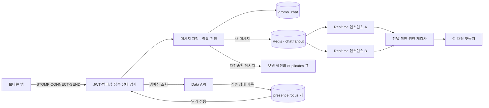

# Realtime

> 같은 섬의 주민이 대화하고 읽은 위치를 이어가는 실시간 서버입니다.

[서버 전체 보기](../README.md) · [채팅 DB 스키마](docs/db/schema.dbml) · [실시간 이벤트 설계](../../docs/prd/fishcat/realtime-events/high-level-design.md)

## 1. 역할과 구현 범위

Realtime은 WebSocket/STOMP 채팅, 메시지 이력, 읽음 위치와 Redis를 통한 다중 인스턴스 전파를 담당합니다. Data API와 코드를 공유하지 않는 Java 17·Spring Boot 4.0.6 독립 프로젝트이며, 채팅 데이터는 별도 `gromo_chat` DB에 보관합니다.

**현재 사용할 수 있는 주 도메인은 채팅입니다.** `/ws/realtime` 연결 경로와 신규 이벤트 라우터 기반은 있지만, 새 섬 이벤트 채널은 인가·스냅샷·권한 회수 구현이 준비되기 전까지 닫혀 있습니다. `DisabledRealtimeDelivery`는 새 이벤트 전달을 거절합니다.

## 2. 채팅 전달 구조



인메모리 SimpleBroker는 자신의 JVM에 연결된 구독자만 압니다. Redis Pub/Sub가 인스턴스 간 전달을 맡고, 각 인스턴스는 실제 소켓으로 내보내기 직전에도 JWT·멤버십·집중 상태를 검사합니다.

## 3. 채팅 계약

| 구분 | 경로 | 의미 |
| --- | --- | --- |
| WebSocket | `/ws/chat`, `/ws/realtime` | STOMP 연결, CONNECT 프레임에서 인증 |
| SEND | `/app/groups/{groupId}/send` | 메시지 전송 |
| SUBSCRIBE | `/topic/groups/{groupId}` | 해당 섬의 채팅 수신 |
| SUBSCRIBE | `/user/queue/errors` | 전송 오류 |
| SUBSCRIBE | `/user/queue/duplicates` | 재전송한 메시지의 원 결과 |
| GET | `/api/v1/chat/rooms` | 내 채팅방과 읽지 않은 개수 |
| GET | `/api/v1/chat/rooms/{groupId}/messages?cursor&size` | 최신순 메시지 이력 |
| POST | `/api/v1/chat/rooms/{groupId}/read` | 읽음 위치를 앞으로 이동 |

### 집중 중에는 연결과 채팅 권한을 구분합니다

CONNECT는 JWT 인증을 담당합니다. 집중 중에도 연결은 유지할 수 있지만 채팅 구독·발신·REST 접근과 기존 구독에 대한 본문 전달은 제한합니다. 채팅에서 푸시를 발송하지는 않습니다.

### 재전송과 재연결을 구분합니다

`clientMessageId`로 중복 저장을 막습니다. 재전송은 원 메시지를 보낸 세션의 `/user/queue/duplicates`로 돌려주며 방 전체에 다시 방송하지 않습니다. Redis Pub/Sub는 메시지 이력 저장소가 아니므로 재연결 후에는 REST 이력 조회로 보완합니다.

## 4. 데이터 소유권과 현재 제약

| 자원 | 소유 · 사용 |
| --- | --- |
| `gromo_chat` | Realtime의 메시지·읽음 위치, Flyway 관리 |
| `cache:chat:member:{userId}` | Realtime이 관리하는 멤버십 캐시 |
| `chat:fanout` | Realtime의 인스턴스 간 Pub/Sub |
| `presence:focus:{userId}` | Data가 쓰고 Realtime이 읽는 집중 상태 |

- 현재 멤버십 조회는 요청자의 AT로 Data의 `GET /api/v1/groups`를 호출합니다. 신규 내부 인가 계약으로의 전환은 별도 작업입니다.
- 멤버십 캐시 기본 TTL은 120초입니다. 탈퇴·강퇴 반영은 캐시 만료까지 지연될 수 있습니다.
- dev overlay의 Redis에는 서비스별 ACL이 적용되지 않았습니다. presence 읽기 전용은 현재 코드 규칙이며, 배포 권한으로 강제되는 상태와 구분해야 합니다.
- Redis는 Realtime의 필수 의존성입니다. readiness에 DB·Redis를 포함합니다.

## 5. 실행 · 검증

### 통합 테스트

Java 17과 Docker를 준비합니다. 테스트는 PostgreSQL·Redis 컨테이너를 사용하고, `ci`에서도 Flyway와 Hibernate `validate`로 스키마를 검증합니다.

```bash
cd server/realtime
./gradlew test
./gradlew build
```

### 개발 실행

수신 채널은 heartbeat와 별도 실행기를 사용합니다. `chat.websocket.inbound.threads` 기본값은 4,
`queue-capacity`는 256입니다. 큐가 차면 제출 스레드가 처리해 입력을 늦추며 프레임을 버리지 않습니다.
연속 프레임의 처리 순서는 유지하고, 포화 중 재귀 호출로 스택을 소진하지 않도록 같은 스레드에서 이어 처리합니다.
이 값은 실행기 큐의 예산입니다. 세션별 순서 보존 큐나 전체 동시 연결 수의 상한을 뜻하지 않습니다.

관측 시 `executor.active`·`executor.queued`·`executor.queue.remaining`의
`name=realtime-inbound`와 `name=realtimeHeartbeatScheduler`를 구분합니다.
`realtime.inbound.caller.runs`는 포화 또는 종료 시 제출 스레드에서 처리한 **작업** 수입니다.
하나의 프레임이 여러 처리기에 전달되므로 메시지 수로 해석하지 않습니다.
기본 예산의 운영 효과는 섬당 10명·70/80/100명·1 Hz 동일 조건 재측정으로 확인해야 합니다.

전용 DB와 Redis를 준비하고 아래 환경변수를 주입합니다. Data와 `JWT_SECRET`이 같아야 합니다.

| 설정 | 용도 |
| --- | --- |
| `CHAT_DB_URL`, `CHAT_DB_USERNAME`, `CHAT_DB_PASSWORD` | 별도 채팅 DB |
| `REDIS_HOST`, `REDIS_PORT` | Redis 연결, 포트 기본값 6379 |
| `JWT_SECRET` | Data가 발급한 AT 서명 검증 |
| `DATA_API_BASE_URL` | 멤버십 조회 상류 |
| `CHAT_WS_ALLOWED_ORIGINS` | 핸드셰이크 허용 Origin. **앱도 Origin(`https://<API 호스트>`)을 보내므로** API 도메인을 넣어야 한다 — 비면 앱 접속도 403 |

```bash
# server/realtime 기준, 위 환경변수 주입 후
./gradlew bootRun --args='--spring.profiles.active=dev'
```

기본 포트는 `8081`, 내부 관리 포트는 `9091`입니다. 개발 서버의 [Realtime overlay](../scripts/docker-compose.realtime.yml)는 기존 dev Compose 위에서 `realtime-db-init`으로 DB를 준비합니다. **dev 전용**이며 prod에 그대로 적용할 수 없습니다. 자세한 조합은 [Scripts](../scripts/README.md)를 참고합니다.

### 동시 연결 종료와 메모리 예산 (GROMO-2417)

`server.tomcat.threads.max`의 기본값은 32입니다. 소켓 연결 개수를 제한하는 값은 아닙니다. Tomcat이 처리하는
핸드셰이크·HTTP 요청·소켓 종료 콜백이 이 작업 스레드 예산을 공유하며, STOMP 채널 실행기는 별도입니다.
환경별로 `SERVER_TOMCAT_THREADS_MAX`로 조정할 수 있지만, 스레드 수를 늘리기 전에는 컨테이너 메모리 여유를 함께 확인해야 합니다.

2026-10-22 운영 시험에서는 1,000개 유휴 연결 종료 부근에 768MiB 컨테이너의 cgroup OOM kill이 발생했습니다.
종료 직전 힙은 used 229MiB / committed 400MiB / max 483MiB, 비힙 committed는 246MiB였습니다.
힙 사용량만으로 메모리 여유를 판단할 수 없으며, 종료 시점의 구체적인 할당 원인은 운영 자료만으로 확정하지 못했습니다.

같은 JRE 17.0.20.1, 768MiB 한도와 Datadog agent를 사용하는 격리 로컬 실험에서는 1,000개를 초당 40개씩 연결한 뒤
동시에 닫았습니다. 종료 리스너가 동기 Redis I/O를 수행하는 동안 Tomcat이 기본 200개 작업 스레드까지 늘어났습니다.
종료 전후 확보된 힙 크기가 같은 상태에서 RSS 증가가 약 63MiB였고, 상한을 32로 바꾼 비교에서는 약 18MiB였습니다.
두 단발 실험 모두 소켓·STOMP 세션·아웃바운드 대기 작업이 0으로 돌아왔습니다. 이 변경은 확인된 종료 시 스레드 증가를 제한합니다.
그러나 같은 프로세스에서 60초 유지·60초 회복을 반복하자 **32개 상한에서도 두 번째 연결 증가 중 cgroup OOM이 재현됐습니다.**
첫 회차 종료 후 메모리가 남아 있었으며, 메모리 예산을 함께 검증해야 합니다. 이 상한만으로 운영 1,000명 수용량이나 전체 OOM 해결을 입증하지 않습니다.

추가 비교에서 연결별 `permessage-deflate`를 제거하면 같은 65% 힙으로 짧은 3회 반복을 통과했지만,
cgroup 메모리가 768MiB에 근접했습니다. 압축을 제거하고 힙 비율을 40%로 제한하면 약 715MiB까지 줄었습니다.
힙 40%만 적용하거나 glibc arena를 줄인 비교에서는 OOM이 계속 발생해, arena 설정은 변경하지 않습니다.

서버의 두 WebSocket endpoint는 `NoCompressionHandshakeHandler`로 WebSocket 확장 협상을 끕니다.
Spring에서 선택 확장 목록만 비워도 Tomcat 11이 내장 압축 확장을 다시 협상하므로, 이 handler는 해당 handshake에
전달되는 Servlet request에서 확장 제안 헤더를 제거합니다. 인증·Origin·STOMP subprotocol 헤더는 유지합니다.
현재 Tomcat의 내장 확장은 `permessage-deflate`뿐이며, 향후 다른 확장을 사용하려면 별도 예산과 협상 검증이 필요합니다.
압축을 제안하는 기존 클라이언트도 표준 WebSocket 협상에 따라 무압축으로 연결됩니다. 전송 바이트는 늘 수 있습니다.
Infra의 Realtime 전용 JVM 옵션은 `-XX:MaxRAMPercentage=40.0`이며 컨테이너 한도·공용 JVM 설정·Datadog agent는 유지합니다.

최종 통합 JAR(`2e185d2fcb47d7ce50c6114b47af89341eaadb555ba99ade728193daa5a960ce`)로
1,000개 연결·60초 유지·60초 회복을 정상/강제/정상 종료로 3회 반복해 모두 통과했습니다.
클라이언트가 압축을 제안했지만 모든 응답의 확장 헤더는 없었고, 정상 종료 2,000개 모두 peer close 1000을 확인했습니다.
OOM·재시작·조기 종료가 없었으며 매 회차 소켓/STOMP 세션과 송신 큐가 0으로 회복했습니다.
최종 인바운드·브로커 큐도 0입니다(heartbeat scheduler의 주기 작업 1개는 정상 상태).

| 종료 방식 | RSS 최대 관측(MiB) | cgroup 최대 관측(MiB) | 서버 정리 관측(s) |
| --- | ---: | ---: | ---: |
| 정상 | 605.23 | 648.43 | 0.193 |
| 강제 | 656.73 | 672.89 | 1.095 |
| 정상 | 657.96 | 661.51 | 0.554 |

위 표는 약 0.5초 간격 표본이며, 별도 live 표본의 커널 `memory.peak` 관측값은 674.41MiB였습니다.
Tomcat 스레드는 최대 32개, JVM 스레드는 최대 95개였습니다. Docker 호스트는 8CPU이고 JVM/컨테이너는 2CPU로 제한했습니다.
같은 호스트에 외부 Gradle 작업이 있었으므로 **로컬 cgroup 메모리 회귀 검증이며 TPS 측정은 아닙니다.**
원본과 실행 전후 호스트 집계는 최종 통합 작업트리의 `build/diagnose/final-1000-40-uncompressed/`에 남겼습니다.
시험 전용 컨테이너와 네트워크는 종료 후 독립 조회에서도 0개였고, 익명 볼륨은 `docker rm -f -v`로 회수했습니다.

운영 부하 도구의 Node 22.23.4도 압축 확장을 제안하지만, 당시 응답 확장은 수집하지 않았습니다.
또한 Node는 수신만 압축 해제하고 Python probe는 송신도 압축하는 차이가 있습니다.
로컬의 압축 A/B는 메모리 증가 요인을 확인하는 근거이며, 운영 OOM의 단일 원인이나 운영 수용량 확정으로 사용하지 않습니다.

`WebSocketCloseBurstTest`는 DB·Redis 없이 실제 Tomcat에서 200개의 연결을 동시에 닫습니다. 종료 콜백의 짧은 I/O 대기를
재현하여 최대 동시 실행 수와 전체 연결 정리를 검증합니다. 기본 200개 설정에서 실패하고, 32개 설정에서 통과합니다.

```bash
./gradlew test --tests '*WebSocketCloseBurstTest'
```

반복 측정은 [`scripts/close-memory-probe.py`](scripts/close-memory-probe.py)를 사용합니다. Python 3의 `websockets==16.0`,
Docker와 로컬 Realtime 이미지(Java 17·Datadog agent 포함)가 필요합니다. 이미지의 앱 대신 `--jar`로 지정한 이번 빌드를 실행하며,
보고서에 이미지 ID, JAR·probe SHA와 협상된 확장을 기록합니다. 외부 endpoint나 운영 fixture는 받지 않고, 임의 이름의 전용 DB·Redis·앱과 네트워크를
만든 뒤 삭제합니다. Docker unix socket과 loopback 포트만 허용합니다.

```bash
./gradlew bootJar
python3 scripts/close-memory-probe.py \
  --image phone-local/realtime:latest \
  --jar build/libs/realtime-0.0.1-SNAPSHOT.jar \
  --output build/close-memory-probe --deny-sea \
  --max-ram-percentage 40 --compression deflate --expect-no-compression
```

기본 시나리오는 같은 768MiB 컨테이너에서 1,000개 연결을 초당 40개씩 열고 60초 유지한 뒤 normal/forced/normal 종료,
각 60초 회복 관측을 반복합니다. `--deny-sea`는 사고 당시 Redis `sea:*` 권한 누락을 재현하며 생략하면 정상 Redis 권한입니다.
`--tomcat-max 200`은 이전 기본값 비교에 사용합니다. 연결 수·유지·회복 시간을 줄여 하네스 smoke test를 할 수 있습니다.
클라이언트 성공과 별개로 OOM 이벤트·재시작·readiness 장애·남은 소켓/STOMP 세션·송신 큐가 있으면 실패하고 다음 회차를 시작하지 않습니다.
`summary.json`에 회차별 판정, `samples.json`에 메모리/스레드/큐 원시값, `application.log`에 로컬 테스트 로그를 저장합니다.

재측정할 때는 같은 램프·유지·종료 패턴으로 프로세스 RSS, cgroup `memory.current`/`memory.events`, JVM heap used/committed/max와 nonheap,
`jvm_threads_live_threads`, `tomcat_threads_current_threads`, `tomcat_threads_busy_threads`, STOMP 실행기 큐와 종료 시간을 함께 수집합니다.
Native Memory Tracking을 사용할 경우 JVM 시작부터 `-XX:NativeMemoryTracking=summary`를 넣고 연결 전·유지 중·종료 직후를 비교합니다.
JVM 힙이나 컨테이너 한도 증설은 이 변경에 포함하지 않습니다.

## 6. 코드 탐색

[`com.oneorthree.realtime`](src/main/java/com/oneorthree/realtime)의 `message/`는 채팅 저장·조회, `membership/`은 섬 권한, `presence/`는 집중 상태 조회, `fanout/`은 Redis 전파, `event/`는 신규 이벤트 라우팅을 담당합니다. WebSocket 인바운드·아웃바운드 보안은 `config/`에서 확인합니다.
