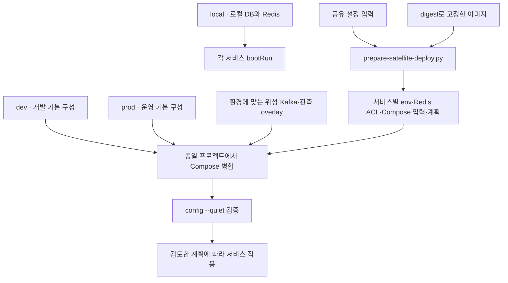

# 서버 실행 · 배포 도구

> 환경별 컨테이너 구성과 서비스 분리·데이터 이관 절차를 재현하는 도구 모음입니다.

[서버 전체 보기](../README.md) · [시스템 아키텍처](../../docs/architecture/system-architecture.md) · [관측 스택](../observability/README.md)

## 1. 구성 방식

기본 Compose에 필요한 overlay를 합쳐 실행합니다. overlay는 서비스나 설정을 추가하는 파일이며 단독 실행을 전제로 하지 않습니다. 서비스 이름 `app`은 Data API를 뜻합니다.



Realtime·OSS 관측 overlay는 dev용입니다. 그림의 선택 항목을 모든 환경에 일괄 적용하는 구조는 아닙니다.

이 문서의 prod Compose·`gromo/prod/env` 설명은 기존 Gromo 구성을 대상으로 합니다. Catus 2.0의 실행 구성은 Infra 저장소의 `prod/catus/runtime`에서 관리하며, Phone의 `prod-ci.yml`·`prod-cd.yml` 실행은 [Catus 운영 절차](../../docs/prd/fishcat/server-separation/deployment.md#catus-20-운영-발행배포)를 따릅니다.

## 2. Compose 파일 안내

| 파일 | 용도 · 전제 |
| --- | --- |
| [local](docker-compose.local.yml) | 로컬 PostgreSQL 16·Redis 7. API는 호스트에서 실행 |
| [dev](docker-compose.dev.yml) | 개발 환경의 Data·DB·Redis 기본 구성 |
| [prod](docker-compose.prod.yml) | 운영 Data·Datadog 구성. DB는 외부 RDS |
| [realtime](docker-compose.realtime.yml) | dev에 채팅 DB 준비 작업·Realtime 추가 |
| [business](docker-compose.business.yml) | Business와 미리보기 전용 Redis 추가 |
| [satellites](docker-compose.satellites.yml) | Business·Notification·전용 Redis. 서비스별 env와 이미지 digest 필수 |
| [satellites.dev](docker-compose.satellites.dev.yml) | dev Nginx용 Business loopback 포트 8083. prod에는 적용하지 않음 |
| [satellites.data](docker-compose.satellites.data.yml) | 기존 Data의 env·이미지 교체. `!override` 지원 Compose 필요 |
| [kafka](docker-compose.kafka.yml) | 위성 이벤트 전달용 Kafka |
| [observability](docker-compose.observability.yml) | dev에 Prometheus·Grafana·Loki·exporter 추가 |
| [datadog](docker-compose.datadog.yml) | dev에 Datadog 관측 설정 추가 |

## 3. 환경별 실행 조합

환경마다 **한 줄**입니다. 저장소 루트 기준이고 실제 적용 전에는 같은 인자에 `config --quiet`를 먼저 붙여 봅니다. `<out>`은 [위성 배포 준비](#8-위성-배포-준비)가 만든 출력 디렉터리(서비스별 env·`compose.env`·Business Redis ACL)입니다.

```bash
# local — DB·Redis만 컨테이너. API 는 각 서비스 bootRun
docker compose -f server/scripts/docker-compose.local.yml up -d db redis
# local + Nginx(선택) — dev 와 같은 공개 라우팅을 «호스트에서 이미 떠 있는» Business·Realtime 앞에 세운다.
# 127.0.0.1:8088 → Business 8090 · Realtime 8085. 두 서비스가 안 떠 있으면 nginx 는 healthy 여도 그 경로는 502 다.
# ⚠️ 두 서비스의 기본 포트는 Business 8080 · Realtime 8081 이라 그대로 bootRun 하면 Data(8080)·Metro(8081)와 부딪히고
#    nginx 도 502 다. 로컬에서는 아래처럼 포트를 옮겨 띄운다(다른 필수 env 는 각 서비스 README).
#    Business 의 폐기 세션 거부 목록은 기본 1시간이라, 로컬 data-api 의 AT 수명(예시 30일)에 맞춰 늘린다.
(cd server/business-api && SERVER_PORT=8090 AUTH_REVOKED_SESSION_TTL=2592000s ./gradlew bootRun)
(cd server/realtime && SERVER_PORT=8085 ./gradlew bootRun)
docker compose -f server/scripts/docker-compose.local.yml --profile nginx up -d nginx
LOCAL_BUSINESS_PORT=8083 LOCAL_REALTIME_PORT=8081 docker compose -f server/scripts/docker-compose.local.yml --profile nginx up -d nginx   # 포트가 다를 때 — 셸 env 면 된다
curl -si 127.0.0.1:8088/actuator/health | head -1; curl -si 127.0.0.1:8088/health | head -1   # 404 · 200(Business 응답) 이면 정상. 200 대신 502 면 Business 가 안 떠 있는 것
docker compose -f server/scripts/docker-compose.local.yml --profile nginx rm -sf nginx   # nginx 만 내린다. `--profile nginx down` 은 db·redis 까지 내리니 쓰지 않는다
# 이동 측정(docs/prd/fishcat/island-movement/scripts)처럼 게스트를 한 번에 15명 만들 때 — 게스트 발급 상한(IP당 10/시간)을 env 로 연다
(cd server/data-api && AUTH_GUEST_RATE_LIMIT_MAX=1000000 AUTH_GUEST_RATE_LIMIT_MAX_GLOBAL=1000000 ./gradlew bootRun)   # application-local.yml.example 의 auth.guest.rate-limit 자리표시자 — 이미 application-local.yml 이 있으면 같은 블록을 직접 추가

# dev (GCP gromo-dev-app) — Data·Postgres·공유 Redis·Realtime·Kafka·Business(+전용 Redis)·Notification. compose 에 nginx 없음(호스트 systemd Nginx 가 공개 라우팅)
# dev VM 에 영구 env 없음(GROMO-2224) — CD·ops-*.dev 워크플로가 job 마다 SM 에서 임시로 만든다. 수동이면
# RUNTIME_ENV_FILE=$(.github/scripts/dev-env.sh) 로 만들고(SM 읽을 AWS 자격 필요) 쓰고 나서 지운다. <out> 은 위성 env 임시 폴더.
# 전체 기동이면 Data 이미지도 넘긴다 — 인자 없이 만들면 phone-data-api 가 없는 새·복구 VM 에서 APP_IMAGE 가 자리표시라 pull 이 실패:
#   RUNTIME_ENV_FILE=$(.github/scripts/dev-env.sh asia-northeast3-docker.pkg.dev/oneorthree2/data-api/data-api@sha256:<digest>)
# REALTIME_IMAGE 필수(기본값 없음) — 지금 떠 있는 것: REALTIME_IMAGE=$(docker inspect -f '{{.Config.Image}}' phone-realtime)
REALTIME_IMAGE=<…/realtime/realtime:sha 또는 @digest> docker compose -p phone --env-file "$RUNTIME_ENV_FILE" --env-file <out>/compose.env -f server/scripts/docker-compose.dev.yml -f server/scripts/docker-compose.realtime.yml -f server/scripts/docker-compose.kafka.yml -f server/scripts/docker-compose.satellites.yml up -d

# prod (AWS gromo-prod) — nginx·Data·datadog-agent·Kafka·Business(+전용 Redis)·Notification. DB 는 RDS, Realtime 없음
docker compose -p "$PROD_PROJECT" --project-directory <prod 배포 디렉터리> --env-file <prod 배포 디렉터리>/.env.prod --env-file <out>/compose.env -f server/scripts/docker-compose.prod.yml -f server/scripts/docker-compose.kafka.yml -f server/scripts/docker-compose.satellites.yml up -d
```

| 환경 | 파일 조합 | 지금 자동으로 도는 부분 | 사람이 붙이는 부분 |
| --- | --- | --- | --- |
| local | local (+`--profile nginx`) | — | 전부. nginx 프로필은 아래 불릿 |
| dev | dev (+datadog) (+kafka) (+satellites.data.dev) → + realtime · satellites · satellites.dev | `data-api-cd.dev.yml`: 기존 DB를 유지하며 `data-api`만 갱신 | Realtime(`up -d realtime`) · 위성(Satellite Dev CD) · Kafka 기동(Actions **Dev Kafka**) |
| prod | prod (+kafka) (+satellites (+satellites.data)) | 없음 — 옛 `prod-cd.yml`(SSM 으로 `docker-compose.prod.yml` 단독 `up -d`)은 GROMO-2224 에서 삭제 | 위성·Kafka 전부 수동. Realtime 은 prod 배선 자체가 없다 |

- **local nginx 프로필**(GROMO-2216): [dev 공개 라우팅 정본](nginx-dev-2.0-routes.conf.example)을 [`nginx-local-routes.sh`](nginx-local-routes.sh)가 기동 때 읽어 upstream 두 곳만 호스트 포트로 치환해 그대로 쓴다 — `/internal`·`/actuator`·옛 경로 404 와 신원 헤더 비움이 dev 와 같다. 변수는 셸 env 로 준다(`.env` 불필요).
  - **선행 조건**: Business·Realtime 이 호스트에서 떠 있어야 한다. 기본 포트 8090·8085 는 서비스 yml 값이 아니라 **로컬 기동 관례**다 — Data 가 8080, Metro 가 Realtime 기본 8081 을 쓰므로 둘을 비켜 `SERVER_PORT` 로 띄운 값. 다른 포트로 띄웠다면 `LOCAL_BUSINESS_PORT`·`LOCAL_REALTIME_PORT` 를 그 값으로 맞춘다.
  - **헬스체크는 upstream 을 보지 않는다**: 정본의 `location / → 404` 를 「라우팅이 올라왔다」는 신호로 쓰므로 두 서비스가 꺼져 있어도 healthy 다. 그때 `/health`·`/auth/...`·`/ws/realtime` 은 502(실측). 즉 **healthy + 502 = 호스트 서비스를 먼저 띄운다**.
  - `LOCAL_NGINX_BIND`(기본 `127.0.0.1`) · `LOCAL_NGINX_PORT`(기본 8088): nginx 가 듣는 주소·포트. **`LOCAL_NGINX_BIND=0.0.0.0` 은 LAN 실기기 테스트용이다** — TLS 가 없어 토큰이 평문으로 지나고 앞단 인증이 없어 같은 LAN 의 누구나 bootRun 중인 Business·Realtime 에 닿는다. 집·사무실 LAN 에서만 쓰고 공용 Wi-Fi 에서는 열지 않는다.
  - **WebSocket 을 이 경로로 붙이면 Realtime 에 `CHAT_WS_ALLOWED_ORIGINS=http://127.0.0.1:8088` 이 필요하다**(포트를 바꿨으면 그 포트, LAN 실기기면 `http://<LAN IP>:8088` 추가). 정본이 포트를 뗀 `$host`(`127.0.0.1`)를 넘겨 Origin 의 `:8088` 과 포트가 어긋나 same-origin 검사가 403 을 낸다 — dev 의 GROMO-2175 는 TLS 종단으로 scheme 이 갈린 경우라 결과만 같다.
  - **내릴 때**: nginx 만 내리려면 `--profile nginx rm -sf nginx`. `--profile nginx down` 은 프로필 없는 db·redis 까지 내린다(Compose 프로필 규칙). 프로필 없이 `down` 하면 반대로 nginx 만 빠져 8088 을 계속 잡는다.
  - **Linux**: `host-gateway` 가 브리지 IP(예 `172.17.0.1`)라 bootRun 이 `127.0.0.1` 만 듣고 있으면 502 다 — `0.0.0.0` 에 바인드하거나 방화벽의 브리지→호스트 허용을 확인한다.
- Data 를 전용 env 로 바꿀 때만(준비 도구를 `--data-image`로 실행해 `compose.env`에 `DATA_API_ENV_FILE`·`DATA_API_PROFILES`가 있을 때) dev에서는 `docker-compose.satellites.data.dev.yml`, prod에서는 `docker-compose.satellites.data.yml`을 **마지막 `-f`**로 더합니다. dev CD는 전용 env가 없거나 유효하지 않으면 배포를 중단합니다.
- prod 호스트에는 레포가 없고 옛 `prod-cd.yml`(GROMO-2224 에서 삭제)이 `docker-compose.prod.yml`만 S3 로 올렸습니다. prod 줄의 `server/scripts/…`는 같은 커밋의 파일을 호스트에 옮겨 둔 경로로 바꾸고, `.env.prod`·`./deploy/nginx.conf`·`./certs`는 `--project-directory`(현행 배포 디렉터리) 기준으로 풉니다.
- prod 파일에는 `name:`이 없어 프로젝트명이 호스트 디렉터리에서 정해집니다. `satellites.yml`의 `name: phone`이 이를 바꾸지 않도록 `-p`에 `docker compose ls`로 확인한 현재 이름을 넣습니다.
- `docker-compose.business.yml`은 Notification 없이 Business 만 띄우는 옛 진입점입니다. `satellites.yml`과 **함께 쓰지 않습니다**(같은 서비스를 정의).
- dev 관측은 위 줄에 `-f server/scripts/docker-compose.datadog.yml` 또는 `-f server/scripts/docker-compose.observability.yml`을 더합니다.

### `/static` 카탈로그 이미지 (GROMO-2331)

- 이미지는 `server/static/customization/<kind>/<이름>.<sha8>.png`(내용 해시 파일명 — 만들 때 `static-hash.sh <원본.png> <kind>`)이고 Business 를 거치지 않고 Nginx 가 `/static/` 으로 직접 준다(`Cache-Control: public, max-age=31536000, immutable`). 로컬 nginx 프로필은 compose 볼륨으로 이 폴더를 마운트한다.
- dev 는 VM 디스크에 수동 복사한다(맵 에셋과 같은 절차). prod 의 `/static/` location 은 인프라 레포 몫이다.
- 로컬 확인은 `psql … -f server/scripts/local/seed-customization.sql` 로 오리 모자를 심고, Business 에 `STATIC_ASSETS_BASE_URL=http://<맥 IP>:8088`(비우면 상대 경로)을 준다.

## 4. 시크릿·스위치 — 비었을 때의 동작

dev 의 compose 보간 입력 `dev.env`와 Data·위성 컨테이너 env 는 CD·`ops-*.dev` 워크플로가 **job 마다** Secrets Manager 에서 임시로 만들고 끝나면 지웁니다([`dev-env.sh`](../../.github/scripts/dev-env.sh) → [`write-compose-env.py`](../../.github/scripts/write-compose-env.py)). 원본은 `gromo/dev/env` 하나이고, 서버별로 필요한 키만 고르는 건 `write-compose-env.py` 허용목록입니다. 그래서 dev 스위치는 파일이 아니라 **SM 키**로 바꾸고, 반영은 다음 배포 또는 Actions 의 `ops-redeploy.dev` 로 합니다. 필수 9개 외 아래 dev 행의 키는 SM 에 있을 때만 옮기고, 없으면 compose 기본값이 남습니다. 위성·Data 전용 env 는 같은 스크립트의 `--service` 허용목록이 정합니다. prod 의 Data 는 `.env.prod`(SM `gromo/prod/env` 전체)를 통째로 받습니다.

| 키 | 받는 쪽 · 경로 | 비었을 때 |
| --- | --- | --- |
| `SVC_TOKEN_DATA_TO_REALTIME` | Realtime(dev.env → `realtime.yml`) · Data(satellites 프로파일, `data-api.env` 선택) | Realtime `POST /internal/events` 가 401 → Data relay 의 REALTIME 행이 전달되지 않고 재시도로 남는다. Data 는 relay OFF 면 무영향, relay ON 이면 기동 거부 |
| `REALTIME_BASE_URL` | Business(`business-api.env` **필수**) · Data(satellites, 선택) | Business: writer 가 env 생성 단계에서 거부(수동 누락 시 부팅 fail-fast). Data: relay ON 이면 기동 거부 |
| `SVC_TOKEN_BIZ_TO_REALTIME` | Business(**필수**) · Realtime(dev.env → `realtime.yml`) | Realtime 쪽이 비면 우체통 내부 어댑터 `/internal/*` 401 → 섬 편지 저장 실패. `SVC_TOKEN_DATA_TO_REALTIME`과 같은 값이면 writer 가 모든 모드에서 거부한다(Data 자격으로 우체통을 부를 수 있게 되므로) |
| `BUSINESS_CURSOR_ENABLED` · `BUSINESS_CURSOR_KEY_V1` | Business(**필수**) | writer 가 거부. 손으로 비우면 부팅·헬스는 정상인데 커서 목록(`GET /islands`·`/islands/discover`·`/islands/{id}/members`·`/islands/{id}/join-requests`·`/me/join-requests`)만 503 |
| `BUSINESS_CURSOR_ACTIVE_KEY` | Business(선택) | `v1` |
| `APPLE_TEAM_ID` · `APPLE_KEY_ID` · `APPLE_PRIVATE_KEY` | Business(선택) | 부팅·헬스는 정상, 시작 시 WARN 한 줄. 탈퇴 요청에 `appleAuthorizationCode` 가 와도 Apple 토큰 폐기를 건너뛰고 WARN 만 남긴다(탈퇴는 성공, GROMO-2401). 값은 Apple Developer 의 「Sign in with Apple」 키(.p8)에서 온다 — Team ID · Key ID · PKCS#8 PEM 전문(개행은 `\n` 리터럴이어도 된다). `APPLE_CLIENT_ID`(Data 의 aud 목록)와 별개다 — Business 는 client_id 를 yml(`apple.revoke.client-id`)에 둔다 |
| `LOGIN_ATTEMPT_DIGEST_SECRET` | Business(**필수**) | writer 가 거부(부팅 fail-fast) |
| `JWT_SECRET` | Data(legacy **필수**) · Business(**필수**) · Realtime(dev.env → `realtime.yml`) | writer 가 거부. 세 서비스가 **같은 값**이어야 한다 — 다르면 한 곳이 서명한 AT 를 나머지가 전부 401 로 거절한다. `LOGIN_ATTEMPT_DIGEST_SECRET` 과는 달라야 한다 |
| `APPLE_CLIENT_ID` · `GOOGLE_CLIENT_ID` | Data(legacy **필수**). Business env 로도 옮겨지지만 Business 코드는 읽지 않는다 — 제공자 토큰 검증은 Data 가 한다 | writer 가 거부(키 자체가 없을 때). 값이 빈 문자열이면 부팅은 되고 경고 한 줄만 남긴 채 그 제공자 로그인이 **전부** 401 `APPLE_TOKEN`·`GOOGLE_TOKEN`. 값은 쉼표로 구분한 허용 `aud` 목록이다(계정 정책 LOGIN-D03) — Apple 은 앱 번들 id(`com.oneorthree.focuscat`, 1.x `com.oneorthree.gromo`), Google 은 **Web 클라이언트 id**(2.0 은 `263851348176-hpndg0cj…`, GROMO-2215). 바꿀 때는 기존 값을 지우지 않고 **덧붙인다** — 설치된 구 빌드가 옛 `aud` 로 들어온다. 발급·확인 절차는 개인 문서가 아니라 이 표가 정본이다 |
| `OUTBOX_RELAY_REALTIME_KAFKA_ENABLED` | Data(satellites, 선택) | `false` — REALTIME 을 HTTP 로 보낸다 |
| `OUTBOX_RELAY_RUN_LENGTH` · `OUTBOX_RELAY_WORKER_THREADS` · `OUTBOX_RELAY_TICK_BUDGET` | Data(satellites, 선택) | `10` · `4` · `PT5S` — 축마다 앞쪽 10건을 한 번에 집고, 축 4개를 병렬로 보내고, 한 틱이 5초 안에서 빌 때까지 라운드를 반복한다(GROMO-2338). poll 1s 면 relay 가 일하는 비율 ≈ 5/(5+1) ≈ 83%. relay 동시 DB 커넥션은 최대 worker-threads + 1(Hikari 기본 10). `1`·`1`·`PT0S` 면 2337 까지의 동작(축당 틱당 1건)이다. **`OUTBOX_RELAY_LEASE_DURATION` 은 `run-length × http-read-timeout`(기본 10 × 10s) 보다 충분히 커야 한다** — 축 안은 순차라 뒤 행이 앞 행 전송을 기다리는 동안 리스가 만료되면 그 축이 멈추고 나머지를 놓는다(순서는 안전하지만 처리량이 떨어진다) |
| `CHAT_WS_ALLOWED_ORIGINS` | Realtime(dev.env → `realtime.yml`) | Origin 을 보낸 WS 핸드셰이크 전부 403. React Native 앱도 접속 URL 기준 `Origin: https://<API 호스트>` 를 보내므로 **앱 실시간 연결이 끊긴다**. dev 는 `https://oneorthree.dev.mooo.com`(GROMO-2175). 기본값을 `*` 로 열지 않는다 |
| `REALTIME_EVENTS_KAFKA_ENABLED` | Realtime(dev.env) | `false` — `realtime-events` 소비자가 뜨지 않는다 |
| `REALTIME_MOVEMENT_MULTI_INSTANCE_ENABLED` | Realtime(dev.env → `realtime.yml`) | `true`(기본, 비어 있어도 ON) — 섬마다 소유자 리스 `movement:owner:*` 를 든 한 대가 이동 방을 돌리고 나머지는 `chat:movement:cmd:v1`·`frames:v1` 로 중계한다(GROMO-2339, ADR A26). 1대여도 같은 경로라 리스 갱신이 1초마다 돈다. `false` 로 끄면 Redis 를 쓰지 않는 단일 인스턴스 현행 경로 — **끈 채 2대 이상이면 같은 섬 방이 인스턴스마다 따로 생겨 서로 안 보인다**. PING 은 소유자별 채널 `chat:movement:cmd:v1:<instanceId>`(GROMO-2352)로 가므로 1대면 소유자가 자기라 PING 이 안 나가고, poll p95 기준치는 2대(2353) 뒤에 잡는다. |
| `KAFKA_BOOTSTRAP_SERVERS` | Realtime(dev.env) · Data·Notification(서비스 env) | Realtime·Data 는 `kafka:9092`. Notification 은 필수 |
| `FOCUS_SESSION_START_ENABLED` | Data(dev.env → `dev.yml`, `data-api.env` 선택) | `false` — 새 집중 start 만 503 |
| `FOCUS_PRESENCE_ENABLED` | Data(같은 경로) | `false` — 프레즌스를 쓰지 않는다 |
| `SVC_TOKEN_REALTIME_TO_DATA` | Realtime(dev.env → `realtime.yml`) · Data(`data-api.env`), **필수** | env writer와 Compose가 배포 준비를 거부한다. 섬 목록 `GET /internal/users/{userId}/islands`를 포함한 내부 조회에 쓰며, Data와 Realtime에 같은 값을 넣는다 |
| `REALTIME_AUTHORIZATION_DATA_URL` | Realtime(선택) | 미지정이면 응원·차단 조회는 fail-closed로 거절한다. 현재 멤버십 인가 클라이언트를 켠 배포는 기동 검증에서 거부한다. 섬 목록이 쓰는 `DATA_API_BASE_URL`과 별도 설정이다 |
| `REALTIME_BLOCKS_FILTER_ENABLED` · `USER_BLOCKS_REALTIME_EVENTS_ENABLED` | Realtime(dev.env → `realtime.yml`) · Data(`data-api.env` 선택) | `false` — 받는 사람 기준 차단 필터(GROMO-2182)가 꺼져 있고 Data 는 `user.blocks.updated` 를 만들지 않는다. 켜는 순서는 `server/realtime/CLAUDE.md` Contracts 6번 |
| `REALTIME_AUTHORIZATION_WAIT_TIMEOUT` · `REALTIME_AUTHORIZATION_CACHE_TTL_SECONDS` | Realtime(선택, `REALTIME_AUTHORIZATION_CLIENT_ENABLED=true` 일 때만 의미) | `200ms`·`30` — 현재 멤버십 HTTP 판정의 동시 상한(`REALTIME_AUTHORIZATION_MAX_IN_FLIGHT`, 16)이 찼을 때 기다리는 시간(총 예산 1.5s 에 포함, `0` = 바로 503)과 «허용» 결정 캐시 TTL(초, `0` = 끔; 거절은 캐시 안 함, 멤버십 사건·탈퇴가 즉시 지움. 사건은 한 인스턴스에만 닿으므로 다중 인스턴스에서 즉시성이 필요하면 `0`). GROMO-2342 |
| `CHAT_WEBSOCKET_HEARTBEAT_SERVER_MS` · `CHAT_WEBSOCKET_HEARTBEAT_CLIENT_MS` | Realtime(선택, dev.env → `realtime.yml`) | `10000`·`10000` — STOMP heartbeat(GROMO-2341). CONNECTED 가 `heart-beat:<server>,<client>` 로 협상하고, 클라이언트가 3×max(client, 앱 송신 주기) 동안 아무것도 안 보내면 브로커가 세션을 닫는다(ERROR `Session closed.` 를 보내며 1002 종료). 앱(`islandRealtime.ts`) 10s/10s 와 맞추고 Cloudflare 유휴 100s 보다 짧게 둔다 |
| `CHAT_DATA_API_MAX_CONCURRENCY` | Realtime(선택, OFF 모드 `GroupClient`) | `32` — 캐시 미스 시 내부 `GET /internal/users/{userId}/islands` 동시 호출 상한. 넘으면 `chat.data-api.timeout-ms`(2s)까지 기다리다 503. 연결·읽기 타임아웃 2s 는 `SimpleClientHttpRequestFactory`(소켓 읽기마다 적용), keep-alive 는 JDK 기본. GROMO-2342 |
| `FOCUS_SEA_REALTIME_EVENTS_ENABLED` | Data(`data-api.env` 선택) | `false` — Data 는 바다 방 사건 `sea.member.updated`(GROMO-2299)를 만들지 않는다. **Realtime 이 이 type 을 받는 버전으로 먼저 배포된 것을 확인한 뒤 켠다** — 옛 Realtime 은 400 → relay 가 그 사용자의 USER 축을 영구 차단하고 USER 축은 `user.withdrawn` 과 같은 축이라 탈퇴 전파까지 멈춘다. 배포 순서는 `doc/sea-voyage-2026-10-17/contract.md` §8 |
| `AUTH_SESSION_REVOKED_REALTIME_EVENTS_ENABLED` | Data(`data-api.env` 선택) | `false` — Data 는 세션 폐기 사건 `auth.session.revoked`(GROMO-2350)를 NOTI 에만 보내고 Realtime 에는 보내지 않는다(폐기된 세션의 STOMP 연결이 AT 만료까지 산다). **Realtime 이 이 type 을 받는 버전으로 먼저 배포된 것을 확인한 뒤 켠다** — 옛 Realtime 은 400 → relay 가 그 행을 permanent 로 표시하지만(A18 보류라 폐기하지는 않고) 백오프 재시도(지수, 상한 2^16 초)를 계속해 그동안 그 사용자의 USER 축이 막혀 탈퇴 전파가 늦어진다. **켜기:** realtime 이 이 type 을 받는 버전으로 배포됐는지 머지 PR 의 `deployed:dev-realtime` 라벨(Deployments `dev-server/realtime`)로 확인(`deploy-failed:dev-realtime` 이면 켜지 않는다) → SM `gromo/dev/env` 에 `=true` 등록 → `ops-redeploy.dev` data-api. **끄기:** SM 값을 `false` 로(또는 삭제) → `ops-redeploy.dev` data-api — 이미 쌓인 REALTIME 행은 relay 가 계속 보내므로 realtime 이 살아 있으면 무해 |
| `ISLAND_ARRIVAL_REALTIME_EVENTS_ENABLED` | Data(`data-api.env` 선택) | `false` — Data 는 주민 첫 도착 사건 `island.member.arrived`(GROMO-2302)를 만들지 않는다(도착 API 는 그대로 동작하고 `arrivedBefore` 도 계산된다). **Realtime 이 이 type 을 받는 버전으로 먼저 배포된 것을 확인한 뒤 켠다** — 옛 Realtime 은 400 → relay 가 그 섬의 `ISLAND_ARRIVAL` 축을 영구 차단한다(그 섬 도착 소식만 영향). 배포 순서는 `doc/sea-voyage-2026-10-18/contract.md` §1.6 |
| `FOCUS_REWARD_ACCRUAL_ENABLED` | Data(같은 경로) | `false` — 분당 적립 크론이 돌지 않는다. 적립은 finish 가 한 번에 확정하므로 정상 종료는 제값을 받지만, **finish 를 안 거치는 강퇴·포기 세션은 그 시점까지의 몫을 못 받는다**. 켜는 것은 배포가 한 버전으로 수렴한 뒤 — 혼합 버전 창에서는 새 크론과 옛 `finish` 가 다른 멱등 키로 이중 지급한다 |
| `ISLAND_BOARD_WRITES_ENABLED` | Data(dev.env → `dev.yml`, `data-api.env` 선택) | `false` — 섬 게시판 공지 작성·수정·삭제·댓글 작성·댓글 삭제 5종이 503 `NOTICE_WRITE_UNAVAILABLE`. BQ02·BQ03 는 2026-09-25 결정(GROMO-2136)으로 확정됐지만 prod 개방은 별도 릴리스 결정이라 기본값은 그대로 `false` |
| `ISLAND_MANAGEMENT_COMMANDS_ENABLED` · `ISLAND_MANAGEMENT_HOST_TRANSFER_ENABLED` | Data(dev.env → `dev.yml`, `data-api.env` 선택) | `false` — 섬 정보 수정·가입 승인/거절·강퇴·나가기 4종이 503 `ISLAND_MANAGEMENT_NOT_READY`, 방장 위임이 503 `REALTIME_NOT_READY`. dev 는 2026-09-29 relay ON·강퇴 채팅 차단 검증(GROMO-2140) 뒤 켰다. prod 개방은 별도 결정 |

섬 목록·멤버십·차단 조회는 Realtime 서비스 자격으로 Data 내부 API를 호출합니다. `SVC_TOKEN_REALTIME_TO_DATA`는 공유 dev env와 Data 전용 env 모두 필수이며, Data 기본 프로파일은 `<환경>,satellites,realtime-authorization`입니다. `--data-profiles`로 덮어쓸 때도 두 내부 API 프로파일을 포함해야 합니다. 응원 인가와 받는 사람 기준 차단 필터의 활성화 순서는 [runtime.md «dev 에서 켜는 순서»](../../docs/prd/fishcat/server-separation/runtime.md#dev-에서-켜는-순서)를 따릅니다.

## 5. 컨테이너 로그 보존

모든 서비스에 `json-file` 크기 회전을 둡니다. 정본은 [계정 정책 L09](../../docs/prd/fishcat/account/policy.md#로그분석-보존-기간)입니다.

| 묶음 | 서비스 | 값 | 상한 |
| --- | --- | --- | --- |
| 앱 로그 | Data·Realtime·Business·Notification·prod nginx | `max-size 50m` · `max-file 4` | 컨테이너당 200 MB |
| 인프라 | Postgres·Redis·Kafka·datadog-agent·관측 스택·일회성 잡 | `max-size 10m` · `max-file 3` | 컨테이너당 30 MB |

- JVM 서비스의 stdout 은 logback APP 로그(L01, **7일**)와 같은 내용이므로 목표는 7일입니다. Docker 는 **기간이 아니라 크기로만** 지우므로 200 MB 는 「하루 약 30 MB 이하」를 가정한 근사치입니다. 로그가 더 적으면 7일보다 오래 남고, 많으면 일찍 지워집니다.
- 실측 후 보정합니다. 하루 뒤 `sudo du -h $(docker inspect -f '{{.LogPath}}' <컨테이너>)*`로 일 증가량을 재고 `max-size × max-file ≈ 7 × 일 증가량`이 되도록 이 파일들의 앵커 한 줄을 고칩니다.
- `logging`이 바뀐 컨테이너는 다음 `up`에서 **재생성**됩니다. dev CD는 `up -d --no-deps data-api`로 DB 재생성을 막습니다. `redis`는 app 의존성이 아니라 사람이 `up -d redis`를 할 때 적용됩니다. prod 는 SSM 의 `up -d`가 nginx·agent 까지 재생성합니다.

## 6. Business Redis ACL 반영

Redis 는 `--aclfile`을 **기동 때만** 읽습니다. `default` 사용자를 꺼 두어 `ACL LOAD`를 부를 수 있는 사용자도 없습니다. `BUSINESS_REDIS_PASSWORD`를 바꿔 ACL 파일을 다시 만들었다면 위성보다 먼저 재생성합니다(준비 도구의 계획 2단계).

```bash
docker compose <위 환경 줄의 -p·--env-file·-f 그대로> up -d --force-recreate business-redis
```

ACL 파일은 원자 교체(새 inode)라 `restart`만으로는 기존 단일 파일 바인드가 옛 내용을 볼 수 있습니다. 캐시 전용(저장 없음)이라 재생성으로 비워져도 다시 채워집니다.

## 7. 자주 쓰는 명령

모든 예시는 **저장소 루트 기준**입니다.

### 로컬 의존성

```bash
docker compose -f server/scripts/docker-compose.local.yml up -d db redis
docker compose -f server/scripts/docker-compose.local.yml ps
docker compose -f server/scripts/docker-compose.local.yml --profile nginx up -d nginx   # dev 와 같은 공개 라우팅(선택) — 변수·주의는 §3 local nginx 프로필
docker compose -f server/scripts/docker-compose.local.yml --profile nginx down   # 전부 내린다(db·redis 포함). nginx 만이면 rm -sf nginx
```

### 기존 dev에 Realtime 추가

평소엔 `realtime-cd.dev` 가 배포합니다. 수동 예시는 `phone` 프로젝트 기준이고, env 는 `RUNTIME_ENV_FILE=$(.github/scripts/dev-env.sh)` 로 임시로 만든 뒤 쓰고 지웁니다(SM 을 읽을 AWS 자격 필요, VM 에 영구 env 없음). `REALTIME_IMAGE`(예: `asia-northeast3-docker.pkg.dev/oneorthree2/realtime/realtime:<sha>`)는 필수입니다 — 기본값이 없어 비면 compose 가 실패합니다. `APP_IMAGE` 는 `dev-env.sh` 가 넣어 줍니다.

```bash
# 띄울 이미지 — 지금 떠 있는 것을 유지하려면: export REALTIME_IMAGE=$(docker inspect -f '{{.Config.Image}}' phone-realtime)
export REALTIME_IMAGE=asia-northeast3-docker.pkg.dev/oneorthree2/realtime/realtime:<sha>

docker compose -p phone --env-file "$RUNTIME_ENV_FILE"   -f server/scripts/docker-compose.dev.yml   -f server/scripts/docker-compose.realtime.yml config --quiet

docker compose -p phone --env-file "$RUNTIME_ENV_FILE"   -f server/scripts/docker-compose.dev.yml   -f server/scripts/docker-compose.realtime.yml up -d realtime
```

Compose가 DB·Redis 및 `realtime-db-init` 의존성을 함께 처리합니다. 기존 `chat` 이름의 서비스는 자동으로 중지되지 않으므로 인스턴스 전환 절차에서 확인합니다.

## 8. 위성 배포 준비

[`prepare-satellite-deploy.py`](prepare-satellite-deploy.py)는 공유 SecretString JSON을 표준입력으로 받고 서비스별 허용목록에 맞는 env, Business Redis ACL, Compose 보간 입력과 적용·복구 계획을 생성합니다. 이미지가 `REPOSITORY@sha256:<64hex>` 형식인지 검사합니다.

```bash
python3 server/scripts/prepare-satellite-deploy.py --help
```

| 주요 인자 | 의미 |
| --- | --- |
| `--environment dev\|prod` | 대상 환경 |
| `--phase transition\|final` | 전환 단계, 기본 transition |
| `--output-dir` | 생성 파일 디렉터리 |
| `--base-compose`, `--shared-env-file` | 기존 배포 구성·런타임 설정 |
| `--business-image`, `--notification-image` | 위성 이미지 digest |
| `--data-image`, `--data-profiles` | Data 교체를 준비할 때 사용 |
| `--project-name` | 기존 Compose 프로젝트명 |

이 도구의 결과는 **준비된 파일과 계획**입니다. Compose 실행, Secrets Manager 조회, nginx 재적재, 발송 게이트 활성화는 수행하지 않습니다. 실제 적용 명령은 생성된 계획에서 확인합니다.

위성 라우팅의 참고 설정은 [nginx 경로](nginx-satellites.include.conf.example), [프록시 헤더](nginx-satellites-proxy-headers.conf.example)에 있습니다.

## 9. DB 준비와 데이터 이관

### 알림 DB와 계정

[`provision-notification-db.sh`](provision-notification-db.sh)는 [SQL](provision-notification-db.sql)을 실행해 알림 database와 전용 계정을 준비합니다. 관리자 연결에는 `PGHOST`, `PGUSER`와 libpq 인증 설정을 사용하며 다음 값이 필요합니다.

- `API_DB_USERNAME`, `CORE_DB_NAME`: 기존 Data 계정·database.
- `NOTI_DB_USERNAME`, `NOTI_DB_PASSWORD`: 알림 전용 계정.

실행 전 대상 DB를 확인하고 서비스 환경변수 분리 절차와 함께 적용합니다.

### Catus V0 전환과 Data·Realtime 동시 교체

기존 dev와 Catus prod DB는 [Data V0 전환 절차](../data-api/docs/db/README.md)의 읽기 전용 계획·백업·writer 중지·검증을 거쳐 전환합니다. 독립 Link 서비스의 정지 스냅샷 이관 경로와 실행 도구는 폐기했습니다. 현행 섬 초대 링크는 Data 내부 API가 관리합니다.

**Data와 Realtime은 같은 중단 창에서 교체해야 합니다.** 새 Data는 `/api/v1/groups`를 제공하지 않으며, 새 Realtime은 서비스 토큰으로 `GET /internal/users/{userId}/islands`를 호출합니다. 구 Realtime과 새 Data를 함께 서비스하면 섬 멤버십 조회가 실패합니다.

1. 배포 전에 두 이미지와 runtime 설정을 준비합니다. Data는 `<환경>,satellites,realtime-authorization` 프로파일과 `SVC_TOKEN_REALTIME_TO_DATA`가 필요하며, Realtime에도 같은 토큰을 주입합니다. Data를 호출할 주소와 서비스 토큰이 배포 설정에 반영되어 있어야 합니다.
2. Catus prod는 Infra의 `prod/catus/runtime`에 `SPRING_PROFILES_ACTIVE=prod,satellites,realtime-authorization` 및 양쪽 서비스 토큰을 **재시작 전에** 반영합니다. 이 저장소의 옛 Gromo 1.x `docker-compose.prod.yml`이나 env writer 검증만으로 외부 Catus runtime이 바뀌지 않습니다.
3. 트래픽과 Data·Realtime 및 DB writer를 중지하고 진행 중 요청을 소진한 뒤 V0 전환을 수행합니다. 전환 검증이 성공하면 같은 창에서 새 Data와 새 Realtime을 기동합니다.
4. Data 내부 섬 목록 인증·응답과 Realtime의 섬 입장·채팅 연결을 확인한 뒤 트래픽을 재개합니다. 스키마 전환 뒤 복구는 V0 문서의 백업·검증 절차를 따릅니다.

개발 환경의 자동 진입점은 `data-api-ci.dev.yml`입니다. Data 또는 Realtime 입력이 바뀌면 같은 main SHA로 두 이미지를 검사·발행하고, 두 digest를 `data-api-cd.dev.yml`에 함께 전달합니다. 해당 push가 위성 CI 대상이면 같은 SHA의 Business·Notification 배포 완료를 먼저 기다립니다. Realtime CI는 PR 검사와 재사용 빌드만 담당하며 독립 Realtime CD는 없습니다.

공동 CD의 [`deploy-core-dev.py`](../../.github/scripts/deploy-core-dev.py)는 이미지 OCI revision·digest, 실제 Compose의 공유 토큰·프로파일, DB 전환 패키지, nginx stop/start 권한을 먼저 검증합니다. nginx가 실행 중이었다면 멈추고 Data·Realtime·Business·Notification 및 Data DB 관측 연결을 중지합니다. DB·Redis·Kafka와 볼륨은 유지합니다. 이미지에 포함된 `deploy-v0.py`로 DB 백업·기존 migration 보완·V0 전환을 수행한 뒤 새 Data·Realtime을 함께 시작합니다. 두 컨테이너의 readiness와 이미지가 확인되면 원래 실행 중이던 위성·관측 및 nginx를 복원합니다.

진행 기록과 백업은 러너 계정의 `~/.local/state/catus/dev/`에 보존됩니다(디렉터리 0700, JSON 0600). 이 경로를 작업 디렉터리 정리 대상에 넣지 않습니다. 실패하면 nginx와 writer는 닫힌 상태를 유지합니다. **실패한 동일 SHA·digest의 공동 CD job을 재실행**하면 DB 실제 상태를 다시 확인하고 이어서 처리합니다. 다른 SHA의 배포나 일반 ops·위성 배포는 미완료 기록이 있으면 거부됩니다. 정상 배포의 설정만 재적용할 때는 `Ops Dev Redeploy`에서 Data 또는 Realtime을 선택하며, 두 경우 모두 마지막 공동 배포 job을 재실행합니다. 이전 독립 배포 이력은 선택하지 않습니다.

## 10. 로그 S3 적재본 수명 주기

[`s3-log-archive-lifecycle.json`](s3-log-archive-lifecycle.json)은 운영 로그 적재 버킷 `gromo-prod-logs-808715036056`(AWS 프로필 `gromo`)의 만료 규칙입니다. 접두 세 개 모두 **90일**입니다.

| 접두 | 내용 | 적재 경로 |
| --- | --- | --- |
| `system_log/app-N/` | `app.log` | 호스트 systemd 타이머가 매시간 업로드(티켓 590) |
| `user_log/app-N/` | `user-activity.log` | 같은 타이머(티켓 590) |
| `user-activity/dt=YYYY-MM-DD/` | user-activity 로그 | Fluent Bit 전환 예정 접두(티켓 790, 미완) |

로컬 logback 보존(APP 7일·user-activity 30일)과 S3 보존은 **다른 값**입니다. 기간 정본은 [계정 정책 로그·분석 보존 기간](../../docs/prd/fishcat/account/policy.md#로그분석-보존-기간)이며 S3 값을 바꾸면 이 파일과 정책 표를 함께 고칩니다.

**적용 완료 2026-09-19** — 이 파일은 버킷에 적용된 규칙의 기록입니다. 버킷의 Terraform 원본은 이 레포가 아니라 **`OneOrThree/terraform` 레포의 `aws-prod-server/s3.tf`**(티켓 590)입니다.

2026-09-21 기준 그쪽은 아직 버킷 전체 단일 규칙(`expire-90d` · `filter {}` · 90일 · 멀티파트 정리 없음)이라 이 파일과 **어긋나 있습니다**(동기화 티켓 GROMO-1948). `aws-prod-server/`는 로컬 state·수동 apply 구성이라 그 레포의 CI가 적용하지 않습니다 — 대신 누군가 로컬에서 `AWS_PROFILE=gromo terraform apply`를 돌리는 순간 위 규칙 3개가 `expire-90d` 하나로 되돌아갑니다. 동기화할 때는 접두 3개 규칙으로 교체하되, 종전 `expire-90d`가 버킷 **전체**를 만료시켰다는 점에 주의합니다. 접두 밖 객체는 교체 후 만료되지 않습니다.

`put-bucket-lifecycle-configuration`은 버킷의 기존 규칙 전체를 **교체**합니다. 먼저 현재 규칙을 조회해 다른 규칙이 있으면 이 파일에 합친 뒤 적용합니다.

```bash
aws --profile gromo s3api get-bucket-lifecycle-configuration --bucket gromo-prod-logs-808715036056
aws --profile gromo s3api put-bucket-lifecycle-configuration --bucket gromo-prod-logs-808715036056 \
  --lifecycle-configuration file://server/scripts/s3-log-archive-lifecycle.json
aws --profile gromo s3api get-bucket-lifecycle-configuration --bucket gromo-prod-logs-808715036056
```

## 11. 실행 전후 확인

- GitHub Actions의 `Dev Stack` 수동 워크플로는 main SHA의 Data API·Business/Notification·Realtime
  CI 상태와 dev 호스트의 Data API·DB·Redis·Realtime·Business·Notification·Kafka·Datadog 컨테이너
  상태를 한 Job Summary에 표시합니다. 기본 실행은 미기동 컴포넌트도 보고만 하며, 전체 스택을
  검증할 때는 `strict`를 켜서 미기동 또는 unhealthy 상태를 실패로 처리합니다.
- 병합 검증은 실제 적용과 동일한 `-p`, `--env-file`, `-f` 목록에 `config --quiet`를 사용합니다.
- Data의 서비스별 env 교체는 `app` 재생성을 수반합니다. 생성 계획의 적용·복구 순서를 따릅니다.
- 관측 스택만 멈출 때는 [관측 README의 stop 명령](../observability/README.md)을 사용합니다. 병합 구성의 `down`은 기본 앱·DB까지 내립니다.
- 관리 포트 `9091`은 내부 수집용이며 호스트에 공개하지 않습니다.
- 배포 준비·DB 권한·이관 회귀 검증 코드는 [`.github/scripts`](../../.github/scripts)에 있습니다.

## 12. Dev 알림 Kafka 컷오버

[`dev-notification-kafka-cutover.sh`](dev-notification-kafka-cutover.sh)는 사람이 수행해야 하는 dev
컷오버를 8단계로 안내합니다. Kafka 기동, relay 재시도 정책 기록, Notification 소비자 준비,
`notification-events`와 `notification-events.DLT`의 3파티션 검증, relay drain, 단방향 OUTBOX 전환을
순서대로 확인합니다.

```bash
./server/scripts/dev-notification-kafka-cutover.sh
```

실행 기록은 기본적으로 gitignored `doc/dev-notification-cutover.env`에 0600으로 저장됩니다.
스크립트는 Secrets Manager의 값을 자동 변경하거나 발송 gate를 열지 않습니다. 각 비가역 단계에서 사람이
실제 상태를 확인하고 승인해야 다음 단계로 진행합니다.
