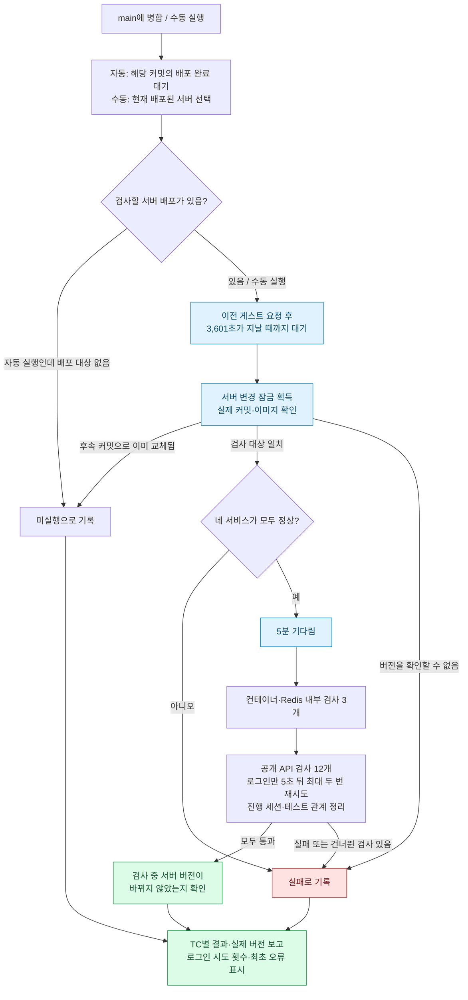

# FocusCat 스모크 테스트

[](https://github.com/OneOrThree/phone/actions/workflows/ops-smoke.dev.yml)

[GROMO-2285](https://romance.atlassian.net/browse/GROMO-2285) · Plannotator에서 합의한 서버 스모크 계획과 실행 방법

이번 구현은 서버 TC **001~010·014~018, 총 15개**다. 명세는 [server/TCL.md](server/TCL.md), 명령·환경변수는 [server/README.md](server/README.md)에 둔다. Android·iOS·Web은 추후 같은 플랫폼 폴더에서 관리한다.

공개 API·웹소켓 검사는 로컬 명령으로 원격 BASE_URL을 검사할 수 있다. 컨테이너 health·Redis·DB 초기 준비는 검사 대상 서버에서 실행한다. 토큰과 DB 접속 설정은 결과 artifact에 넣지 않는다.

## 전체 실행 흐름



배포 대기·게스트 요청 제한 창 대기는 서버 변경 잠금을 잡지 않는다. 내부 검사에 실패해도 공개 API 검사를 진행해 결과를 함께 남긴다.
배포 대기·버전 확인·정리 실패도 전체 실패이며, 「미실행」은 15개 TC 통과와 구분한다.
실제 서비스 버전이 일치하고 전체 검사가 통과한 뒤에만 성공 이미지 이력을 갱신한다.

[로그인 AS IS / TO BE](server/login-retry.md) · [실행·재시도 설정](server/README.md#로그인이-늦을-때) · [TC 명세](server/TCL.md) · [검증 기록](server/verification.md)

## 1. 수행 조건 — 사전에 명시·준비되는 세 가지

### 1-1. 매뉴얼 (체크리스트)

복잡한 시나리오가 아닌, 핵심 기능·경로를 빠르게 확인하는 단순 체크리스트.

- 실체: 서버 TC는 `smoke/server/TCL.md`에 도메인별로 정리한다(정본). 플랫폼별 README는 실행 안내를 담는다. TC 표는 이 공통 문서에 두지 않는다.
- 규칙: TC별 최종 판정 1건 · 정상 흐름과 명시된 게스트 구매 거절 · 게스트 로그인만 일시적 실패에 5초 뒤 최대 두 번 재시도. 인프라 스모크는 상태코드·키 존재·동일성·시간을 판정. 핵심 사용자 흐름(014)은 적립·건설 차감·구매 거절 후 무변경을 판정 · 넓이 > 깊이.
- ID 체계: `SMOKE-{SERVER|ANDROID|IOS|WEB}-###`. 플랫폼별로 번호를 따로 센다. 서버 환경(dev 등)은 ID에 넣지 않는다.
- 인프라 프로브(인증서 만료·디스크·예산)는 앱 계약이 아니라 Infra 레포 몫 — 스모크 ID를 주지 않는다.

### 1-2. 환경

아래 dev는 기존 dev 서버다. `ops-smoke.dev.yml`은 꺼져 있고, dev V2용 자동 스모크는 아직 없다.

| 환경 | BASE_URL | 공개 표면 | 내부 검사 |
|---|---|---|---|
| dev | `https://oneorthree.dev.mooo.com` | Nginx가 business-api(8083) 무접두 경로·`/ws/realtime`(8081)·`/health`(business)만 통과. data-api `/api/v1`·`/actuator`·notification은 외부 404 | `[self-hosted, dev]` 러너에서 `docker inspect` |

- 변수: `BASE_URL`, `SMOKE_DEVICE_ID` (미지정 시 새 UUID).
- 다른 서버 환경이 생기면 같은 TC를 변수만 바꿔 돌린다. 이 문서는 dev만 다룬다.
- dev 실측 2026-10-11: relay ON, Kafka 상시(2주 healthy). REALTIME·NOTI는 HTTP, 알림 사건은 Kafka 적재까지 확인됐고 notification 소비는 꺼져 있음. 서비스별 검사 범위는 §3-1 참고.

### 1-3. 도구 (실행기·판정기·배치)

판정은 스크립트 exit code. 사람 눈 아님.

```
smoke/                      ← 레포 phone. 플랫폼별 폴더. GitHub 없이도 BASE_URL만 주면 로컬 실행
  README.md                 ← §1~§4 원칙 (TC 표 없음)
  server/
    README.md               ← 서버 스모크 실행 안내
    TCL.md                  ← SMOKE-SERVER TC 명세 (정본, 도메인별 구분)
    login-retry.md          ← 로그인 AS IS / TO BE 차트
    guest_login.py          ← 고정 5초 대기·최대 두 번 재시도·진단
    guest-budget.py         ← 실행 간 제한 창 대기·부모/자식 요청 횟수 공유
    run.sh                  ← 001~007·009·010·015·016 실행. curl+jq. results.tsv 출력
    stomp-connect.mjs       ← 007·010 전용 (Node ≥22 내장 WebSocket, 패키지 의존성 0)
    core-flow.sh            ← 014 핵심 사용자 흐름
    prepare-statistics.sh   ← 015 전용 도서관 초기 준비
    seed-core-flow.sh · sql  ← 전용 섬 DB 초기 준비 (internal 러너에서만 실행)
    internal.sh             ← 008 서비스 health + 017·018 Redis 읽기·쓰기
  android/
    README.md · flows/      ← SMOKE-ANDROID TC 표 · Maestro YAML (추후)
  ios/
    README.md · flows/      ← SMOKE-IOS (추후)
  web/
    README.md               ← SMOKE-WEB (대상 미정, 자리만)
.github/workflows/
  ops-smoke.dev.yml         ← main push + workflow_dispatch. 배포 완료 뒤 smoke/server/ 호출
```

- `.github/` 안에 두지 않는다. `.github/scripts/`는 GitHub 컨텍스트 없이는 못 도는 접착제 전용. 스모크는 로컬 Nginx 프로필(GROMO-2216)에도 때려보는 도구여야 한다.
- 레포는 phone: 러너가 phone에 등록, CD가 phone에, 검사 대상이 business-api 계약. Infra 레포는 Terraform 전용.
- 워크플로:
  - main 병합으로 발생한 `push`에서 한 번 실행한다. 매일 정기 실행과 서비스별 중복 호출은 없다. `workflow_dispatch`는 수동 재현용이다.
  - `wait-deploy`: 해당 SHA의 실제 GitHub main push 실행 기록에서 Data·Realtime CI(내부 CD 포함)와 Satellite CI·별도 CD 완료를 기다린다. 경로 필터를 자체 재현하지 않으며, 실행 등록을 최소 120초 관찰하고 신규 대상이 나타나면 관찰 시간을 다시 센다. 배포 대기 제한은 180분이다. Satellite는 원본 CI id/attempt에 연결된 완료 상태를 확인해 옛 결과로 통과하지 않는다.
  - `guest-budget`: 동일 러너에 기록한 마지막 스모크 게스트 생성 요청부터 3,601초가 지난 뒤 다음 검사를 허용한다. 자동·수동 실행에 동일하게 적용하며, 이 대기는 배포 잠금을 잡지 않는다. 제한 창 안의 연속 병합은 대기열에 남는다.
  - `execute`: `[self-hosted, dev]` 러너에서 공개 BASE_URL·WS·전용 fixture·health·Redis 전체 15개를 실행한다. 배포 대기는 잠금 없이 하고 검사 중에만 `dev-vm-deploy` 잠금을 잡는다.
  - 검사 대상은 실행 시점에 배포된 dev 버전이다. 선행 배포 완료 후 실행 잠금을 얻기 전에 다음 병합의 배포가 완료될 수 있으므로, 특정 커밋만 격리해 검증하는 결과는 아니다. Data·Realtime의 현재 deploy 조건은 main push이며 정상 CI에서 배포를 선택적으로 생략하지 않는다.
  - `report`: TC 누락·FAIL·SKIP·정리 실패·배포 선행 실패는 비정상 exit으로 판정한다. summary와 TSV를 남기고 workflow 상태로 배지를 표시한다.
- DB 준비와 API 시나리오는 같은 내부 러너에서 수행한다. 토큰은 잡 output/artifact로 전달하지 않는다. 전용 게스트·섬만 준비하며 앱의 게스트 제한·전역 상품 정책은 변경하지 않는다.
- 브랜치 `chore/GROMO-####-dev-smoke`, PR `[CHORE]` + `workflow` 라벨.

---

## 2. 수행 전 — 사전 준비

| 항목 | 원칙 | FocusCat 적용 |
|---|---|---|
| 체크리스트·임계치 최신화 | 현재 빌드에 맞는 점검 항목·성능 임계치 확인 | 임계치는 `run.sh` 상수: HTTP 응답 2초, WS CONNECT 5초, 이벤트 수신 3초. 오류율 %는 안 쓴다 — TC당 1건이라 실패 1건 = 실패 |
| 환경 변수·시크릿 유효성 | DB 연결·API 키 등 필수 설정 점검 | `secrets-check` 잡(main push 때 SM 키 빈값 검사)이 이미 한다. 기본 external 스모크는 시크릿 0개. 014의 DB 준비는 internal 러너의 기존 DB 접근을 사용하며 접속값은 로그에 출력하지 않음 |
| 테스트 데이터 준비 | 일관된 결과를 내는 고정 데이터 또는 멱등 데이터 | 기본은 매 실행 새 `X-Device-Id`로 전용 게스트를 만든다. 같은 기기의 게스트 복구는 현재 계약상 5분 창에 한정되므로 고정 기기를 매일 재사용하지 않는다. 섬은 없으면 만든다. 쓰기는 `Idempotency-Key` 매번 새 UUID. 진행 중 세션이 남아 있으면 먼저 finish |
| 의존성·롤백 전략 | 기동 순서 정의, 실패 시 롤백·재시도 | 기동 순서 = `docs/prd/fishcat/server-separation/runtime.md «dev 에서 켜는 순서»`. 롤백 = `ops-redeploy.dev.yml`로 직전 성공 배포 재실행. 재시도 = [게스트 로그인만 5초 뒤 최대 두 번](server/login-retry.md). 다른 요청·전체 실행은 자동 재시도하지 않음 |

### 구현 전 확인 (코드 읽기)

- 004 `POST /islands` 응답 코드 (200/201)
- 005 홈이 섬 1개 게스트로 200 나는지
- 006 start·current·finish 응답과 종료 후 current=null 확인
- 009는 공개 `/api/v1/users/me/device-token`, 로그인 `X-Device-Bootstrap`으로 등록
- 010은 집중 시작 전에 구독을 보낸다. 현재 Spring SimpleBroker는 구독 receipt를 지원하지 않아 기본 500ms 안정화 후 시작하며, `type`·`payload.userId`·`payload.sessionId`·`payload.status=active`를 대조한다.
- 014는 실제 집중 적립·회관 착공·게스트 구매 403 SOCIAL_LOGIN_REQUIRED 및 무변경을 검증한다. 빈 카탈로그에서도 유효한 형식의 fixture 상품 ID로 회원 gate를 확인하며 전역 가격을 발행하지 않는다.
- 015는 `PUT /me/screen-time/{date}`와 개인 범위 통계를 사용한다. 날짜는 UTC, 업로드 `deviceId`는 로그인 AT의 서명된 `sid`다. 표본은 최신 측정을 선택하며 가산하지 않는다.
- 016은 다른 전용 게스트를 같은 섬에 가입시키고 친구 관계를 맺어 `/members`·`/focus-members`·`/friends`에서 집중 상태를 조회한다.
- 017·018 Redis 접속·인증·ACL과 임시 키 이름·TTL 확인

---

## 3. 수행 내용

도메인별 TC와 판정 기준은 [서버 TCL](server/TCL.md)을 따른다.

공개 기본 실행 순서는 001→002→003→004→005→007 접속·구독→006 시작·조회→010 수신→006 종료→009다. 전체 API 실행은 006 종료 후 016→009→014→015 순서로 이어진다. 008·017·018은 별도 내부 실행기에서 수행한다.

검사할 서비스는 기존 dev 배포를 사용한다. 테스트를 위해 서비스 재시작·설정 변경을 하지 않는다. 선행 실패 시 후속 검사도 실패/건너뜀으로 결과에 남기며, 014의 실패가 015의 독립된 통계 검증을 막지 않게 한다.

014는 매 실행 새 게스트·단독 섬을 준비한다. 상점·도서관·초기 섬 통장 잔액만 guarded SQL로 준비하고 집중 적립·회관 착공·게스트 구매 거절은 공개 API로 검사한다. 실제 정책 시간만큼 집중하며 건설은 착공·차감까지 확인한다. 구매는 403 SOCIAL_LOGIN_REQUIRED이고 지갑·주문·소유가 변하지 않아야 한다. 회원 구매·장착 성공은 이번 TC에서 제외한다.

015도 별도의 새 게스트·단독 섬과 도서관만 준비할 수 있다. 016은 주민 가입과 집중 세션을 API로 만들고, 게스트의 친구 요청 금지 정책에 따라 두 전용 계정의 친구 관계만 guarded SQL로 준비한다. 검사 후 관계·소속·세션을 정리하고 이번 실행에서 만든 섬은 마지막 주민 퇴장 API로 닫는다. DB 준비는 신규 계정·세션·단독 방장·섬 이름을 대조한 뒤 수행하며, 이미 사용된 fixture를 reset하지 않는다. 테스트 계정과 스모크 결과 파일은 보존하지만, 섬의 공동 통장·건설·구매 기록은 종료할 때 삭제된다. 옛 dev 스모크 섬은 잡지 운영 런북의 확인 SQL로 별도 정리한다.

## 4. 수행 후

실행기는 `results.tsv`에 `id`, `status`, `http_code`, `ms`, `reason`을 남긴다. 모든 요청·판정·정리 실패를 FAIL로 처리하며 PASS만 있는 실행은 exit 0, 하나라도 FAIL/SKIP이면 exit 1이다. HTTP 요청 원문·인증 토큰·DB/Redis 접속값을 저장한 임시 디렉터리는 접근 권한 0700으로 만들고 실행 종료 시 제거한다. Actions에서는 `TMPDIR=runner.temp`를 사용해 프로세스가 강제 종료돼도 job 종료 시 러너가 임시 파일을 정리한다.

GitHub Actions는 TC별 표와 실행 시간을 summary에 남기고 TSV·실제 버전·자격을 제거한 로그인 시도 기록을 7일 보관한다. 로그인은 첫 요청 통과와 재시도 후 통과를 구분하며 요청 횟수·누적 시간·최초 실패 원인을 표시한다. 판정은 README의 `서버 스모크 스냅샷` 배지로 표시한다. `branch=main&event=push`로 main 자동 실행 결과만 사용하며 수동 실행으로 덮어쓰지 않는다. 배지를 클릭하면 원본 workflow와 TC별 결과로 이동한다. PR 실패 라벨·정기 실패 이슈는 만들지 않는다. 배포 선행 실패나 TC 누락도 passing으로 표시하지 않는다.

배지는 main 병합 후 첫 자동 실행부터 실제 passing/failing 상태를 표시한다. 병합 전 브랜치의 수동 GCP 결과는 [검증 기록](server/verification.md)에서 확인한다. 배지 형식은 [GitHub Actions 상태 배지 문서](https://docs.github.com/ko/actions/how-tos/monitor-workflows/add-a-status-badge)를 따른다.

CD만 재실행해 성공해도 이미 종료된 스모크는 자동 재실행되지 않는다. 실패 원인을 고친 뒤 원래 main push 스모크 실행을 Actions에서 재실행하거나 다음 main 병합 결과를 확인한다. 수동 `workflow_dispatch`는 재현용이며 main 자동 실행 배지를 갱신하지 않는다.

기본 세트는 2분, 014는 실제 집중 1분을 포함해 3분을 목표로 한다. 단건 HTTP·웹소켓·이벤트 시간 제한과 정리 결과를 함께 기록한다. 실패한 서비스를 자동 재배포하거나 기존 DB를 되돌리지 않는다. 통과 여부뿐 아니라 실패 TC·HTTP 상태·소요 시간·재현 명령·환경 차단 조건을 PR에 남긴다.

자동 실행은 항상 전체 15개다. 로컬 명령의 기본 공개 모드는 9개이며 내부 DB 설정이 있으면 전체 모드를 선택한다. 전체 실행은 정상 흐름에서 게스트 로그인 4곳, 014 실패 후 015 독립 준비까지 최대 5곳을 사용한다. 각 로그인은 같은 기기 UUID로 5초 뒤 최대 두 번 더 요청하고 총 40초 안에 끝낸다. 실제 요청은 재시도를 포함해 부모·자식 전체 10회 이하이며, 아직 시작하지 않은 로그인의 첫 요청 몫을 남겨 둔다. 429·인증·응답 계약 오류는 즉시 실패한다. [AS IS / TO BE](server/login-retry.md)와 [설정·판정](server/README.md#로그인이-늦을-때)을 따른다. Actions는 실행 사이에 마지막 생성 요청부터 기존 IP 제한 창(기본 1시간)을 기다려 스모크끼리 한도를 소진하지 않게 한다. 로컬 직접 실행은 이 대기를 자동 적용하지 않으며 같은 IP의 다른 트래픽이나 변경된 제한 설정으로 429가 발생하면 FAIL로 기록한다. 공개 제한을 해제하거나 우회하지 않는다. 요청 시각 파일은 `runner.tool_cache/phone-smoke/guest-last-request`에 보존한다(자격 정보 없음).
